# Загальний план координації: Фаза 0 (Сетап інфраструктури та старт)
## Навчальний клон сервісу бронювання житла Booking.com 3D

Цей каталог містить покрокові інструкції для **трьох студентів-розробників** для виконання завдань **Фази 0** (Дні 1–3) відповідно до [Дорожньої карти проєкту](../roadmap/phases-and-milestones.md) та [Архітектури системи](../architecture/system-overview.md).

---

## 👥 Спеціалізація та індивідуальні інструкції !!!!!!!!!!!!!!!!!!!!!!!!!!!!!!

| Студент | Роль у проєкті | Посилання на інструкцію | Ключові технології | Головний артефакт Фази 0 |
| :---: | :--- | :--- | :--- | :--- |
| **Студент №1** | **Backend Core & API** | [student-1-backend-core.md](student-1-backend-core.md) | Django 5, DRF, SimpleJWT, Swagger, CORS | Архітектура `backend/`, Swagger UI (`/api/docs/`), `GET /api/health/` |
| **Студент №2** | **Backend & Database / DevOps** | [student-2-backend-db.md](student-2-backend-db.md) | PostgreSQL 16, Docker Compose, Dockerfile | `docker-compose.yml`, БД з volume, папки для 3D медіа, `/admin/` |
| **Студент №3** | **Frontend Developer** | [student-3-frontend.md](student-3-frontend.md) | React 18, TypeScript, Vite, Tailwind CSS, Axios | Клієнт `frontend/`, 6 сторінок, токени палітри Booking, роутинг |

---

## 🔄 Схема командної взаємодії у Фазі 0

```mermaid
graph LR
    subgraph S2 ["Студент №2: DevOps & DB"]
        D_Compose["docker-compose.yml<br/>(PostgreSQL 16)"]
        D_Env[".env.example"]
        Media_Dirs["backend/media/properties/<br/>(photos + 3d_renders)"]
    end

    subgraph S1 ["Студент №1: Backend Core"]
        Req["requirements.txt"]
        Django_Core["backend/core/settings.py"]
        Swagger["Swagger UI (/api/docs/)"]
        Health_API["GET /api/health/"]
    end

    subgraph S3 ["Студент №3: Frontend"]
        Vite_App["React 18 + TS + Vite"]
        Tailwind["Tailwind Tokens (Booking Palette)"]
        Axios_Client["Axios Health Indicator"]
    end

    S1 -->|Передає requirements.txt| S2
    S2 -->|Передає .env та Docker-оточення| S1
    S1 -->|Відкриває CORS та Swagger| S3
    S2 -->|Забезпечує роздачу /media/| S3
    S3 -->|Викликає /api/health/| S1
```



---

## 🌿 Регламент роботи з Git у Фазі 0

### 1. Хто створює репозиторій та початкова ініціалізація
Відповідальний за створення та первинну ініціалізацію репозиторію: **Студент №2 (Backend & Database / DevOps)**.

#### Кроки для Студента №2:
1. **Створення репозиторію на GitHub**:
   - Зайти на [GitHub](https://github.com/) ➔ натиснути кнопку **New** (новий репозиторій).
   - Вказати назву: `booking-3d` (або `booking-clone-3d`).
   - Тип доступу: *Public* або *Private*.
   - **Важливо**: НЕ ставити позначки біля "Add a README file" чи "Add .gitignore" (вони вже підготовлені локально в проєкті).
2. **Надання доступу команді (Collaborators)**:
   - У створеному репозиторії на GitHub перейти в **Settings ➔ Collaborators ➔ Add people**.
   - Знайти та запросити за нікнеймами або email **Студента №1** та **Студента №3**.
   - Студенти №1 та №3 мають прийняти запрошення (через email або сповіщення на GitHub).
3. **Локальна ініціалізація та перший коміт (виконує Студент №2 у терміналі)**:
   ```bash
   cd /home/skmelyuk/Documents/projects/Booking

   # 1. Ініціалізація локального git-репозиторію
   git init

   # 2. Налаштування автора комітів (якщо не задано глобально)
   git config user.name "Ім'я Студента 2"
   git config user.email "student2@example.com"

   # 3. Встановлення основної гілки main
   git branch -M main

   # 4. Додавання базових файлів структури та документації
   git add .gitignore README.md docs/ "ТЗ_Клон Booking 3D.docx.pdf"

   # 5. Створення першого базового коміту
   git commit -m "chore: initial project structure and documentation"

   # 6. Прив'язка віддаленого GitHub репозиторію
   git remote add origin https://github.com/<username>/booking-3d.git

   # 7. Пуш базової гілки main на GitHub
   git push -u origin main
   ```

---

### 2. Як підключаються Студент №1 та Студент №3 (Клонування)

Після того, як Студент №2 опублікував базову гілку `main`, Студент №1 та Студент №3 клонують репозиторій на свої комп'ютери:

```bash
# Клонування репозиторію
git clone https://github.com/<username>/booking-3d.git Booking
cd Booking

# Налаштування власного імені та email для комітів
git config user.name "Ваше Ім'я"
git config user.email "your_email@example.com"

# Перевірка підключення та актуального стану
git status
```

---

### 3. Коли студенти мають робити коміти (Правила частоти та змісту)

1. **Комітити після кожного завершеного логічного кроку інструкції**:
   - Реалізували один конкретний крок (наприклад, створили `requirements.txt`, налаштували `Dockerfile`, прописали `tailwind.config.js` чи додали роутинг) ➔ переконалися, що немає синтаксичних помилок ➔ **зробили коміт**.
   - ❌ **Типова помилка**: Працювати три дні без комітів, накопичити десятки змінених файлів і в кінці зробити один гігантський коміт `first commit` або `done phase 0`.
   - ✅ **Правильна практика**: Мати 4–6 невеликих, атомарних комітів на кожну задачу.
2. **Ніколи не комітити зламаний код (Never commit broken code)**:
   - Перед кожним `git commit` обов'язково перевірте: чи сервер запускається, чи компілюється TypeScript (`npm run build`), чи немає помилок імпорту. Кожен коміт у гілці повинен бути у робочому стані.
3. **Обов'язковий коміт перед зміною контексту або оновленням**:
   - Перед перемиканням на іншу гілку (`git checkout`).
   - Перед тим, як робити `git pull` або `git merge`.
4. **Щоденний Push у кінці робочої сесії**:
   - Завжди відправляйте свій робочий прогрес на GitHub перед завершенням дня (`git push origin feature/...`). Це гарантує безпеку вашої роботи та прозорість для ментора і колег.

---

### 4. Як правильно формувати коміти (Стандарт Conventional Commits)

Усі повідомлення комітів мають формуватися за стандартом:
```
<type>(<scope>): <опис дій у теперішньому часі>
```

#### Дозволені типи (`type`):
- `feat`: новий функціонал, новий компонент, новий ендпоінт чи модуль.
- `chore`: налаштування оточення, Docker, бібліотеки, залежності, `.gitignore`.
- `fix`: виправлення помилки в конфігурації або логіці.
- `docs`: зміни або доповнення документації.
- `style`: стилізація Tailwind, форматування, відступи (без зміни бізнес-логіки).
- `refactor`: рефакторинг та оптимізація коду без зміни поведінки.

#### 💡 Приклади правильних повідомлень комітів для кожного студента:
* **Студент №1 (Backend Core)**:
  - `chore(backend): add requirements.txt with django 5 and drf dependencies`
  - `feat(core): initialize django core project and settings`
  - `feat(api): configure drf-spectacular swagger ui and cors headers`
  - `feat(health): add api health check endpoint with database ping`
* **Студент №2 (DevOps & Database)**:
  - `chore(infra): create .env.example, .gitignore, and .dockerignore`
  - `chore(docker): create backend dockerfile on python 3.11-slim`
  - `chore(docker): create docker-compose with postgres 16 and django`
  - `chore(media): initialize directory structure for 3d renders and photos`
* **Студент №3 (Frontend)**:
  - `chore(frontend): initialize vite react-ts template`
  - `chore(styles): install tailwind css and configure booking color tokens`
  - `feat(routes): setup react router with 6 initial page layouts`
  - `feat(api): create axios client and header health indicator widget`

---

### 5. Повний покроковий цикл роботи в терміналі (Git Workflow)

Кожен студент виконує наступну точну послідовність команд для розробки своїх завдань:

#### Крок 1. Створення власної робочої гілки від `main`:
```bash
git checkout main
git pull origin main
git checkout -b feature/phase0-<назва_задачі>
```
*Фіксовані назви гілок:*
- Студент №1: `feature/phase0-backend-core`
- Студент №2: `feature/phase0-docker-postgres`
- Студент №3: `feature/phase0-frontend-init`

#### Крок 2. Перевірка статусу та фіксація змін:
```bash
# 1. Перевірити, які файли створено або змінено
git status

# 2. Переглянути точні рядкові зміни
git diff

# 3. Додати файли до індексу (staging)
git add path/to/file1 path/to/file2
# Або додати всю директорію:
git add backend/

# 4. Зробити коміт
git commit -m "feat(scope): чіткий опис зробленої дії"
```

#### Крок 3. Відправка гілки на GitHub:
```bash
# Перший пуш гілки з прив'язкою віддаленого upstream:
git push -u origin feature/phase0-<назва_задачі>

# Усі наступні пуші в цій же гілці:
git push
```

#### Крок 4. Синхронізація з `main` під час розробки (якщо хтось із колег уже злив свій PR):
```bash
git fetch origin
git merge origin/main
# Якщо виникли конфлікти: відкрити файли в редакторі, вирішити конфліктні рядки, зберегти і виконати:
# git add .
# git commit -m "chore: resolve merge conflicts with main"
```

#### Крок 5. Створення Pull Request (PR) на GitHub:
1. Перейти в репозиторій на GitHub.
2. Біля сповіщення про нову гілку натиснути **Compare & pull request**.
3. Вказати заголовок (наприклад, `feat(backend): Django 5 setup, Swagger UI, and Health Check`).
4. В описі додати чеклист виконаних кроків з інструкції (DoD).
5. У полі **Reviewers** призначити двох інших студентів команди.

#### Крок 6. Порядок злиття (Merge Order):
1. **Першим зливається Студент №2**: Інфраструктура Docker, PostgreSQL, `.env.example`, `.gitignore`. Команда переглядає, залишає апрув, Студент №2 натискає **Merge pull request**.
2. **Другим зливається Студент №1**: Код бекенду Django, Swagger UI, CORS, Health Check. Команда апрувить і зливає.
3. **Третім зливається Студент №3**: Клієнтський застосунок React 18 у папці `frontend/`. Команда апрувить і зливає.

#### Крок 7. Оновлення локального `main` після завершення злиття:
```bash
git checkout main
git pull origin main

# Видалення локальної гілки, яка вже злита в main
git branch -d feature/phase0-<назва_задачі>
```

---

## 🧪 Спільний інтеграційний тест (Sprint 0 Smoke Test)

Після того, як усі три студенти завершили кроки своїх інструкцій, команда збирається на спільну 10-хвилинну перевірку:

1. **Крок 1**: Клонування або оновлення репозиторію:
   ```bash
   git pull origin main
   cp .env.example .env
   ```
2. **Крок 2**: Запуск серверної частини:
   ```bash
   docker compose up --build -d
   ```
   *Перевірка:* команди `docker compose ps` показують два контейнери у стані `Up`.
3. **Крок 3**: Запуск клієнтської частини:
   ```bash
   cd frontend
   npm install
   npm run dev
   ```
4. **Крок 4**: Верифікація у браузері:
   - `http://localhost:8000/api/docs/` ➔ Swagger UI завантажується, документація доступна.
   - `http://localhost:8000/admin/` ➔ Django Admin відкривається, створений суперкористувач успішно входить.
   - `http://localhost:5173/` ➔ React додаток відкривається, у шапці світиться зелений індикатор **"API Online"**, клікабельні переходи між 6 сторінками працюють без збоїв.

---

## ✅ Загальний критерій готовності (Definition of Done) Фази 0

Фаза 0 вважається успішно завершеною, коли:
- [x] Розподілено ролі та створено персональні гілки в Git.
- [x] Створено ізольоване контейнеризоване середовище PostgreSQL 16 + Django 5.
- [x] Згенеровано та протестовано Swagger UI документацію REST API.
- [x] Підготовлено сховище для 3D-рендерів інтер'єру з Autodesk 3ds Max.
- [x] Ініціалізовано клієнтський додаток React 18 + TypeScript + Vite + Tailwind CSS.
- [x] Налаштовано роутинг та підтверджено зв'язок Frontend ➔ Backend через endpoint `/api/health/`.
- [x] Усі Pull Requests перевірені та успішно об'єднані в головну гілку.
