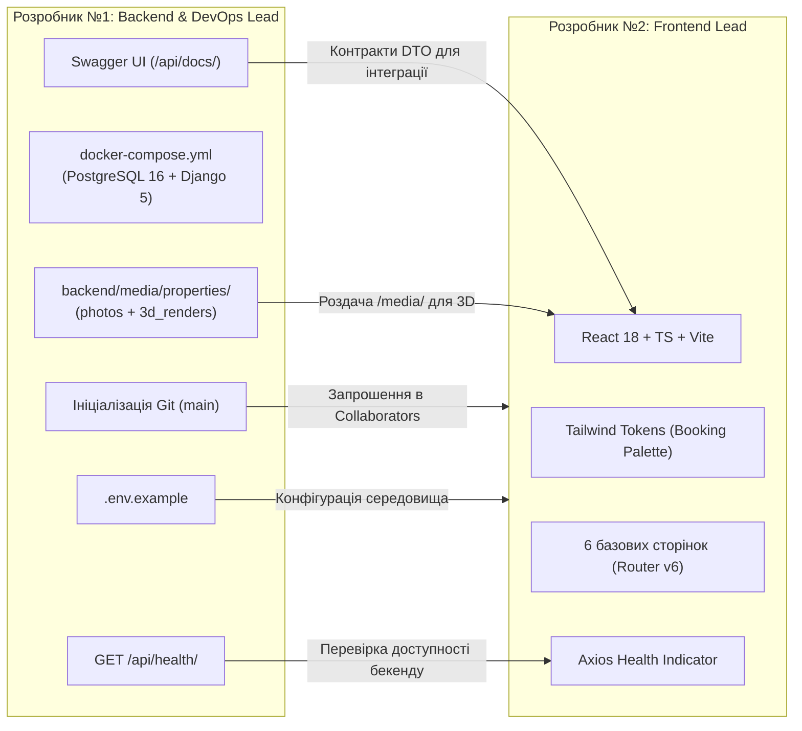

# Загальний план координації: Фаза 0 (Сетап інфраструктури та старт)
## Навчальний клон сервісу бронювання житла Booking.com 3D

Цей каталог містить покрокові інструкції для **двох розробників** для виконання завдань **Фази 0** (Дні 1–3) відповідно до [Дорожньої карти проєкту](../roadmap/phases-and-milestones.md) та [Архітектури системи](../architecture/system-overview.md).

---

## 👥 Спеціалізація та індивідуальні інструкції

| Розробник | Роль у проєкті | Посилання на інструкцію | Ключові технології | Головний артефакт Фази 0 |
| :---: | :--- | :--- | :--- | :--- |
| **Розробник №1** | **Backend & DevOps Lead** | [dev-1-backend-devops.md](dev-1-backend-devops.md) | Docker Compose, PostgreSQL 16, Python 3.11+, Django 5, DRF, SimpleJWT, Swagger, CORS | Репозиторій `main`, `docker-compose.yml`, БД з volume, архітектура `backend/`, Swagger UI (`/api/docs/`), `GET /api/health/`, Superuser для `/admin/` |
| **Розробник №2** | **Frontend Lead** | [dev-2-frontend.md](dev-2-frontend.md) | React 18, TypeScript, Vite, Tailwind CSS, Axios, Lucide Icons | Клієнт `frontend/`, 6 сторінок, токени палітри Booking, роутинг, живий індикатор статусу API в `Header` |

---

## 🔄 Схема командної взаємодії у Фазі 0



---

## 🌿 Регламент роботи з Git у Фазі 0

### 1. Хто створює репозиторій та початкова ініціалізація
Відповідальний за створення та первинну ініціалізацію репозиторію: **Розробник №1 (Backend & DevOps Lead)**.

#### Кроки для Розробника №1:
1. **Створення репозиторію на GitHub**:
   - Назва: `booking-3d` (або `booking-clone-3d`).
   - Тип доступу: *Public* або *Private*.
   - **Важливо**: НЕ ставити позначки біля "Add a README file" чи "Add .gitignore" (вони вже підготовлені локально в проєкті).
2. **Надання доступу Розробнику №2 (Collaborators)**:
   - У створеному репозиторії на GitHub перейти в **Settings ➔ Collaborators ➔ Add people**.
   - Знайти та запросити за нікнеймом або email **Розробника №2**.
   - Розробник №2 має прийняти запрошення (через email або сповіщення на GitHub).
3. **Локальна ініціалізація та перший коміт (виконує Розробник №1 у терміналі)**:
   ```bash
   cd /home/skmelyuk/Documents/projects/Booking

   # 1. Ініціалізація локального git-репозиторію
   git init

   # 2. Налаштування автора комітів
   git config user.name "Ім'я Розробника 1"
   git config user.email "dev1@example.com"

   # 3. Встановлення основної гілки main
   git branch -M main

   # 4. Додавання базових файлів структури та документації
   git add .gitignore README.md docs/ "ТЗ_Клон Booking 3D.docx.pdf"

   # 5. Створення першого базового коміту
   git commit -m "chore: initial project structure and documentation"

   # 6. Прив'язка віддаленого GitHub репозиторію
   git remote add origin https://github.com/<username>/booking-3d.git

   # 7. Пуш базової гілки main на GitHub
   git push -u origin main
   ```

---

### 2. Як підключається Розробник №2 (Клонування)

Після того, як Розробник №1 опублікував базову гілку `main`, Розробник №2 клонує репозиторій:

```bash
# Клонування репозиторію
git clone https://github.com/<username>/booking-3d.git Booking
cd Booking

# Налаштування власного імені та email для комітів
git config user.name "Ім'я Розробника 2"
git config user.email "dev2@example.com"

# Створення персональної гілки
git checkout -b feature/phase0-frontend-init
```

---

### 3. Правила комітів (Стандарт Conventional Commits)

Усі повідомлення комітів мають формуватися за стандартом:
```
<type>(<scope>): <опис дій у теперішньому часі>
```

#### 💡 Приклади правильних повідомлень комітів:
* **Розробник №1 (Backend & DevOps Lead)**:
  - `chore(infra): create .env.example, .gitignore, and .dockerignore`
  - `chore(docker): create backend Dockerfile and docker-compose with postgres 16`
  - `chore(backend): add requirements.txt with django 5, drf, and psycopg`
  - `feat(core): initialize django core project, settings, and modular apps`
  - `feat(api): configure drf-spectacular swagger ui, cors, and health check`
* **Розробник №2 (Frontend Lead)**:
  - `chore(frontend): initialize vite react-ts template`
  - `chore(styles): install tailwind css and configure booking color tokens`
  - `feat(routes): setup react router with 6 initial page layouts`
  - `feat(api): create axios client and header health indicator widget`

---

### 4. Порядок злиття (Merge Order) у Фазі 0

1. **Крок 1 (Розробник №1)**: Пушить готову інфраструктуру бекенду та Docker прямо в гілку `main` (або через PR) після проходження локальних тестів.
2. **Крок 2 (Розробник №2)**: Закінчує ініціалізацію `frontend/`, пушить гілку `feature/phase0-frontend-init` та відкриває Pull Request.
3. **Крок 3**: Розробник №1 перевіряє PR Розробника №2, тестує взаємодію фронтенду з бекендом і виконує злиття (Merge pull request) у `main`.

---

## 🧪 Спільний інтеграційний тест (Sprint 0 Smoke Test)

Після завершення кроків команда збирається на спільну перевірку:

1. **Крок 1**: Клонування або оновлення репозиторію:
   ```bash
   git checkout main
   git pull origin main
   cp .env.example .env
   ```
2. **Крок 2**: Запуск серверної частини:
   ```bash
   docker compose up --build -d
   ```
   *Перевірка:* команда `docker compose ps` показує два контейнери (`booking_postgres` та `booking_backend`) у стані `Up`.
3. **Крок 3**: Запуск клієнтської частини:
   ```bash
   cd frontend
   npm install
   npm run dev
   ```
4. **Крок 4**: Верифікація у браузері:
   - `http://localhost:8000/api/docs/` ➔ Swagger UI завантажується, схема доступна.
   - `http://localhost:8000/admin/` ➔ Django Admin відкривається, створений суперкористувач успішно входить.
   - `http://localhost:5173/` ➔ React додаток відкривається, у шапці світиться зелений індикатор **"Online"**, клікабельні переходи між 6 сторінками працюють без збоїв.

---

## ✅ Загальний критерій готовності (Definition of Done) Фази 0

Фаза 0 вважається успішно завершеною, коли:
- [x] Розподілено ролі між 2 розробниками та створено робочі гілки в Git.
- [x] Створено ізольоване контейнеризоване середовище PostgreSQL 16 + Django 5.
- [x] Згенеровано та протестовано Swagger UI документацію REST API.
- [x] Підготовлено сховище для 3D-рендерів інтер'єру з Autodesk 3ds Max.
- [x] Ініціалізовано клієнтський додаток React 18 + TypeScript + Vite + Tailwind CSS.
- [x] Налаштовано роутинг та підтверджено зв'язок Frontend ➔ Backend через endpoint `/api/health/`.
- [x] Усі зміни успішно об'єднані в головну гілку `main`.
