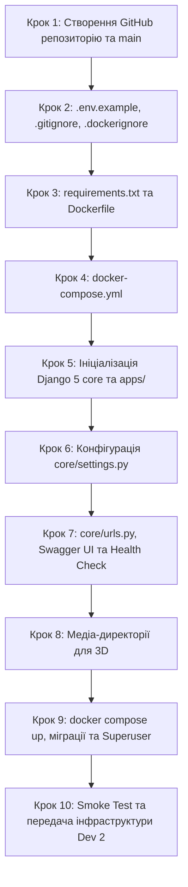

# Інструкція для Розробника №1: Backend & DevOps Lead
## Фаза 0: Репозиторій Git, Docker Compose, PostgreSQL 16, Django 5, Swagger UI та Health Check

---

> **Паспорт ролі:**
> - **Спеціалізація:** Backend Developer & DevOps Lead
> - **Стек:** Docker Compose, PostgreSQL 16, Python 3.11+, Django 5+, Django REST Framework (DRF), SimpleJWT, drf-spectacular (Swagger / OpenAPI 3), django-cors-headers, psycopg, Linux/Bash
> - **Термін виконання:** Дні 1–3 (Фаза 0)
> - **Головний результат:** Ініціалізований та опублікований Git-репозиторій із запрошеним Розробником №2; робоче контейнеризоване середовище (`docker compose up -d`); піднята база даних PostgreSQL 16 із persistent volume; модульна архітектура `backend/` на Django 5; згенерована документація Swagger UI за адресою `http://localhost:8000/api/docs/`; налаштований CORS для порту 5173; реалізований ендпоінт `GET /api/health/`; виконані системні міграції та створений Superuser для `/admin/`.

---

## 1. Мета та очікувані артефакти Фази 0

У команді з 2 розробників ви повністю відповідаєте за всю серверну частину та DevOps-інфраструктуру. Ваше завдання — надати Розробнику №2 (Frontend Lead) повністю робоче серверне середовище, документацію API та точку перевірки з'єднання ще до того, як почнеться активна розробка бізнес-моделей.

### 📦 Результати (Deliverables) Розробника №1:
1. Створений GitHub-репозиторій `booking-3d` з налаштованою базовою гілкою `main` та наданим доступом для Розробника №2.
2. Файли оточення `.env.example`, `.env`, `.gitignore` та `.dockerignore`.
3. Оптимізований `backend/Dockerfile` та залежності `backend/requirements.txt`.
4. Конфігурація `docker-compose.yml` з двома пов'язаними сервісами (`db` на PostgreSQL 16 та `backend` на Django 5).
5. Модульна структура Django 5 проєкту: `backend/core/` та додатки `backend/apps/users`, `apps/properties`, `apps/bookings`, `apps/reviews`.
6. Налаштування `backend/core/settings.py` (CORS для `http://localhost:5173`, Swagger UI, SimpleJWT, PostgreSQL з `.env`, директорії медіа для фото та 3D-рендерів WebP).
7. Маршрутизація `backend/core/urls.py` з робочим ендпоінтом `GET /api/health/` (перевірка з'єднання з БД) та Swagger UI `/api/docs/`.
8. Виконані системні міграції та створений Superuser для панелі керування `http://localhost:8000/admin/`.

---

## 2. Необхідні інструменти

Переконайтеся, що на вашому комп'ютері встановлено:
- **Docker Desktop** або **Docker Engine + Docker Compose** (`docker --version`, `docker compose version`).
- **Python**: версія 3.11 або новіша (`python3 --version`).
- **Git**: встановлений та налаштований (`git --version`).
- **Клієнт БД**: DBeaver, DataGrip або pgAdmin (для візуального контролю).
- **Редактор коду**: VS Code або PyCharm.

---

## 3. Покроковий план реалізації



---

### Крок 1. Створення репозиторію на GitHub та надання доступу

1. **Створіть новий репозиторій на GitHub**:
   - Назва: `booking-3d` (або `booking-clone-3d`).
   - Тип: Public або Private.
   - **Не додавайте** автоматичний README чи .gitignore (вони вже підготовлені).
2. **Запросіть Розробника №2**:
   - **Settings ➔ Collaborators ➔ Add people** ➔ введіть нікнейм або email Розробника №2.
3. **Локальна ініціалізація та перший коміт у `main`**:
   ```bash
   cd /home/skmelyuk/Documents/projects/Booking

   git init
   git config user.name "Ваше Ім'я (Dev 1)"
   git config user.email "dev1@example.com"
   git branch -M main

   git add README.md docs/ "ТЗ_Клон Booking 3D.docx.pdf"
   git commit -m "chore: initial project documentation and architecture specs"

   git remote add origin https://github.com/<username>/booking-3d.git
   git push -u origin main
   ```
4. Повідомте Розробника №2, що базову гілку опубліковано і він може клонувати репозиторій.

---

### Крок 2. Налаштування файлів конфігурації оточення

1. **Створіть `.env.example` у корені проєкту**:
   ```env
   # Django Settings
   DEBUG=True
   SECRET_KEY=django-insecure-booking3d-dev-secret-key-change-me-in-production
   ALLOWED_HOSTS=localhost,127.0.0.1,backend,0.0.0.0

   # PostgreSQL 16 Credentials
   DB_NAME=booking_db
   DB_USER=booking_user
   DB_PASSWORD=booking_pass_secret
   DB_HOST=db
   DB_PORT=5432

   # CORS Settings
   CORS_ALLOWED_ORIGINS=http://localhost:5173,http://127.0.0.1:5173
   ```

2. **Створіть локальний робочий `.env`**:
   ```bash
   cp .env.example .env
   ```

3. **Створіть `.gitignore`**:
   ```gitignore
   # Python & Django
   __pycache__/
   *.py[cod]
   *$py.class
   *.sqlite3
   .env
   .venv/
   venv/
   ENV/

   # Media files (keep folders via .gitkeep)
   backend/media/properties/photos/*
   !backend/media/properties/photos/.gitkeep
   backend/media/properties/3d_renders/*
   !backend/media/properties/3d_renders/.gitkeep

   # Node.js
   frontend/node_modules/
   frontend/dist/
   frontend/.env.local

   # Docker & IDE
   .idea/
   .vscode/
   *.log
   ```

4. **Створіть `.dockerignore`**:
   ```dockerignore
   .git
   .env
   .venv
   venv
   __pycache__
   *.pyc
   node_modules
   dist
   ```

---

### Крок 3. Створення `requirements.txt` та `Dockerfile`

1. **Створіть директорію `backend/` та файл `backend/requirements.txt`**:
   ```bash
   mkdir -p backend
   ```

   Вміст `backend/requirements.txt`:
   ```text
   # Django Framework & Core
   Django>=5.0.0,<5.2.0

   # Django REST Framework & Extensions
   djangorestframework>=3.15.0
   djangorestframework-simplejwt>=5.3.1
   drf-spectacular>=0.27.1
   django-filter>=24.2
   django-cors-headers>=4.3.1

   # Database Driver (PostgreSQL 16)
   psycopg[binary]>=3.1.18

   # Media & Utilities
   Pillow>=10.3.0
   python-dotenv>=1.0.1
   ```

2. **Створіть `backend/Dockerfile`**:
   ```dockerfile
   FROM python:3.11-slim

   ENV PYTHONDONTWRITEBYTECODE=1 \
       PYTHONUNBUFFERED=1

   WORKDIR /app

   RUN apt-get update && apt-get install -y --no-install-recommends \
       build-essential \
       libpq-dev \
       curl \
       && rm -rf /var/lib/apt/lists/*

   COPY requirements.txt /app/
   RUN pip install --no-cache-dir --upgrade pip && \
       pip install --no-cache-dir -r requirements.txt

   COPY . /app/

   EXPOSE 8000

   CMD ["python", "manage.py", "runserver", "0.0.0.0:8000"]
   ```

---

### Крок 4. Створення `docker-compose.yml`

У корені проєкту створіть `docker-compose.yml`:
```yaml
version: '3.8'

services:
  db:
    image: postgres:16-alpine
    container_name: booking_postgres
    restart: unless-stopped
    environment:
      POSTGRES_DB: ${DB_NAME:-booking_db}
      POSTGRES_USER: ${DB_USER:-booking_user}
      POSTGRES_PASSWORD: ${DB_PASSWORD:-booking_pass_secret}
    ports:
      - "5432:5432"
    volumes:
      - postgres_data:/var/lib/postgresql/data
    healthcheck:
      test: ["CMD-SHELL", "pg_isready -U ${DB_USER:-booking_user} -d ${DB_NAME:-booking_db}"]
      interval: 5s
      timeout: 5s
      retries: 5
    networks:
      - booking_network

  backend:
    build:
      context: ./backend
      dockerfile: Dockerfile
    container_name: booking_backend
    restart: unless-stopped
    command: python manage.py runserver 0.0.0.0:8000
    volumes:
      - ./backend:/app
      - media_data:/app/media
    ports:
      - "8000:8000"
    env_file:
      - .env
    environment:
      - DB_HOST=db
      - DB_PORT=5432
    depends_on:
      db:
        condition: service_healthy
    networks:
      - booking_network

volumes:
  postgres_data:
    name: booking_postgres_data
  media_data:
    name: booking_media_data

networks:
  booking_network:
    name: booking_network
    driver: bridge
```

---

### Крок 5. Ініціалізація модульного проєкту Django 5

Створіть базовий проєкт та структуру додатків у `backend/`:

```bash
cd backend

# Створення кореневого модуля core
django-admin startproject core .

# Створення модульної папки apps
mkdir -p apps/users apps/properties apps/bookings apps/reviews

# Додавання __init__.py для коректного імпорту
touch apps/__init__.py
touch apps/users/__init__.py
touch apps/properties/__init__.py
touch apps/bookings/__init__.py
touch apps/reviews/__init__.py
```

---

### Крок 6. Конфігурація `backend/core/settings.py`

Оновіть `backend/core/settings.py`, підключивши необхідні сервіси:

```python
import os
from pathlib import Path
from datetime import timedelta

BASE_DIR = Path(__file__).resolve().parent.parent

SECRET_KEY = os.getenv('SECRET_KEY', 'dev-secret-key-booking-3d')
DEBUG = os.getenv('DEBUG', 'True').lower() in ('true', '1')
ALLOWED_HOSTS = os.getenv('ALLOWED_HOSTS', 'localhost,127.0.0.1,backend,0.0.0.0').split(',')

# Application definition
INSTALLED_APPS = [
    'django.contrib.admin',
    'django.contrib.auth',
    'django.contrib.contenttypes',
    'django.contrib.sessions',
    'django.contrib.messages',
    'django.contrib.staticfiles',

    # Third-party apps
    'rest_framework',
    'rest_framework_simplejwt',
    'corsheaders',
    'drf_spectacular',
    'django_filters',

    # Local project apps
    'apps.users',
    'apps.properties',
    'apps.bookings',
    'apps.reviews',
]

MIDDLEWARE = [
    'corsheaders.middleware.CorsMiddleware',
    'django.middleware.security.SecurityMiddleware',
    'django.contrib.sessions.middleware.SessionMiddleware',
    'django.middleware.common.CommonMiddleware',
    'django.middleware.csrf.CsrfViewMiddleware',
    'django.contrib.auth.middleware.AuthenticationMiddleware',
    'django.contrib.messages.middleware.MessageMiddleware',
    'django.middleware.clickjacking.XFrameOptionsMiddleware',
]

ROOT_URLCONF = 'core.urls'

TEMPLATES = [
    {
        'BACKEND': 'django.template.backends.django.DjangoTemplates',
        'DIRS': [BASE_DIR / 'templates'],
        'APP_DIRS': True,
        'OPTIONS': {
            'context_processors': [
                'django.template.context_processors.debug',
                'django.template.context_processors.request',
                'django.contrib.auth.context_processors.auth',
                'django.contrib.messages.context_processors.messages',
            ],
        },
    },
]

WSGI_APPLICATION = 'core.wsgi.application'

# Database configuration (PostgreSQL 16)
DATABASES = {
    'default': {
        'ENGINE': 'django.db.backends.postgresql',
        'NAME': os.getenv('DB_NAME', 'booking_db'),
        'USER': os.getenv('DB_USER', 'booking_user'),
        'PASSWORD': os.getenv('DB_PASSWORD', 'booking_pass_secret'),
        'HOST': os.getenv('DB_HOST', 'db'),
        'PORT': os.getenv('DB_PORT', '5432'),
    }
}

# Password validation
AUTH_PASSWORD_VALIDATORS = [
    {'NAME': 'django.contrib.auth.password_validation.UserAttributeSimilarityValidator'},
    {'NAME': 'django.contrib.auth.password_validation.MinimumLengthValidator'},
    {'NAME': 'django.contrib.auth.password_validation.CommonPasswordValidator'},
    {'NAME': 'django.contrib.auth.password_validation.NumericPasswordValidator'},
]

LANGUAGE_CODE = 'uk-ua'
TIME_ZONE = 'Europe/Kyiv'
USE_I18N = True
USE_TZ = True

STATIC_URL = '/static/'
STATIC_ROOT = BASE_DIR / 'staticfiles'

# Media Storage (Photos and 3D WebP renders)
MEDIA_URL = '/media/'
MEDIA_ROOT = BASE_DIR / 'media'

DEFAULT_AUTO_FIELD = 'django.db.models.BigAutoField'

# Django REST Framework
REST_FRAMEWORK = {
    'DEFAULT_SCHEMA_CLASS': 'drf_spectacular.openapi.AutoSchema',
    'DEFAULT_AUTHENTICATION_CLASSES': (
        'rest_framework_simplejwt.authentication.JWTAuthentication',
    ),
    'DEFAULT_PERMISSION_CLASSES': (
        'rest_framework.permissions.AllowAny',
    ),
}

# Swagger / OpenAPI 3 settings
SPECTACULAR_SETTINGS = {
    'TITLE': 'Booking 3D Clone REST API',
    'DESCRIPTION': 'API сервісу бронювання житла з підтримкою інтерактивних 3D-турів',
    'VERSION': '1.0.0',
    'SERVE_INCLUDE_SCHEMA': False,
}

# CORS settings for Frontend (Vite port 5173)
cors_origins_env = os.getenv('CORS_ALLOWED_ORIGINS', 'http://localhost:5173,http://127.0.0.1:5173')
CORS_ALLOWED_ORIGINS = [origin.strip() for origin in cors_origins_env.split(',') if origin.strip()]
CORS_ALLOW_CREDENTIALS = True
```

---

### Крок 7. Маршрутизація, Swagger UI та Health Check

1. **Створіть файл `backend/core/views.py` для перевірки працездатності**:
   ```python
   from rest_framework.views import APIView
   from rest_framework.response import Response
   from rest_framework import status
   from django.db import connection
   from drf_spectacular.utils import extend_schema, OpenApiResponse

   class HealthCheckView(APIView):
       """
       Перевірка працездатності бекенду та підключення до PostgreSQL
       """
       authentication_classes = []
       permission_classes = []

       @extend_schema(
           summary="API Health Check",
           description="Повертає статус бекенду та перевіряє життєздатність бази даних PostgreSQL",
           responses={
               200: OpenApiResponse(description="Сервіс працює стабільно"),
               503: OpenApiResponse(description="Помилка з'єднання з базою даних"),
           }
       )
       def get(self, request):
           db_status = "connected"
           try:
               with connection.cursor() as cursor:
                   cursor.execute("SELECT 1;")
           except Exception as e:
               db_status = f"unhealthy: {str(e)}"
               return Response({
                   "status": "error",
                   "backend": "online",
                   "database": db_status
               }, status=status.HTTP_533_SERVICE_UNAVAILABLE)

           return Response({
               "status": "ok",
               "backend": "online",
               "database": db_status,
               "version": "1.0.0"
           }, status=status.HTTP_200_OK)
   ```

2. **Оновіть `backend/core/urls.py`**:
   ```python
   from django.contrib import admin
   from django.urls import path
   from django.conf import settings
   from django.conf.urls.static import static
   from drf_spectacular.views import SpectacularAPIView, SpectacularSwaggerView
   from core.views import HealthCheckView

   urlpatterns = [
       path('admin/', admin.site.urls),

       # Health check endpoint for Frontend
       path('api/health/', HealthCheckView.as_view(), name='api-health'),

       # OpenAPI 3 and Swagger UI
       path('api/schema/', SpectacularAPIView.as_view(), name='schema'),
       path('api/docs/', SpectacularSwaggerView.as_view(url_name='schema'), name='swagger-ui'),
   ]

   if settings.DEBUG:
       urlpatterns += static(settings.MEDIA_URL, document_root=settings.MEDIA_ROOT)
   ```

---

### Крок 8. Створення структури медіа-директорій для 3D

Створіть каталоги для фотографій та 3D-візуалізацій з файлами `.gitkeep`:
```bash
cd /home/skmelyuk/Documents/projects/Booking

mkdir -p backend/media/properties/photos
mkdir -p backend/media/properties/3d_renders

touch backend/media/properties/photos/.gitkeep
touch backend/media/properties/3d_renders/.gitkeep
```

---

### Крок 9. Перший запуск у Docker, міграції та Superuser

У корені проєкту виконайте:

```bash
# 1. Запуск контейнерів
docker compose up --build -d

# 2. Перевірка статусу контейнерів
docker compose ps

# 3. Виконання початкових системних міграцій
docker compose exec backend python manage.py migrate

# 4. Створення Superuser для входу в Django Admin
docker compose exec backend python manage.py createsuperuser
# Вкажіть:
# Email/Username: admin@booking3d.com
# Password: admin12345 (або ваш безпечний пароль)
```

---

### Крок 10. Smoke Test та фіксація результату в Git

1. **Перевірте працездатність у браузері**:
   - `http://localhost:8000/api/health/` ➔ `{"status": "ok", "backend": "online", "database": "connected"}`.
   - `http://localhost:8000/api/docs/` ➔ відкривається інтерактивний інтерфейс Swagger UI.
   - `http://localhost:8000/admin/` ➔ вхід з обліковими даними створеного Superuser.

2. **Зафіксуйте зміни у Git та запушіть у `main`**:
   ```bash
   git add .
   git commit -m "feat(infra): setup Docker Compose, PostgreSQL 16, Django 5, Swagger UI, and Health Check"
   git push origin main
   ```

3. **Передайте Розробнику №2**:
   - Підтвердження, що бекенд та Docker запущені.
   - Адресу Swagger UI: `http://localhost:8000/api/docs/`.
   - Адресу Health Check: `http://localhost:8000/api/health/`.
