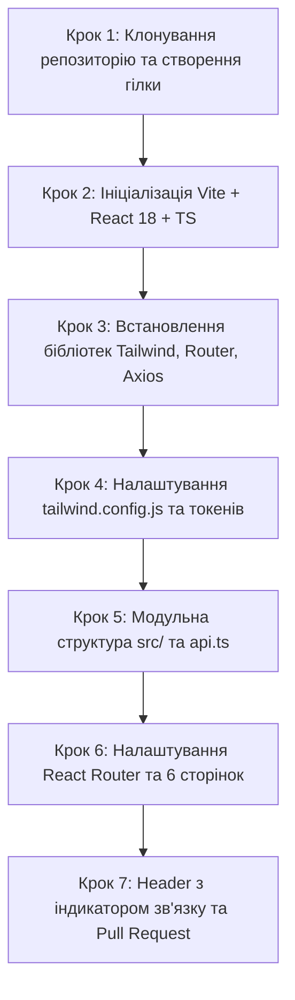

# Інструкція для Розробника №2: Frontend Lead
## Фаза 0: Ініціалізація React 18 + Vite, Tailwind CSS, Токени "Cold Start" та Роутинг

---

> **Паспорт ролі:**
> - **Спеціалізація:** Frontend Lead / Client Application Developer
> - **Стек:** React 18, TypeScript, Vite, Tailwind CSS, Lucide React, Axios, React Router v6
> - **Термін виконання:** Дні 1–3 (Фаза 0)
> - **Головний результат:** Швидкий клієнтський SPA-застосунок у директорії `frontend/`, налаштований Tailwind CSS з фірмовими дизайн-токенами Booking.com та бейджем 3D, модульна файлова структура `src/`, 6 сторінок-заглушок із налаштованим роутингом, попередньо налаштований клієнт Axios та живий індикатор підключення до бекенду (`/api/health/`) у шапці сайту.

---

## 1. Мета та очікувані артефакти Фази 0

На етапі Фази 0 ви розгортаєте клієнтський фронтенд і готуєте каркас для реалізації Wireframes (Фаза 1) та інтерактивної 3D-галереї (Фаза 3). Завдяки регламенту "Cold Start" ви не чекаєте, доки дизайнери намалюють фінальні екрани в Figma, а самостійно налаштовуєте дизайн-токени (палітра Booking), базову навігацію та зв'язок із сервером Розробника №1.

### 📦 Результати (Deliverables) Розробника №2:
1. Ініціалізований проєкт на базі Vite + React 18 + TypeScript у папці `frontend/`.
2. Конфігураційні файли `tailwind.config.js` та `postcss.config.js` із фірмовими кольорами (`primary`, `accent`, `badge3d`, `surface`).
3. Встановлені бібліотеки: `react-router-dom`, `lucide-react`, `axios`.
4. Модульна структура вихідного коду: `src/components/`, `src/pages/`, `src/services/`, `src/types/`.
5. Екземпляр Axios (`src/services/api.ts`) з підтримкою змінних оточення `VITE_API_URL`.
6. Налаштована маршрутизація (React Router v6) для 6 ключових екранів:
   - `/` — Головна сторінка
   - `/search` — Результати пошуку та каталог
   - `/properties/:id` — Деталі житла та 3D-галерея
   - `/booking/:id` — Форма бронювання
   - `/cabinet` — Кабінет гостя ("Мої бронювання", "Обране")
   - `/owner` — Кабінет власника житла
7. Компоненти `Header` (із живим статусом бекенду: зелений/червоний індикатор) та `Footer`.

---

## 2. Необхідні інструменти та налаштування оточення

Переконайтеся, що на вашому комп'ютері встановлено:
- **Node.js**: версія 18 LTS або 20 LTS (`node -v`).
- **Менеджер пакетів**: npm (`npm -v`) або pnpm / yarn.
- **Git**: встановлений та налаштований (`git --version`).
- **Редактор коду**: VS Code з рекомендованими розширеннями:
  - *Tailwind CSS IntelliSense*
  - *ESLint*
  - *Prettier - Code formatter*

---

## 3. Покроковий план реалізації



---

### Крок 1. Підключення до репозиторію та створення робочої гілки

> [!NOTE]
> Перед цим кроком переконайтеся, що **Розробник №1** уже створив репозиторій на GitHub, опублікував базовий `main` та надіслав вам запрошення в Collaborators.

1. **Клонуйте репозиторій**:
   ```bash
   git clone https://github.com/<username>/booking-3d.git Booking
   cd Booking

   # Налаштуйте ваші дані (якщо не налаштовано глобально):
   git config user.name "Ваше Ім'я (Dev 2)"
   git config user.email "dev2@example.com"

   git checkout main
   git pull origin main
   ```

2. **Створіть персональну робочу гілку**:
   ```bash
   git checkout -b feature/phase0-frontend-init
   ```

---

### Крок 2. Ініціалізація клієнтського проєкту через Vite

У кореневій директорії проєкту `Booking` запустіть створення клієнтської частини:

```bash
# Створення React 18 + TypeScript проєкту за допомогою Vite
npm create vite@latest frontend -- --template react-ts

cd frontend

# Встановлення базових залежностей
npm install
```

---

### Крок 3. Встановлення додаткових бібліотек

Встановіть Tailwind CSS, іконки Lucide, HTTP-клієнт Axios та маршрутизатор:

```bash
# 1. Стилізація та утиліти CSS
npm install -D tailwindcss postcss autoprefixer

# 2. Ініціалізація конфігурацій Tailwind
npx tailwindcss init -p

# 3. Маршрутизація, іконки та HTTP-клієнт
npm install react-router-dom lucide-react axios
```

---

### Крок 4. Налаштування токенів палітри Booking у `tailwind.config.js`

Відкрийте `frontend/tailwind.config.js` та замініть його вміст:

```javascript
/** @type {import('tailwindcss').Config} */
export default {
  content: [
    "./index.html",
    "./src/**/*.{js,ts,jsx,tsx}",
  ],
  theme: {
    extend: {
      colors: {
        booking: {
          blue: {
            DEFAULT: '#003580', // Класичний синій Booking Header
            light: '#006ce4',   // Акцентний синій для кнопок і посилань
            dark: '#00224f',    // Темний відтінок футера
          },
          yellow: {
            DEFAULT: '#febb02', // Фірмовий жовтий колір кнопок дій і пошуку
            hover: '#e5a800',
          },
          badge3d: {
            DEFAULT: '#008009', // Фірмовий бейдж наявності 3D туру
            light: '#e8f5e9',
          },
          surface: '#f5f5f5',
          border: '#e7e7e7',
        }
      },
      fontFamily: {
        sans: ['BlinkMacSystemFont', '-apple-system', 'Segoe UI', 'Roboto', 'Helvetica', 'Arial', 'sans-serif'],
      }
    },
  },
  plugins: [],
}
```

Замініть вміст `frontend/src/index.css`:
```css
@tailwind base;
@tailwind components;
@tailwind utilities;

body {
  margin: 0;
  font-family: BlinkMacSystemFont, -apple-system, Segoe UI, Roboto, Helvetica, Arial, sans-serif;
  background-color: #f5f5f5;
  color: #1a1a1a;
  -webkit-font-smoothing: antialiased;
}
```

---

### Крок 5. Створення модульної структури директорій та API-клієнта

1. **Створіть модульні каталоги всередині `frontend/src/`**:
   ```bash
   mkdir -p src/components/layout src/components/common src/pages src/services src/types
   ```

2. **Створіть файл оточення `frontend/.env.development`**:
   ```env
   VITE_API_URL=http://localhost:8000
   ```

3. **Створіть налаштований Axios-клієнт у `frontend/src/services/api.ts`**:
   ```typescript
   import axios from 'axios';

   const API_BASE_URL = import.meta.env.VITE_API_URL || 'http://localhost:8000';

   export const api = axios.create({
     baseURL: API_BASE_URL,
     timeout: 8000,
     headers: {
       'Content-Type': 'application/json',
     },
   });

   export interface HealthResponse {
     status: string;
     backend: string;
     database: string;
     version?: string;
   }

   export const checkHealth = async (): Promise<HealthResponse> => {
     const response = await api.get<HealthResponse>('/api/health/');
     return response.data;
   };
   ```

---

### Крок 6. Створення 6 сторінок-заглушок

Створіть базові сторінки у `frontend/src/pages/`:

1. `HomePage.tsx`:
   ```tsx
   import React from 'react';
   import { Box } from 'lucide-react';

   export const HomePage: React.FC = () => (
     <div className="max-w-7xl mx-auto px-4 py-8">
       <div className="bg-booking-blue rounded-xl p-8 text-white mb-8">
         <h1 className="text-3xl font-bold mb-2">Знайдіть ідеальне житло з 3D-туром інтер'єру</h1>
         <p className="text-blue-100">Переглядайте реалістичні ракурси номерів перед бронюванням</p>
       </div>
       <div className="bg-white p-6 rounded-lg shadow-sm border border-booking-border flex items-center justify-between">
         <div className="flex items-center space-x-3">
           <Box className="w-8 h-8 text-booking-badge3d" />
           <div>
             <h3 className="font-semibold text-gray-900">3D-візуалізації об'єктів готові до інтеграції</h3>
             <p className="text-sm text-gray-500">Фаза 0: каркас фронтенду успішно підключено</p>
           </div>
         </div>
         <span className="bg-booking-badge3d-light text-booking-badge3d px-3 py-1 rounded-full text-xs font-semibold">
           3D Ready
         </span>
       </div>
     </div>
   );
   ```

2. `SearchPage.tsx`:
   ```tsx
   import React from 'react';

   export const SearchPage: React.FC = () => (
     <div className="max-w-7xl mx-auto px-4 py-8">
       <h1 className="text-2xl font-bold text-gray-900 mb-4">Результати пошуку помешкань</h1>
       <p className="text-gray-600">Тут відображатиметься каталог житла з фільтрацією та 3D-бейджів (Фаза 1–2).</p>
     </div>
   );
   ```

3. `PropertyDetailPage.tsx`:
   ```tsx
   import React from 'react';
   import { useParams } from 'react-router-dom';

   export const PropertyDetailPage: React.FC = () => {
     const { id } = useParams<{ id: string }>();
     return (
       <div className="max-w-7xl mx-auto px-4 py-8">
         <h1 className="text-2xl font-bold text-gray-900 mb-4">Деталі житла #{id}</h1>
         <p className="text-gray-600">Тут розміщуватиметься інтерактивна 3D-галерея ракурсів інтер'єру (Фаза 3).</p>
       </div>
     );
   };
   ```

4. `BookingPage.tsx`:
   ```tsx
   import React from 'react';
   import { useParams } from 'react-router-dom';

   export const BookingPage: React.FC = () => {
     const { id } = useParams<{ id: string }>();
     return (
       <div className="max-w-7xl mx-auto px-4 py-8">
         <h1 className="text-2xl font-bold text-gray-900 mb-4">Бронювання помешкання #{id}</h1>
         <p className="text-gray-600">Форма вибору дат, розрахунку вартості та оформлення броні (Фаза 2).</p>
       </div>
     );
   };
   ```

5. `GuestCabinetPage.tsx`:
   ```tsx
   import React from 'react';

   export const GuestCabinetPage: React.FC = () => (
     <div className="max-w-7xl mx-auto px-4 py-8">
       <h1 className="text-2xl font-bold text-gray-900 mb-4">Особистий кабінет гостя</h1>
       <p className="text-gray-600">Список "Мої бронювання", збережені об'єкти та історія подорожей (Фаза 3).</p>
     </div>
   );
   ```

6. `OwnerCabinetPage.tsx`:
   ```tsx
   import React from 'react';

   export const OwnerCabinetPage: React.FC = () => (
     <div className="max-w-7xl mx-auto px-4 py-8">
       <h1 className="text-2xl font-bold text-gray-900 mb-4">Панель власника житла</h1>
       <p className="text-gray-600">Керування об'єктами, завантаження 3D-рендерів та перегляд бронювань (Фаза 3).</p>
     </div>
   );
   ```

---

### Крок 7. Header із віджетом Health Check та налаштування роутингу

1. **Створіть `frontend/src/components/layout/Header.tsx`**:
   ```tsx
   import React, { useState, useEffect } from 'react';
   import { Link } from 'react-router-dom';
   import { checkHealth } from '../../services/api';
   import { Building, Activity, Box } from 'lucide-react';

   export const Header: React.FC = () => {
     const [apiOnline, setApiOnline] = useState<boolean | null>(null);

     useEffect(() => {
       const verifyBackend = async () => {
         try {
           const res = await checkHealth();
           setApiOnline(res.status === 'ok');
         } catch {
           setApiOnline(false);
         }
       };

       verifyBackend();
       const interval = setInterval(verifyBackend, 15000);
       return () => clearInterval(interval);
     }, []);

     return (
       <header className="bg-booking-blue text-white shadow-md">
         <div className="max-w-7xl mx-auto px-4 h-16 flex items-center justify-between">
           <Link to="/" className="flex items-center space-x-2 text-xl font-bold tracking-tight">
             <Building className="w-6 h-6 text-booking-yellow" />
             <span>Booking<span className="text-booking-yellow">3D</span></span>
           </Link>

           <nav className="flex items-center space-x-6">
             <Link to="/search" className="text-sm font-medium hover:text-booking-yellow transition">
               Пошук житла
             </Link>
             <Link to="/cabinet" className="text-sm font-medium hover:text-booking-yellow transition">
               Мої бронювання
             </Link>
             <Link to="/owner" className="text-sm font-medium hover:text-booking-yellow transition">
               Для власників
             </Link>

             {/* Live API Health Check Indicator */}
             <div className="flex items-center space-x-2 bg-booking-blue-dark px-3 py-1.5 rounded-full text-xs">
               <Activity className="w-3.5 h-3.5" />
               <span>API:</span>
               {apiOnline === null ? (
                 <span className="text-gray-400">Перевірка...</span>
               ) : apiOnline ? (
                 <span className="flex items-center text-green-400 font-semibold">
                   <span className="w-2 h-2 rounded-full bg-green-400 mr-1.5 animate-pulse"></span>
                   Online
                 </span>
               ) : (
                 <span className="flex items-center text-red-400 font-semibold">
                   <span className="w-2 h-2 rounded-full bg-red-400 mr-1.5"></span>
                   Offline
                 </span>
               )}
             </div>
           </nav>
         </div>
       </header>
     );
   };
   ```

2. **Створіть `frontend/src/components/layout/Footer.tsx`**:
   ```tsx
   import React from 'react';

   export const Footer: React.FC = () => (
     <footer className="bg-booking-blue-dark text-gray-300 py-6 mt-12 border-t border-booking-blue">
       <div className="max-w-7xl mx-auto px-4 text-center text-sm">
         <p>© 2026 Booking 3D Clone. Навчальний проєкт (Фаза 0: Сетап інфраструктури).</p>
       </div>
     </footer>
   );
   ```

3. **Оновіть `frontend/src/App.tsx`**:
   ```tsx
   import React from 'react';
   import { BrowserRouter as Router, Routes, Route } from 'react-router-dom';
   import { Header } from './components/layout/Header';
   import { Footer } from './components/layout/Footer';
   import { HomePage } from './pages/HomePage';
   import { SearchPage } from './pages/SearchPage';
   import { PropertyDetailPage } from './pages/PropertyDetailPage';
   import { BookingPage } from './pages/BookingPage';
   import { GuestCabinetPage } from './pages/GuestCabinetPage';
   import { OwnerCabinetPage } from './pages/OwnerCabinetPage';

   export const App: React.FC = () => {
     return (
       <Router>
         <div className="min-h-screen flex flex-col bg-booking-surface">
           <Header />
           <main className="flex-1">
             <Routes>
               <Route path="/" element={<HomePage />} />
               <Route path="/search" element={<SearchPage />} />
               <Route path="/properties/:id" element={<PropertyDetailPage />} />
               <Route path="/booking/:id" element={<BookingPage />} />
               <Route path="/cabinet" element={<GuestCabinetPage />} />
               <Route path="/owner" element={<OwnerCabinetPage />} />
             </Routes>
           </main>
           <Footer />
         </div>
       </Router>
     );
   };

   export default App;
   ```

---

### Крок 8. Smoke Test та відкриття Pull Request

1. **Запустіть локальний dev-сервер**:
   ```bash
   cd frontend
   npm run dev
   ```
2. **Перевірте у браузері за адресою `http://localhost:5173/`**:
   - Шапка завантажується, логотип та навігація активні.
   - Якщо бекенд Розробника №1 запущений (`docker compose up -d`), індикатор API переходить у стан **Online (зелений)**.
   - Переходи за маршрутами `/search`, `/properties/1`, `/cabinet` працюють коректно.
3. **Зафіксуйте зміни у Git та відкрийте Pull Request**:
   ```bash
   git add .
   git commit -m "feat(frontend): initialize React 18, Vite, Tailwind palette, routing, and API health widget"
   git push -u origin feature/phase0-frontend-init
   ```
4. **Створіть Pull Request на GitHub**:
   - Призначте **Розробника №1** як рев'юера.
   - Після апруву злийте гілку в `main`.
