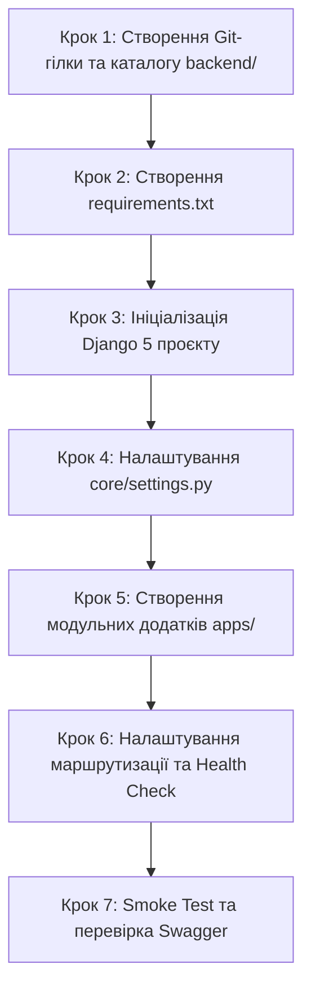

# Інструкція для Студента №1: Backend Core & API
## Фаза 0: Старт проєкту, структура Django 5, Swagger UI та API Health Check

---

> **Паспорт ролі:**
> - **Спеціалізація:** Backend Developer (Core & API Architecture)
> - **Стек:** Python 3.11+, Django 5+, Django REST Framework (DRF), SimpleJWT, drf-spectacular (Swagger / OpenAPI 3), django-cors-headers, django-filter
> - **Термін виконання:** Дні 1–3 (Фаза 0)
> - **Головний результат:** Робочий каркас Django проєкту в каталозі `backend/`, підключений DRF, згенерована документація Swagger UI за адресою `http://localhost:8000/api/docs/`, налаштований CORS для фронтенду та реалізований ендпоінт `GET /api/health/`.

---

## 1. Мета та очікувані артефакти Фази 0

На етапі Фази 0 ви закладаєте програмний фундамент для всього серверного застосунку. Ваше завдання — створити правильну modular-структуру Django 5 проєкту, де кожен бізнес-домен буде виділений в окремий додаток (`apps/users`, `apps/properties`, `apps/bookings`, `apps/reviews`), підключити генератор документації OpenAPI 3, який критично необхідний Студенту №3 (Frontend) для інтеграції, і забезпечити безперешкодний CORS-доступ.

### 📦 Результати (Deliverables) Студента №1:
1. Файл `backend/requirements.txt` з усіма зафіксованими бібліотеками бекенду.
2. Ініціалізований проєкт Django 5 із модульною структурою директорій `backend/core/` та `backend/apps/`.
3. Файл конфігурацій `backend/core/settings.py` з налаштуваннями DRF, SimpleJWT, CORS та Swagger.
4. Налаштована маршрутизація `backend/core/urls.py` з документацією `/api/docs/` та схемою `/api/schema/`.
5. Працюючий ендпоінт перевірки здоров'я `GET /api/health/`.
6. Підготовлена точка входу для автентифікації `POST /api/auth/token/`.

---

## 2. Необхідні інструменти та налаштування оточення

Переконайтеся, що на вашому комп'ютері встановлено:
- **Python**: версія 3.11 або новіша (`python3 --version`).
- **Git**: встановлений та налаштований (`git --version`).
- **Редактор коду**: VS Code (з розширеннями *Python*, *Django*, *Pylance*) або PyCharm Professional / Community.
- **HTTP-клієнт**: cURL у терміналі, Postman або розширення *Thunder Client* у VS Code.

---

## 3. Покроковий план реалізації



### Крок 1. Підключення до репозиторію та створення робочої гілки

> [!NOTE]
> Перед цим кроком переконайтеся, що **Студент №2** уже створив репозиторій на GitHub, опублікував базовий `main` та надіслав вам запрошення в Collaborators.

1. **Клонуйте репозиторій або підтягніть оновлення**:
   ```bash
   # Якщо ви тільки завантажуєте проєкт:
   git clone https://github.com/<username>/booking-3d.git Booking
   cd Booking

   # Налаштуйте ваші дані (якщо не налаштовано глобально):
   git config user.name "Ім'я Студента 1"
   git config user.email "student1@example.com"

   # Переконайтеся, що ви в актуальній гілці main:
   git checkout main
   git pull origin main
   ```

2. **Створіть вашу персональну робочу гілку**:
   ```bash
   git checkout -b feature/phase0-backend-core
   ```

3. **Створіть директорію для бекенд-частини**:
   ```bash
   mkdir -p backend
   cd backend
   ```

---

### Крок 2. Формування файлу залежностей `requirements.txt`

Створіть файл `backend/requirements.txt` з наступним точним вмістом. Ці бібліотеки покривають як поточну Фазу 0, так і наступні фази розробки:

```text
# Django Framework & Core
Django>=5.0.0,<5.2.0

# Django REST Framework & Extensions
djangorestframework>=3.15.0
djangorestframework-simplejwt>=5.3.1
drf-spectacular>=0.27.1
django-filter>=24.2
django-cors-headers>=4.3.1

# Database Driver (PostgreSQL 16)
psycopg[binary]>=3.1.18

# Images & 3D Media processing
Pillow>=10.2.0

# Environment variables
python-dotenv>=1.0.1

# Production & Dev utilities
gunicorn>=21.2.0
```

> [!NOTE]
> Якщо ви розгортаєте локальне оточення без Docker на своєму ПК для швидкої перевірки коду, створіть та активуйте віртуальне оточення:
> ```bash
> python3 -m venv venv
> source venv/bin/activate  # На Linux/macOS
> # або: venv\Scripts\activate  # На Windows
> pip install --upgrade pip
> pip install -r requirements.txt
> ```

---

### Крок 3. Ініціалізація структури Django проєкту

Знаходячись усередині папки `backend/`, ініціалізуйте проєкт Django з назвою `core`:
```bash
django-admin startproject core .
```
Тепер структура всередині `backend/` має виглядати так:
```
backend/
├── core/
│   ├── __init__.py
│   ├── asgi.py
│   ├── settings.py
│   ├── urls.py
│   └── wsgi.py
├── manage.py
└── requirements.txt
```

Створіть директорію для модульних бізнес-додатків та пакету додатків:
```bash
mkdir -p apps
touch apps/__init__.py
```

---

### Крок 4. Налаштування `backend/core/settings.py`

Відкрийте файл `backend/core/settings.py`. Замініть або доповніть його наступними секціями:

#### 4.1. Імпорти та базові шляхи
На самому початку файлу переконайтеся, що підключено роботу зі змінними оточення та системні шляхи:
```python
import os
from pathlib import Path
from datetime import timedelta
from dotenv import load_dotenv

# Завантаження .env файлу (знаходиться на рівень вище або у backend/)
load_dotenv(dotenv_path=Path(__file__).resolve().parent.parent.parent / '.env')
load_dotenv()  # Fallback для локального .env

BASE_DIR = Path(__file__).resolve().parent.parent

SECRET_KEY = os.getenv('SECRET_KEY', 'django-insecure-booking3d-dev-secret-key-change-me-in-production')
DEBUG = os.getenv('DEBUG', 'True').lower() in ('true', '1', 't')

ALLOWED_HOSTS = os.getenv('ALLOWED_HOSTS', 'localhost,127.0.0.1,backend,0.0.0.0').split(',')
```

#### 4.2. Підключення додатків (`INSTALLED_APPS`)
Оновіть `INSTALLED_APPS`, додавши бібліотеки DRF, CORS, Swagger та майбутні модулі проєкту:
```python
INSTALLED_APPS = [
    # Стандартні Django додатки
    'django.contrib.admin',
    'django.contrib.auth',
    'django.contrib.contenttypes',
    'django.contrib.sessions',
    'django.contrib.messages',
    'django.contrib.staticfiles',

    # Сторонні бібліотеки
    'rest_framework',
    'rest_framework_simplejwt',
    'corsheaders',
    'django_filters',
    'drf_spectacular',

    # Модульні додатки платформи Booking 3D
    'apps.users',
    'apps.properties',
    'apps.bookings',
    'apps.reviews',
]
```

#### 4.3. Middleware
Обов'язково додайте `CorsMiddleware` на самий початок списку:
```python
MIDDLEWARE = [
    'corsheaders.middleware.CorsMiddleware',  # Обов'язково найпершим!
    'django.middleware.security.SecurityMiddleware',
    'django.contrib.sessions.middleware.SessionMiddleware',
    'django.middleware.common.CommonMiddleware',
    'django.middleware.csrf.CsrfViewMiddleware',
    'django.contrib.auth.middleware.AuthenticationMiddleware',
    'django.contrib.messages.middleware.MessageMiddleware',
    'django.middleware.clickjacking.XFrameOptionsMiddleware',
]
```

#### 4.4. Конфігурація бази даних (`DATABASES`)
Налаштуйте підтримку як PostgreSQL 16 (який розгортає Студент №2), так і SQLite у ролі fallback для автономного запуску:
```python
DB_NAME = os.getenv('DB_NAME')
DB_USER = os.getenv('DB_USER')
DB_PASSWORD = os.getenv('DB_PASSWORD')
DB_HOST = os.getenv('DB_HOST')
DB_PORT = os.getenv('DB_PORT', '5432')

if DB_NAME and DB_USER and DB_HOST:
    DATABASES = {
        'default': {
            'ENGINE': 'django.db.backends.postgresql',
            'NAME': DB_NAME,
            'USER': DB_USER,
            'PASSWORD': DB_PASSWORD,
            'HOST': DB_HOST,
            'PORT': DB_PORT,
        }
    }
else:
    # Автономний fallback для локального тестування без Docker
    DATABASES = {
        'default': {
            'ENGINE': 'django.db.backends.sqlite3',
            'NAME': BASE_DIR / 'db.sqlite3',
        }
    }
```

#### 4.5. Конфігурація Django REST Framework та Swagger (`drf-spectacular`)
Додайте в кінець `settings.py`:
```python
REST_FRAMEWORK = {
    'DEFAULT_AUTHENTICATION_CLASSES': (
        'rest_framework_simplejwt.authentication.JWTAuthentication',
    ),
    'DEFAULT_PERMISSION_CLASSES': (
        'rest_framework.permissions.AllowAny',
    ),
    'DEFAULT_SCHEMA_CLASS': 'drf_spectacular.openapi.AutoSchema',
    'DEFAULT_FILTER_BACKENDS': (
        'django_filters.rest_framework.DjangoFilterBackend',
        'rest_framework.filters.SearchFilter',
        'rest_framework.filters.OrderingFilter',
    ),
    'DEFAULT_PAGINATION_CLASS': 'rest_framework.pagination.PageNumberPagination',
    'PAGE_SIZE': 10,
}

# Налаштування генерації OpenAPI 3 / Swagger документації
SPECTACULAR_SETTINGS = {
    'TITLE': 'Booking.com 3D Platform REST API',
    'DESCRIPTION': (
        'Навчальний клон сервісу бронювання житла з підтримкою інтер\'єрних '
        '3D-візуалізацій з Autodesk 3ds Max. REST API документація.'
    ),
    'VERSION': '1.0.0',
    'SERVE_INCLUDE_SCHEMA': False,
    'COMPONENT_SPLIT_REQUEST': True,
    'SECURITY': [{'BearerAuth': []}],
    'APPEND_COMPONENTS': {
        'securitySchemes': {
            'BearerAuth': {
                'type': 'http',
                'scheme': 'bearer',
                'bearerFormat': 'JWT',
            }
        }
    },
}

# Налаштування SimpleJWT
SIMPLE_JWT = {
    'ACCESS_TOKEN_LIFETIME': timedelta(minutes=60),
    'REFRESH_TOKEN_LIFETIME': timedelta(days=7),
    'ROTATE_REFRESH_TOKENS': True,
    'BLACKLIST_AFTER_ROTATION': False,
    'AUTH_HEADER_TYPES': ('Bearer',),
}

# Налаштування CORS (для зв'язку з React Vite фронтендом на порту 5173)
CORS_ALLOWED_ORIGINS = [
    'http://localhost:5173',
    'http://127.0.0.1:5173',
    'http://localhost:3000',
]
CORS_ALLOW_CREDENTIALS = True

# Медіа та статичні файли (для звичайних фото та 3D-рендерів)
STATIC_URL = '/static/'
STATIC_ROOT = BASE_DIR / 'static'

MEDIA_URL = '/media/'
MEDIA_ROOT = BASE_DIR / 'media'
```

---

### Крок 5. Створення структури модульних додатків

Створіть 4 додатки всередині папки `apps/`:
```bash
python manage.py startapp users apps/users
python manage.py startapp properties apps/properties
python manage.py startapp bookings apps/bookings
python manage.py startapp reviews apps/reviews
```

> [!IMPORTANT]
> Оскільки додатки створені всередині папки `apps`, перевірте, щоб у файлі `apps/<app_name>/apps.py` параметр `name` вказував на повний шлях. Наприклад:
> - У `apps/users/apps.py`: `name = 'apps.users'`
> - У `apps/properties/apps.py`: `name = 'apps.properties'`
> - У `apps/bookings/apps.py`: `name = 'apps.bookings'`
> - У `apps/reviews/apps.py`: `name = 'apps.reviews'`

---

### Крок 6. Реалізація ендпоінту Health Check та маршрутизації

Створіть швидкий контролер перевірки здоров'я сервісу. Створіть файл `backend/core/views.py`:

```python
from rest_framework.views import APIView
from rest_framework.response import Response
from rest_framework import status
from django.db import connection
from drf_spectacular.utils import extend_schema
import datetime

class HealthCheckView(APIView):
    """
    Системний ендпоінт перевірки працездатності бекенду та зв'язку з БД.
    Використовується фронтендом для перевірки готовності API.
    """
    permission_classes = []

    @extend_schema(
        summary="Перевірка працездатності API (Health Check)",
        description="Повертає поточний стан сервісу, статус підключення до бази даних та версію API.",
        responses={200: dict}
    )
    def get(self, request):
        db_status = "healthy"
        try:
            connection.ensure_connection()
        except Exception as e:
            db_status = f"unhealthy: {str(e)}"

        return Response({
            "status": "ok",
            "service": "Booking.com 3D API",
            "version": "1.0.0",
            "timestamp": datetime.datetime.now(datetime.timezone.utc).isoformat(),
            "database": db_status
        }, status=status.HTTP_200_OK)
```

Тепер оновіть файл `backend/core/urls.py`:

```python
from django.contrib import admin
from django.urls import path, include
from django.conf import settings
from django.conf.urls.static import static
from drf_spectacular.views import (
    SpectacularAPIView,
    SpectacularSwaggerView,
    SpectacularRedocView,
)
from rest_framework_simplejwt.views import (
    TokenObtainPairView,
    TokenRefreshView,
)
from core.views import HealthCheckView

urlpatterns = [
    # Панель адміністратора Django
    path('admin/', admin.site.urls),

    # Системні ендпоінти
    path('api/health/', HealthCheckView.as_view(), name='health-check'),

    # Автентифікація через JWT (SimpleJWT)
    path('api/auth/token/', TokenObtainPairView.as_view(), name='token_obtain_pair'),
    path('api/auth/token/refresh/', TokenRefreshView.as_view(), name='token_refresh'),

    # Документація OpenAPI 3 / Swagger
    path('api/schema/', SpectacularAPIView.as_view(), name='schema'),
    path('api/docs/', SpectacularSwaggerView.as_view(url_name='schema'), name='swagger-ui'),
    path('api/redoc/', SpectacularRedocView.as_view(url_name='schema'), name='redoc'),
]

# Роздача медіа-файлів у режимі розробки
if settings.DEBUG:
    urlpatterns += static(settings.MEDIA_URL, document_root=settings.MEDIA_ROOT)
    urlpatterns += static(settings.STATIC_URL, document_root=settings.STATIC_ROOT)
```

---

## 4. Перевірка працездатності (Smoke Testing)

Виконайте локальний запуск сервера розробки:
```bash
python manage.py runserver 0.0.0.0:8000
```

Відкрийте інший термінал або браузер і перевірте наступні адреси:

1. **Health Check перевірка**:
   ```bash
   curl -i http://localhost:8000/api/health/
   ```
   **Очікувана відповідь (HTTP 200 OK):**
   ```json
   {
     "status": "ok",
     "service": "Booking.com 3D API",
     "version": "1.0.0",
     "timestamp": "2026-10-13T08:30:00.000000+00:00",
     "database": "healthy"
   }
   ```

2. **Інтерактивна документація Swagger UI**:
   Відкрийте в браузері: `http://localhost:8000/api/docs/`.
   - Має завантажитися графічний інтерфейс Swagger з назвою *"Booking.com 3D Platform REST API"*.
   - У списку мають бути ендпоінти: `/api/health/`, `/api/auth/token/`, `/api/auth/token/refresh/`.
   - Присутня кнопка **Authorize** для введення Bearer JWT токена.

3. **Схема OpenAPI у форматі JSON/YAML**:
   Відкрийте в браузері або через cURL: `http://localhost:8000/api/schema/`.

---

## 5. Протокол взаємодії з іншими студентами команди

| З ким взаємодієте | Що передаєте | Що очікуєте взамін |
| :--- | :--- | :--- |
| **Студент №2** *(Database / DevOps)* | Файл `requirements.txt` для його `backend/Dockerfile`. Список потрібних змінних оточення для `settings.py`. | Працюючий контейнер `db` (PostgreSQL 16) та параметри підключення в `.env`. |
| **Студент №3** *(Frontend)* | Посилання на Swagger UI (`/api/docs/`) та ендпоінт `/api/health/`. Підтвердження дозволу CORS для `http://localhost:5173`. | Перевірку запиту від React-додатка до вашого `/api/health/`. |

---

## 6. Збереження змін у Git (Коли та як комітити)

### 6.1. Регламент комітів для Студента №1:
Фіксуйте кожну завершену логічну дію окремим атомарним комітом. Не накопичуйте всі зміни в один коміт!

```bash
# 1. Після створення requirements.txt:
git add backend/requirements.txt
git commit -m "chore(backend): add requirements.txt with django 5, drf, and spectacular"

# 2. Після створення структури проєкту core та apps:
git add backend/core/__init__.py backend/core/asgi.py backend/core/wsgi.py backend/manage.py backend/apps/
git commit -m "feat(core): initialize django 5 core project and modular apps structure"

# 3. Після конфігурації settings.py:
git add backend/core/settings.py
git commit -m "feat(settings): configure drf, spectacular openapi, cors, and simplejwt"

# 4. Після реалізації Health Check та маршрутизації Swagger:
git add backend/core/views.py backend/core/urls.py
git commit -m "feat(api): implement health check view and configure swagger ui routing"
```

### 6.2. Синхронізація з `main` та створення Pull Request:
Оскільки Студент №2 зливає свій PR з Docker-інфраструктурою першим, перед створенням власного PR підтягніть свіжий `main`:

```bash
# 1. Отримайте оновлення з GitHub
git fetch origin

# 2. Влийте свіжий main у свою гілку
git merge origin/main

# 3. Надішліть гілку на GitHub
git push -u origin feature/phase0-backend-core
```

1. Перейдіть на GitHub ➔ натисніть **Compare & pull request**.
2. Заголовок: `feat(backend): Django 5 core architecture, Swagger UI, and Health Check`.
3. Опис: вкажіть перелік реалізованих модулів з чеклиста DoD.
4. Призначте Студента №2 та Студента №3 у рев'ювери.
5. Після схвалення (Approve) злийте PR у `main`.
6. Оновіть локальний `main`:
   ```bash
   git checkout main
   git pull origin main
   git branch -d feature/phase0-backend-core
   ```

---

## 7. Чеклист готовності (Definition of Done)

- [ ] Файл `backend/requirements.txt` створено та містить Django 5, DRF, drf-spectacular, SimpleJWT, corsheaders.
- [ ] Структура `backend/apps/` створена з додатками `users`, `properties`, `bookings`, `reviews`.
- [ ] Сервер запускається командою `python manage.py runserver` без помилок конфігурації.
- [ ] Сторінка `http://localhost:8000/api/docs/` успішно відкриває Swagger UI.
- [ ] Ендпоінт `GET /api/health/` повертає HTTP 200 зі статусом `"ok"`.
- [ ] CORS налаштовано для джерела `http://localhost:5173`.
- [ ] Зміни зафіксовано в окремій гілці Git та створено Pull Request.
