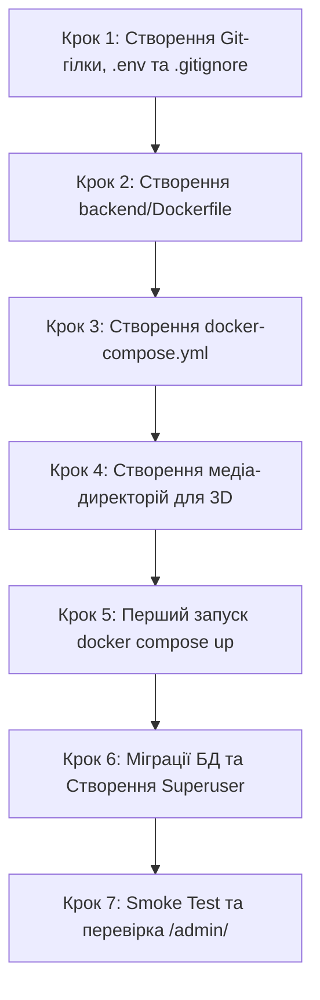

# Інструкція для Студента №2: Backend & Database / DevOps
## Фаза 0: Контейнеризація Docker, PostgreSQL 16, Сховище 3D-медіа та Django Admin

---

> **Паспорт ролі:**
> - **Спеціалізація:** Backend Developer / Database & DevOps Lead
> - **Стек:** PostgreSQL 16, Docker, Docker Compose, Python 3.11-slim, Django ORM, Django Admin (`/admin/`), Linux/Bash
> - **Термін виконання:** Дні 1–3 (Фаза 0)
> - **Головний результат:** Повністю працездатне контейнеризоване середовище (`docker-compose.yml`), піднята база даних PostgreSQL 16 із постійним сховищем (Volume), зібраний образ Django бекенду, підготовлені директорії для 3D-рендерів з 3ds Max, виконані базові міграції та створений суперкористувач для панелі `/admin/`.

---

## 1. Мета та очікувані артефакти Фази 0

На етапі Фази 0 ви відповідаєте за серверну інфраструктуру, надійність збереження даних та готовність бази до проєктування 11 моделей у Фазі 1. Ваше завдання — забезпечити, щоб будь-який член команди (Студент №1, Студент №3 або ментор) міг запустити весь бекенд та базу даних однією командою: `docker compose up -d`.

### 📦 Результати (Deliverables) Студента №2:
1. Файл конфігурації оточення `.env.example` та робочий `.env`.
2. Файли `.gitignore` та `.dockerignore`.
3. Оптимізований `backend/Dockerfile` на базі `python:3.11-slim`.
4. Файл `docker-compose.yml` з конфігурацією двох зв'язаних сервісів: `db` (PostgreSQL 16) та `backend` (Django).
5. Підготовлена файлова структура для збереження медіа: звичайних фото та 3D-візуалізацій інтер'єру (`backend/media/properties/photos/`, `backend/media/properties/3d_renders/`).
6. Успішно виконані базові системні міграції Django у базі `booking_db`.
7. Створений обліковий запис адміністратора (Superuser) та перевірений вхід у `http://localhost:8000/admin/`.

---

## 2. Необхідні інструменти та налаштування оточення

Переконайтеся, що на вашому комп'ютері встановлено:
- **Docker Desktop** (або Docker Engine + docker-compose-plugin на Linux):
  - Перевірте версії: `docker --version` та `docker compose version`.
- **Клієнт бази даних**: DBeaver, DataGrip або pgAdmin (для візуального контролю таблиць).
- **Git**: встановлений та налаштований (`git --version`).

---

## 3. Покроковий план реалізації



### Крок 1. Створення репозиторію на GitHub, базова ініціалізація та робоча гілка

> [!IMPORTANT]
> **Ви відповідальні за створення репозиторію для всієї команди!**
> Перед початком роботи ви створюєте спільний проєкт на GitHub, налаштовуєте `main` та запрошуєте Студента №1 і Студента №3.

#### 1.1. Створення репозиторію на GitHub та надання доступу:
1. Перейдіть на [GitHub](https://github.com/) ➔ створіть новий репозиторій з назвою `booking-3d`.
2. Залиште його порожнім (НЕ додавайте автоматичні README або .gitignore).
3. Перейдіть у **Settings ➔ Collaborators ➔ Add people** та додайте за нікнеймами або email **Студента №1** і **Студента №3**.

#### 1.2. Локальна ініціалізація та перший базовий коміт у `main`:
Виконайте у терміналі в папці `Booking`:
```bash
cd /home/skmelyuk/Documents/projects/Booking

# Ініціалізація git
git init
git config user.name "Ім'я Студента 2"
git config user.email "student2@example.com"
git branch -M main

# Додавання початкової документації та структури
git add README.md docs/ "ТЗ_Клон Booking 3D.docx.pdf"
git commit -m "chore: initial project documentation and architecture specs"

# Підключення віддаленого GitHub репозиторію та перший пуш
git remote add origin https://github.com/<username>/booking-3d.git
git push -u origin main
```
*Після цієї команди повідомте Студента №1 та Студента №3, що вони можуть робити `git clone`!*

#### 1.3. Створення вашої персональної feature-гілки для роботи над Фазою 0:
```bash
git checkout -b feature/phase0-docker-postgres
```

#### 1.4. Створення файлу `.env.example`
У кореневій директорії проєкту `Booking` створіть файл `.env.example`:

```env
# Django Settings
DEBUG=True
SECRET_KEY=django-insecure-booking3d-dev-secret-key-change-me-in-production
ALLOWED_HOSTS=localhost,127.0.0.1,backend,0.0.0.0

# PostgreSQL 16 Credentials
DB_NAME=booking_db
DB_USER=booking_user
DB_PASSWORD=booking_pass_secret
DB_HOST=db
DB_PORT=5432

# CORS Configuration (для зв'язку з React Vite фронтендом)
CORS_ALLOWED_ORIGINS=http://localhost:5173,http://127.0.0.1:5173,http://localhost:3000
```

Скопіюйте його як свій активний `.env`:
```bash
cp .env.example .env
```

#### 1.2. Створення `.gitignore` та `.dockerignore`
У корені проєкту створіть файл `.gitignore`:
```gitignore
# Python & Bytecode
__pycache__/
*.py[cod]
*$py.class
*.so
.Python
env/
venv/
.venv/

# Environment Variables
.env
.env.local

# Django
*.log
local_settings.py
db.sqlite3
db.sqlite3-journal
media/

# Node & Frontend (для зручності Студента №3)
frontend/node_modules/
frontend/dist/
frontend/.env.local

# IDE
.idea/
.vscode/
*.swp
.DS_Store

# Docker
postgres_data/
```

Також створіть файл `.dockerignore`:
```dockerignore
.git
.gitignore
venv
.venv
__pycache__
*.pyc
*.pyo
*.pyd
.env
db.sqlite3
media/
frontend/
docs/
```

---

### Крок 2. Створення оптимізованого `backend/Dockerfile`

У директорії `backend/` створіть файл `Dockerfile`:

```dockerfile
# Використовуємо офіційний легковажний образ Python 3.11 на Debian
FROM python:3.11-slim

# Встановлюємо змінні для запобігання генерації .pyc та буферизації логів
ENV PYTHONDONTWRITEBYTECODE=1
ENV PYTHONUNBUFFERED=1

# Встановлюємо робочу директорію всередині контейнера
WORKDIR /app

# Встановлюємо необхідні системні бібліотеки для компіляції psycopg та роботи з графікою
RUN apt-get update && apt-get install -y --no-install-recommends \
    gcc \
    libpq-dev \
    curl \
    && rm -rf /var/lib/apt/lists/*

# Копіюємо файл залежностей (підготовлений Студентом №1)
COPY requirements.txt /app/

# Встановлюємо залежності Python
RUN pip install --no-cache-dir --upgrade pip && \
    pip install --no-cache-dir -r requirements.txt

# Копіюємо весь вихідний код бекенду
COPY . /app/

# Створюємо каталоги для статичних та медіа-файлів
RUN mkdir -p /app/static /app/media/properties/photos /app/media/properties/3d_renders

# Відкриваємо порт Django
EXPOSE 8000

# За замовчуванням запускаємо вбудований dev-сервер Django
CMD ["python", "manage.py", "runserver", "0.0.0.0:8000"]
```

---

### Крок 3. Створення `docker-compose.yml`

У кореневій директорії проєкту `Booking` створіть файл `docker-compose.yml`:

```yaml
version: '3.8'

services:
  db:
    image: postgres:16-alpine
    container_name: booking_postgres_db
    restart: unless-stopped
    environment:
      POSTGRES_DB: ${DB_NAME:-booking_db}
      POSTGRES_USER: ${DB_USER:-booking_user}
      POSTGRES_PASSWORD: ${DB_PASSWORD:-booking_pass_secret}
    ports:
      - "${DB_PORT:-5432}:5432"
    volumes:
      - postgres_data:/var/lib/postgresql/data
    networks:
      - booking_network
    healthcheck:
      test: ["CMD-SHELL", "pg_isready -U ${DB_USER:-booking_user} -d ${DB_NAME:-booking_db}"]
      interval: 5s
      timeout: 5s
      retries: 5

  backend:
    build:
      context: ./backend
      dockerfile: Dockerfile
    container_name: booking_django_backend
    restart: unless-stopped
    command: python manage.py runserver 0.0.0.0:8000
    volumes:
      - ./backend:/app
      - ./backend/media:/app/media
    ports:
      - "8000:8000"
    env_file:
      - .env
    depends_on:
      db:
        condition: service_healthy
    networks:
      - booking_network

networks:
  booking_network:
    name: booking_network
    driver: bridge

volumes:
  postgres_data:
    name: booking_postgres_data
    driver: local
```

> [!NOTE]
> Конструкція `condition: service_healthy` гарантує, що контейнер Django не почне запускатися раніше, ніж PostgreSQL буде на 100% готовий приймати TCP-з'єднання. Це усуває проблему падіння бекенду при першому старті.

---

### Крок 4. Підготовка структури збереження 3D-медіа та фото

Згідно з інженерним пайплайном взаємодії з дизайнерами (розділ 3 архітектури), Дизайнер №1 (3ds Max) буде передавати рендери у форматі WebP для інтер'єрів об'єктів. 

Створіть директорії для збереження файлів та додайте в них `.gitkeep`:
```bash
mkdir -p backend/media/properties/photos
mkdir -p backend/media/properties/3d_renders
mkdir -p backend/static

touch backend/media/properties/photos/.gitkeep
touch backend/media/properties/3d_renders/.gitkeep
touch backend/static/.gitkeep
```

---

### Крок 5. Перший запуск інфраструктури

Виконайте збірку та запуск контейнерів у фоновому режимі:
```bash
docker compose up --build -d
```

Перевірте статус запущених контейнерів:
```bash
docker compose ps
```
**Очікуваний результат:**
Обидва контейнери `booking_postgres_db` та `booking_django_backend` повинні мати статус `Up` (healthy).

Перегляньте логи на предмет помилок:
```bash
docker compose logs -f
```

---

### Крок 6. Виконання міграцій та створення суперкористувача

#### 6.1. Застосування базових міграцій
Виконайте міграції для стандартних системних таблиць Django (користувачі, сесії, права доступу):
```bash
docker compose exec backend python manage.py migrate
```
**Очікуване виведення в терміналі:**
```text
Operations to perform:
  Apply all migrations: admin, auth, contenttypes, sessions
Running migrations:
  Applying contenttypes.0001_initial... OK
  Applying auth.0001_initial... OK
  Applying admin.0001_initial... OK
  ...
  OK
```

#### 6.2. Створення облікового запису адміністратора (Superuser)
Створіть головного користувача для доступу до панелі управління `/admin/`:
```bash
docker compose exec -it backend python manage.py createsuperuser
```
Заповніть інтерактивні поля:
- **Username:** `admin`
- **Email address:** `admin@booking3d.com`
- **Password:** `admin12345` (або власний надійний пароль)
- **Password (again):** повторіть пароль

---

## 4. Перевірка працездатності (Smoke Testing)

1. **Перевірка доступу до PostgreSQL з хоста**:
   Відкрийте термінал і виконайте команду підключення клієнтом `psql` всередині контейнера:
   ```bash
   docker compose exec db psql -U booking_user -d booking_db -c "\dt"
   ```
   Ви маєте побачити список створених системних таблиць (`auth_user`, `django_session`, `django_migrations` тощо).

2. **Перевірка веб-сервера та Django Admin**:
   Відкрийте у браузері: `http://localhost:8000/admin/`.
   - Введіть логін `admin` та вказаний пароль.
   - Ви маєте успішно потрапити на головний екран панелі керування **Django Administration**.

3. **Перевірка стійкості даних (Volume Persistence)**:
   Зупиніть та видаліть контейнери:
   ```bash
   docker compose down
   ```
   Запустіть контейнери знову:
   ```bash
   docker compose up -d
   ```
   Знову перейдіть за адресою `http://localhost:8000/admin/` — ви повинні зайти під створеним адміністратором без необхідності повторного створення (`createsuperuser`). Це доводить правильну роботу тома `postgres_data`.

---

## 5. Протокол взаємодії з іншими студентами команди

| З ким взаємодієте | Що передаєте | Що очікуєте взамін |
| :--- | :--- | :--- |
| **Студент №1** *(Backend Core)* | Робочий PostgreSQL контейнер. Параметри для конфігурації `DATABASES` у `settings.py` (через `.env`). | Файл `requirements.txt` без конфліктних бібліотек та актуальний код у папці `backend/`. |
| **Студент №3** *(Frontend)* | Інструкцію швидкого запуску бекенду: `docker compose up -d`. Підтвердження, що медіа-файли роздаються за адресою `http://localhost:8000/media/`. | Своєчасне повідомлення про будь-які мережеві помилки з'єднання з портом 8000. |
| **Дизайнер №1** *(3D / 3ds Max)* | Структуру директорій `backend/media/properties/3d_renders/` та узгоджені вимоги: WebP, роздільність до 1920x1080, вага до 300 КБ. | Тестові 3D-рендери для наповнення бази у Фазі 1–2. |

---

## 6. Збереження змін у Git (Коли та як комітити)

### 6.1. Регламент комітів для Студента №2:
Не робіть один загальний коміт у кінці! Фіксуйте роботу покроково (атомарно) після перевірки кожного блоку:

```bash
# 1. Після налаштування файлів конфігурації оточення:
git add .env.example .gitignore .dockerignore
git commit -m "chore(infra): create .env.example, .gitignore, and .dockerignore"

# 2. Після створення Dockerfile:
git add backend/Dockerfile
git commit -m "chore(docker): create backend dockerfile on python 3.11-slim"

# 3. Після створення docker-compose.yml:
git add docker-compose.yml
git commit -m "chore(docker): create docker-compose configuration for postgres 16 and django"

# 4. Після створення структури директорій медіа:
git add backend/media/ backend/static/
git commit -m "chore(media): initialize directory structure for 3d renders and static assets"
```

### 6.2. Відправка на GitHub та створення першого Pull Request:
Оскільки інфраструктура є фундаментом для інших двох студентів, ваш PR зливається **першим**:

```bash
# Відправка гілки на GitHub
git push -u origin feature/phase0-docker-postgres
```

1. Перейдіть на GitHub ➔ натисніть **Compare & pull request**.
2. Заголовок: `chore(infra): setup Docker Compose, PostgreSQL 16, and media storage`.
3. Опис: вкажіть чеклист виконаних завдань з Definition of Done.
4. Призначте Студента №1 та Студента №3 у рев'ювери.
5. Після отримання схвалення (Approve) виконайте **Merge pull request** (злиття в `main`).
6. Оновіть локальну гілку `main`:
   ```bash
   git checkout main
   git pull origin main
   git branch -d feature/phase0-docker-postgres
   ```
7. Повідомте Студента №1, що він може підтягнути `main` у свою гілку!

---

## 7. Чеклист готовності (Definition of Done)

- [ ] Файл `.env.example` створено та задокументовано всі параметри.
- [ ] Файл `.dockerignore` та `.gitignore` запобігають потраплянню сміття та паролів у Git.
- [ ] `backend/Dockerfile` успішно збирає образ без помилок компіляції.
- [ ] Контейнер PostgreSQL 16 запускається, проходить healthcheck та зберігає дані в том `booking_postgres_data`.
- [ ] Обидва сервіси стартують командою `docker compose up -d`.
- [ ] Базові міграції виконані командою `migrate`.
- [ ] Суперкористувач створений, успішний вхід у `http://localhost:8000/admin/` підтверджено.
- [ ] Директорії для збереження 3D-рендерів створені.
- [ ] Створено Pull Request у Git.
