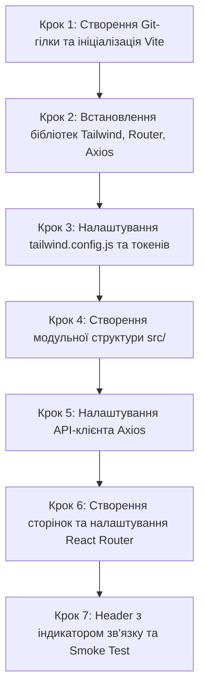

# Інструкція для Студента №3: Frontend Developer
## Фаза 0: Ініціалізація React 18 + Vite, Tailwind CSS, Токени "Cold Start" та Роутинг

---

> **Паспорт ролі:**
> - **Спеціалізація:** Frontend Lead / Client Application Developer
> - **Стек:** React 18, TypeScript, Vite, Tailwind CSS, Lucide React, Axios, React Router v6
> - **Термін виконання:** Дні 1–3 (Фаза 0)
> - **Головний результат:** Швидкий клієнтський SPA-застосунок у директорії `frontend/`, налаштований Tailwind CSS з фірмовими дизайн-токенами Booking.com та бейджем 3D, модульна файлова структура `src/`, 6 сторінок-заглушок із налаштованим роутингом, попередньо налаштований клієнт Axios та живий індикатор підключення до бекенду (`/api/health/`) у шапці сайту.

---

## 1. Мета та очікувані артефакти Фази 0

На етапі Фази 0 ви розгортаєте клієнтський фронтенд і готуєте каркас для реалізації Wireframes (Фаза 1) та інтерактивної 3D-галереї (Фаза 3). Завдяки регламенту "Cold Start" ви не чекаєте, доки дизайнери намалюють фінальні екрани в Figma, а самостійно налаштовуєте дизайн-токени (палітра Booking), базову навігацію та зв'язок із сервером.

### 📦 Результати (Deliverables) Студента №3:
1. Ініціалізований проєкт на базі Vite + React 18 + TypeScript у папці `frontend/`.
2. Конфігураційні файли `tailwind.config.js` та `postcss.config.js` із фірмовими кольорами (`primary`, `accent`, `badge3d`, `surface`).
3. Встановлені бібліотеки: `react-router-dom`, `lucide-react`, `axios`.
4. Модульна структура вихідного коду: `src/components/`, `src/pages/`, `src/services/`, `src/types/`.
5. Екземпляр Axios (`src/services/api.ts`) з підтримкою змінних оточення `VITE_API_URL`.
6. Налаштована маршрутизація (React Router v6) для 6 ключових екранів:
   - `/` — Головна сторінка
   - `/search` — Результати пошуку та каталог
   - `/properties/:id` — Деталі житла та 3D-галерея
   - `/booking/:id` — Форма бронювання
   - `/cabinet` — Кабінет гостя ("Мої бронювання", "Обране")
   - `/owner` — Кабінет власника житла
7. Компоненти `Header` (із живим статусом бекенду: зелений/червоний індикатор) та `Footer`.

---

## 2. Необхідні інструменти та налаштування оточення

Переконайтеся, що на вашому комп'ютері встановлено:
- **Node.js**: версія 18 LTS або 20 LTS (`node -v`).
- **Менеджер пакетів**: npm (`npm -v`) або pnpm / yarn.
- **Git**: встановлений та налаштований (`git --version`).
- **Редактор коду**: VS Code з рекомендованими плагінами:
  - *Tailwind CSS IntelliSense*
  - *ESLint*
  - *Prettier - Code formatter*

---

## 3. Покроковий план реалізації



### Крок 1. Підключення до репозиторію та створення робочої гілки

> [!NOTE]
> Перед цим кроком переконайтеся, що **Студент №2** уже створив репозиторій на GitHub, опублікував базовий `main` та надіслав вам запрошення в Collaborators.

1. **Клонуйте репозиторій або підтягніть оновлення**:
   ```bash
   # Якщо ви тільки завантажуєте проєкт:
   git clone https://github.com/<username>/booking-3d.git Booking
   cd Booking

   # Налаштуйте ваші дані (якщо не налаштовано глобально):
   git config user.name "Ім'я Студента 3"
   git config user.email "student3@example.com"

   # Переконайтеся, що ви в актуальній гілці main:
   git checkout main
   git pull origin main
   ```

2. **Створіть вашу персональну робочу гілку**:
   ```bash
   git checkout -b feature/phase0-frontend-init
   ```

3. **Ініціалізація Vite проєкту з TypeScript**:
   Створіть клієнтський проєкт за допомогою Vite з шаблоном React + TypeScript:
   ```bash
   npm create vite@latest frontend -- --template react-ts
   ```
   Перейдіть у створену директорію та встановіть початкові залежності:
   ```bash
   cd frontend
   npm install
   ```

---

### Крок 2. Встановлення Tailwind CSS, React Router, Lucide та Axios

Встановіть Tailwind CSS, PostCSS та Autoprefixer як dev-залежності:
```bash
npm install -D tailwindcss postcss autoprefixer
```
Ініціалізуйте файли конфігурації Tailwind:
```bash
npx tailwindcss init -p
```

Встановіть основні робочі бібліотеки:
```bash
npm install react-router-dom lucide-react axios
```

---

### Крок 3. Налаштування Tailwind CSS та імпорт токенів ("Cold Start")

Відкрийте створений файл `frontend/tailwind.config.js` та замініть його вміст наступним кодом. Палітра кольорів відповідає стилістиці Booking.com з додаванням акценту для 3D-моделей:

```javascript
/** @type {import('tailwindcss').Config} */
export default {
  content: [
    "./index.html",
    "./src/**/*.{js,ts,jsx,tsx}",
  ],
  theme: {
    extend: {
      colors: {
        // Фірмові кольори Booking.com
        primary: {
          DEFAULT: '#003580', // Класичний темний синій Booking
          dark: '#00224f',
          light: '#006ce4',
        },
        accent: {
          DEFAULT: '#febb02', // Фірмовий золотисто-жовтий акцент
          hover: '#e5a800',
        },
        surface: {
          DEFAULT: '#ffffff',
          alt: '#f5f7fa',
          muted: '#e2e8f0',
        },
        // Спеціальний маркер для 3D-турів та візуалізацій 3ds Max
        badge3d: {
          DEFAULT: '#8b5cf6', // Фіолетовий бейдж "3D Tour"
          dark: '#6d28d9',
          light: '#f3e8ff',
        },
        status: {
          success: '#10b981',
          danger: '#ef4444',
          warning: '#f59e0b',
        }
      },
      fontFamily: {
        sans: ['Inter', 'system-ui', '-apple-system', 'sans-serif'],
      },
    },
  },
  plugins: [],
}
```

Тепер оновіть файл стилів `frontend/src/index.css`:
```css
@tailwind base;
@tailwind components;
@tailwind utilities;

@layer base {
  body {
    @apply bg-surface-alt text-gray-900 font-sans antialiased min-h-screen flex flex-col;
  }
}
```

---

### Крок 4. Створення модульної структури директорій `src/`

Знаходячись у папці `frontend/`, створіть каталоги проєкту:
```bash
mkdir -p src/assets
mkdir -p src/components/common
mkdir -p src/components/layout
mkdir -p src/pages
mkdir -p src/services
mkdir -p src/types
```

Створіть початковий файл типів `frontend/src/types/index.ts`:
```typescript
// Загальні інтерфейси системи Booking 3D

export interface HealthCheckResponse {
  status: string;
  service: string;
  version: string;
  timestamp: string;
  database: string;
}

export interface Amenity {
  id: string;
  name: string;
  icon_name: string;
}

export interface Property3DImage {
  id: string;
  image_url: string;
  room_type: 'living_room' | 'bedroom' | 'kitchen' | 'bathroom';
  camera_angle: string;
  render_engine: 'Corona' | 'V-Ray';
}

export interface Property {
  id: string;
  title: string;
  description: string;
  city: string;
  country: string;
  price_per_night: number;
  rating_avg: number;
  cover_image: string;
  has_3d_tour: boolean;
}
```

---

### Крок 5. Налаштування API-клієнта Axios

Створіть файл оточення `frontend/.env`:
```env
VITE_API_URL=http://localhost:8000/api
```
Також створіть файл `frontend/.env.example`:
```env
VITE_API_URL=http://localhost:8000/api
```

Створіть сервіс для роботи з мережею `frontend/src/services/api.ts`:
```typescript
import axios from 'axios';
import { HealthCheckResponse } from '../types';

const API_BASE_URL = import.meta.env.VITE_API_URL || 'http://localhost:8000/api';

export const apiClient = axios.create({
  baseURL: API_BASE_URL,
  timeout: 5000,
  headers: {
    'Content-Type': 'application/json',
  },
});

/**
 * Перевірка статусу зв'язку з Django бекендом (Health Check)
 */
export const checkBackendHealth = async (): Promise<HealthCheckResponse> => {
  const response = await apiClient.get<HealthCheckResponse>('/health/');
  return response.data;
};
```

---

### Крок 6. Створення компонентів Layout (Header & Footer)

#### 6.1. Створення `frontend/src/components/layout/Header.tsx`
Створіть шапку з навігацією, логотипом та інтерактивним індикатором статусу зв'язку з бекендом Студента №1 і №2:

```tsx
import React, { useEffect, useState } from 'react';
import { Link, useLocation } from 'react-router-dom';
import { Box, Home, Search, User, Building, Wifi, WifiOff } from 'lucide-react';
import { checkBackendHealth } from '../../services/api';

export const Header: React.FC = () => {
  const [backendStatus, setBackendStatus] = useState<'checking' | 'online' | 'offline'>('checking');
  const [apiVersion, setApiVersion] = useState<string>('');
  const location = useLocation();

  useEffect(() => {
    const verifyConnection = async () => {
      try {
        const data = await checkBackendHealth();
        if (data.status === 'ok') {
          setBackendStatus('online');
          setApiVersion(data.version);
        } else {
          setBackendStatus('offline');
        }
      } catch {
        setBackendStatus('offline');
      }
    };

    verifyConnection();
    const interval = setInterval(verifyConnection, 15000); // Опитування раз на 15 секунд
    return () => clearInterval(interval);
  }, []);

  const navLinks = [
    { to: '/', label: 'Головна', icon: Home },
    { to: '/search', label: 'Пошук житла', icon: Search },
    { to: '/cabinet', label: 'Кабінет гостя', icon: User },
    { to: '/owner', label: 'Власникам', icon: Building },
  ];

  return (
    <header className="bg-primary text-white shadow-md sticky top-0 z-50">
      <div className="max-w-7xl mx-auto px-4 sm:px-6 lg:px-8">
        <div className="flex justify-between items-center h-16">
          {/* Логотип */}
          <Link to="/" className="flex items-center space-x-2 text-xl font-bold tracking-tight">
            <span className="text-white">Booking</span>
            <span className="bg-badge3d text-white text-xs px-2 py-0.5 rounded-full font-extrabold flex items-center space-x-1">
              <Box className="w-3.5 h-3.5 inline mr-1" /> 3D
            </span>
          </Link>

          {/* Навігація */}
          <nav className="hidden md:flex space-x-1">
            {navLinks.map((link) => {
              const Icon = link.icon;
              const isActive = location.pathname === link.to;
              return (
                <Link
                  key={link.to}
                  to={link.to}
                  className={`flex items-center space-x-1 px-3 py-2 rounded-md text-sm font-medium transition-colors ${
                    isActive
                      ? 'bg-primary-dark text-accent font-semibold'
                      : 'hover:bg-primary-light text-gray-100'
                  }`}
                >
                  <Icon className="w-4 h-4" />
                  <span>{link.label}</span>
                </Link>
              );
            })}
          </nav>

          {/* Індикатор зв'язку з бекендом */}
          <div className="flex items-center space-x-3 text-xs bg-primary-dark/80 px-3 py-1.5 rounded-full border border-blue-900">
            {backendStatus === 'checking' && (
              <span className="flex items-center text-gray-300">
                <span className="w-2 h-2 rounded-full bg-yellow-400 animate-ping mr-2"></span>
                API: Перевірка...
              </span>
            )}
            {backendStatus === 'online' && (
              <span className="flex items-center text-green-400 font-medium">
                <Wifi className="w-3.5 h-3.5 mr-1" />
                API Online (v{apiVersion})
              </span>
            )}
            {backendStatus === 'offline' && (
              <span className="flex items-center text-red-400 font-medium">
                <WifiOff className="w-3.5 h-3.5 mr-1" />
                API Offline
              </span>
            )}
          </div>
        </div>
      </div>
    </header>
  );
};
```

#### 6.2. Створення `frontend/src/components/layout/Footer.tsx`
Створіть підвал сайту:
```tsx
import React from 'react';

export const Footer: React.FC = () => {
  return (
    <footer className="bg-gray-900 text-gray-400 py-6 mt-auto text-sm border-t border-gray-800">
      <div className="max-w-7xl mx-auto px-4 text-center">
        <p className="text-gray-300 font-medium">
          Booking 3D — Навчальний клон сервісу оренди житла з візуалізаціями Autodesk 3ds Max
        </p>
        <p className="mt-1 text-xs text-gray-500">
          Створено студентською командою розробників та дизайнерів • Фаза 0
        </p>
      </div>
    </footer>
  );
};
```

#### 6.3. Створення `frontend/src/components/layout/MainLayout.tsx`
Створіть спільний шаблон сторінки:
```tsx
import React from 'react';
import { Outlet } from 'react-router-dom';
import { Header } from './Header';
import { Footer } from './Footer';

export const MainLayout: React.FC = () => {
  return (
    <div className="min-h-screen flex flex-col">
      <Header />
      <main className="flex-grow max-w-7xl w-full mx-auto px-4 sm:px-6 lg:px-8 py-8">
        <Outlet />
      </main>
      <Footer />
    </div>
  );
};
```

---

### Крок 7. Створення сторінок-заглушок та роутингу

Створіть 6 сторінок всередині папки `frontend/src/pages/`:

#### 7.1. `frontend/src/pages/HomePage.tsx`
```tsx
import React from 'react';
import { Box, Search, Calendar, Users, Sparkles } from 'lucide-react';
import { Link } from 'react-router-dom';

export const HomePage: React.FC = () => {
  return (
    <div className="space-y-8">
      {/* Hero Banner */}
      <div className="bg-gradient-to-r from-primary to-primary-light rounded-2xl p-8 text-white shadow-lg">
        <div className="inline-flex items-center space-x-2 bg-badge3d/20 border border-badge3d px-3 py-1 rounded-full text-xs font-semibold uppercase tracking-wider mb-4">
          <Sparkles className="w-3.5 h-3.5 text-accent" />
          <span>Інновація проєкту</span>
        </div>
        <h1 className="text-3xl md:text-5xl font-extrabold tracking-tight">
          Знайдіть ідеальне житло з інтерактивними 3D-турами
        </h1>
        <p className="mt-3 text-lg text-blue-100 max-w-2xl">
          Оцінюйте реальний простір та деталі інтер'єру кімнат, змодельованих у Autodesk 3ds Max, ще до оформлення броні.
        </p>

        {/* Швидкий рядок пошуку (Wireframe) */}
        <div className="mt-8 bg-white text-gray-900 rounded-xl p-3 shadow-xl grid grid-cols-1 md:grid-cols-4 gap-3 items-center">
          <div className="flex items-center space-x-2 px-3 py-2 border rounded-lg">
            <Search className="w-5 h-5 text-gray-400" />
            <input
              type="text"
              placeholder="Куди прямуєте? (Київ, Львів...)"
              className="w-full text-sm outline-none"
            />
          </div>
          <div className="flex items-center space-x-2 px-3 py-2 border rounded-lg">
            <Calendar className="w-5 h-5 text-gray-400" />
            <span className="text-sm text-gray-500">Заїзд — Виїзд</span>
          </div>
          <div className="flex items-center space-x-2 px-3 py-2 border rounded-lg">
            <Users className="w-5 h-5 text-gray-400" />
            <span className="text-sm text-gray-500">2 дорослих • 1 кімната</span>
          </div>
          <Link
            to="/search"
            className="bg-accent hover:bg-accent-hover text-primary font-bold py-3 px-6 rounded-lg text-center transition-colors flex items-center justify-center space-x-2 shadow-sm"
          >
            <Search className="w-4 h-4" />
            <span>Знайти житло</span>
          </Link>
        </div>
      </div>

      {/* Переваги 3D */}
      <div className="grid grid-cols-1 md:grid-cols-3 gap-6">
        <div className="bg-white p-6 rounded-xl border border-gray-200 shadow-sm">
          <div className="w-12 h-12 bg-purple-100 text-badge3d rounded-lg flex items-center justify-center mb-4">
            <Box className="w-6 h-6" />
          </div>
          <h3 className="text-lg font-bold">Реалістичні 3ds Max рендери</h3>
          <p className="text-gray-600 text-sm mt-2">
            Високодеталізовані ракурси спалень, віталень та кухонь від нашого 3D-дизайнера.
          </p>
        </div>
        <div className="bg-white p-6 rounded-xl border border-gray-200 shadow-sm">
          <div className="w-12 h-12 bg-blue-100 text-primary rounded-lg flex items-center justify-center mb-4">
            <Calendar className="w-6 h-6" />
          </div>
          <h3 className="text-lg font-bold">Миттєве бронювання</h3>
          <p className="text-gray-600 text-sm mt-2">
            Календар реального часу з транзакційним захистом від подвійного бронювання.
          </p>
        </div>
        <div className="bg-white p-6 rounded-xl border border-gray-200 shadow-sm">
          <div className="w-12 h-12 bg-yellow-100 text-accent-hover rounded-lg flex items-center justify-center mb-4">
            <Sparkles className="w-6 h-6" />
          </div>
          <h3 className="text-lg font-bold">Чесні відгуки та рейтинги</h3>
          <p className="text-gray-600 text-sm mt-2">
            10-бальна шкала оцінки житла від верифікованих гостей платформи.
          </p>
        </div>
      </div>
    </div>
  );
};
```

#### 7.2. Інші сторінки-заглушки:
- Створіть `frontend/src/pages/SearchPage.tsx`:
```tsx
import React from 'react';
import { Link } from 'react-router-dom';

export const SearchPage: React.FC = () => (
  <div className="space-y-4">
    <h1 className="text-2xl font-bold text-primary">Каталог житла та Результати пошуку</h1>
    <p className="text-gray-600">Тут буде розміщено фільтри та картки помешкань (Фаза 1–2).</p>
    <Link to="/properties/test-property-1" className="inline-block bg-primary text-white px-4 py-2 rounded-lg text-sm">
      Переглянути демо-об'єкт із 3D туром
    </Link>
  </div>
);
```

- Створіть `frontend/src/pages/PropertyDetailsPage.tsx`:
```tsx
import React from 'react';
import { useParams, Link } from 'react-router-dom';
import { Box } from 'lucide-react';

export const PropertyDetailsPage: React.FC = () => {
  const { id } = useParams();
  return (
    <div className="space-y-4">
      <div className="flex items-center space-x-2">
        <h1 className="text-2xl font-bold text-primary">Об'єкт житла: {id}</h1>
        <span className="bg-badge3d text-white text-xs px-2.5 py-1 rounded-full font-bold flex items-center">
          <Box className="w-3.5 h-3.5 mr-1" /> 3D Візуалізація
        </span>
      </div>
      <p className="text-gray-600">Тут буде інтерактивна 3D-галерея кімнат та віджет вибору дат.</p>
      <Link to={`/booking/${id}`} className="inline-block bg-accent text-primary font-bold px-6 py-2.5 rounded-lg text-sm">
        Перейти до бронювання
      </Link>
    </div>
  );
};
```

- Створіть `frontend/src/pages/BookingPage.tsx`:
```tsx
import React from 'react';
import { useParams } from 'react-router-dom';

export const BookingPage: React.FC = () => {
  const { id } = useParams();
  return (
    <div className="space-y-4">
      <h1 className="text-2xl font-bold text-primary">Оформлення бронювання</h1>
      <p className="text-gray-600">Об'єкт ID: {id}. Форма введення даних гостя та тестова оплата (Фаза 3–4).</p>
    </div>
  );
};
```

- Створіть `frontend/src/pages/CabinetPage.tsx`:
```tsx
import React from 'react';

export const CabinetPage: React.FC = () => (
  <div className="space-y-4">
    <h1 className="text-2xl font-bold text-primary">Особистий кабінет користувача</h1>
    <p className="text-gray-600">Вкладки "Мої бронювання", "Обране" та профіль гостя.</p>
  </div>
);
```

- Створіть `frontend/src/pages/OwnerPage.tsx`:
```tsx
import React from 'react';

export const OwnerPage: React.FC = () => (
  <div className="space-y-4">
    <h1 className="text-2xl font-bold text-primary">Кабінет власника житла</h1>
    <p className="text-gray-600">Додавання об'єкта, налаштування цін та завантаження 3D-рендерів.</p>
  </div>
);
```

- Створіть `frontend/src/pages/NotFoundPage.tsx`:
```tsx
import React from 'react';
import { Link } from 'react-router-dom';

export const NotFoundPage: React.FC = () => (
  <div className="text-center py-16 space-y-4">
    <h1 className="text-4xl font-extrabold text-primary">404</h1>
    <p className="text-gray-600">Сторінку не знайдено.</p>
    <Link to="/" className="inline-block bg-primary text-white px-4 py-2 rounded-lg text-sm">
      Повернутися на головну
    </Link>
  </div>
);
```

---

### Крок 8. Налаштування роутингу в `frontend/src/App.tsx`

Замініть вміст `frontend/src/App.tsx` наступним кодом:

```tsx
import React from 'react';
import { BrowserRouter, Routes, Route } from 'react-router-dom';
import { MainLayout } from './components/layout/MainLayout';
import { HomePage } from './pages/HomePage';
import { SearchPage } from './pages/SearchPage';
import { PropertyDetailsPage } from './pages/PropertyDetailsPage';
import { BookingPage } from './pages/BookingPage';
import { CabinetPage } from './pages/CabinetPage';
import { OwnerPage } from './pages/OwnerPage';
import { NotFoundPage } from './pages/NotFoundPage';

export const App: React.FC = () => {
  return (
    <BrowserRouter>
      <Routes>
        <Route path="/" element={<MainLayout />}>
          <Route index element={<HomePage />} />
          <Route path="search" element={<SearchPage />} />
          <Route path="properties/:id" element={<PropertyDetailsPage />} />
          <Route path="booking/:id" element={<BookingPage />} />
          <Route path="cabinet" element={<CabinetPage />} />
          <Route path="owner" element={<OwnerPage />} />
          <Route path="*" element={<NotFoundPage />} />
        </Route>
      </Routes>
    </BrowserRouter>
  );
};

export default App;
```

---

## 4. Перевірка працездатності (Smoke Testing)

1. **Запуск Dev-сервера**:
   У папці `frontend/` запустіть Vite:
   ```bash
   npm run dev
   ```
   **Очікуване виведення:**
   ```text
   VITE v5.x.x  ready in 250 ms
   ➜  Local:   http://localhost:5173/
   ```

2. **Перевірка в браузері (`http://localhost:5173`)**:
   - Відкрийте сторінку в браузері.
   - Ви маєте побачити фірмовий темно-синій `Header` з логотипом **Booking 3D** та бейджем 3D.
   - Перевірте переходи між посиланнями навігації ("Головна", "Пошук житла", "Кабінет гостя", "Власникам") — сторінки повинні миттєво змінюватися без перезавантаження сторінки (Client-side Routing).

3. **Перевірка зв'язку з бекендом**:
   - Якщо контейнер бекенду запущений (Студент №1 та №2 виконали свої кроки): у верхньому правому куті Header з'явиться зелена іконка **"API Online (v1.0.0)"**.
   - Якщо бекенд вимкнено: індикатор коректно відображає червоний значок **"API Offline"** без падіння або зависання застосунку.

4. **Тест компіляції TypeScript та збірки**:
   ```bash
   npm run build
   ```
   Збірка має завершитися успішно зі створенням папки `dist/` без помилок типів.

---

## 5. Протокол взаємодії з іншими членами команди

| З ким взаємодієте | Що передаєте | Що очікуєте взамін |
| :--- | :--- | :--- |
| **Студент №1** *(Backend Core)* | Підтвердження успішного опитування ендпоінту `/api/health/`. Порт вашого клієнта (`5173`) для налаштування CORS. | Swagger UI специфікацію ендпоінтів та опис DTO-структур. |
| **Студент №2** *(Database / DevOps)* | Перевірку роботи медіа-посилань. | URL-префікс роздачі медіа (`/media/`) для відображення фото та 3D-рендерів. |
| **Дизайнери №2 та №3** *(UI/UX)* | Демонстрацію працюючого каркасу на Tailwind. | Готові кольорові токени з Figma для оновлення `tailwind.config.js` та чорно-білі Wireframes для Фази 1. |

---

## 6. Збереження змін у Git (Коли та як комітити)

### 6.1. Регламент комітів для Студента №3:
Фіксуйте зміни послідовно (атомарно) після виконання та перевірки кожного кроку:

```bash
# 1. Після ініціалізації Vite та встановлення пакетів:
git add frontend/package.json frontend/package-lock.json frontend/tsconfig*.json frontend/vite.config.ts frontend/index.html
git commit -m "chore(frontend): initialize vite react-ts project and install dependencies"

# 2. Після налаштування Tailwind CSS та імпорту дизайн-токенів:
git add frontend/tailwind.config.js frontend/postcss.config.js frontend/src/index.css
git commit -m "chore(styles): configure tailwind css with booking color tokens and 3d badge"

# 3. Після створення структури директорій та DTO-типів:
git add frontend/src/types/
git commit -m "feat(types): create initial typescript interfaces for booking platform"

# 4. Після налаштування Axios клієнта:
git add frontend/.env.example frontend/src/services/api.ts
git commit -m "feat(api): create axios client with health check service"

# 5. Після створення сторінок, лейаутів та роутингу:
git add frontend/src/components/ frontend/src/pages/ frontend/src/App.tsx
git commit -m "feat(routes): implement react router with 6 pages, header status, and footer"
```

### 6.2. Синхронізація з `main` та створення фінального Pull Request:
Оскільки ваш PR зливається **третім** (після злиття Студента №2 та Студента №1), обов'язково підтягніть їхній код перед відкриттям свого PR:

```bash
# 1. Отримайте свіжі гілки з GitHub:
git fetch origin

# 2. Влийте актуальний main у свою feature-гілку:
git merge origin/main

# 3. Відправте свою гілку на GitHub:
git push -u origin feature/phase0-frontend-init
```

1. Перейдіть на GitHub ➔ натисніть **Compare & pull request**.
2. Заголовок: `feat(frontend): Vite React 18 SPA, Tailwind tokens, routing, and API healthcheck`.
3. Опис: вкажіть перелік виконаних завдань з Definition of Done.
4. Призначте Студента №1 та Студента №2 у рев'ювери.
5. Після отримання двох схвалень (Approve) виконайте **Merge pull request**.
6. Оновіть локальну гілку `main`:
   ```bash
   git checkout main
   git pull origin main
   git branch -d feature/phase0-frontend-init
   ```

---

## 7. Чеклист готовності (Definition of Done)

- [ ] Проєкт у папці `frontend/` успішно запускається командою `npm run dev` на порту 5173.
- [ ] Tailwind CSS налаштовано з фірмовими токенами (`primary`, `accent`, `badge3d`).
- [ ] Встановлено `react-router-dom`, `lucide-react`, `axios`.
- [ ] Створено 6 сторінок-заглушок та перевірено роботу роутингу.
- [ ] Налаштовано клієнт Axios та індикатор Health Check у `Header.tsx`.
- [ ] Команда `npm run build` проходить без жодної помилки компіляції TypeScript.
- [ ] Створено Pull Request у Git.
