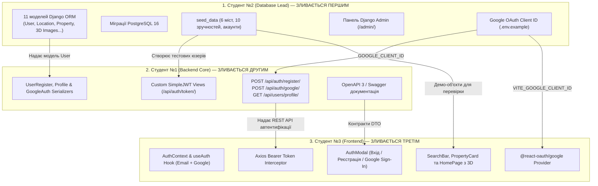

# Загальний план координації: Фаза 1 (Схема БД, Автентифікація та Wireframe-каркас)
## Навчальний клон сервісу бронювання житла Booking.com 3D

Цей каталог містить покрокові інструкції для трьох студентів-розробників для виконання завдань **Фази 1** (Тиждень 1–2) відповідно до [Дорожньої карти проєкту](../roadmap/phases-and-milestones.md), [Архітектури системи](../architecture/system-overview.md) та [Схеми бази даних](../architecture/database-schema.md).

---

## 👥 Спеціалізація та індивідуальні інструкції

| Студент | Роль у проєкті | Посилання на інструкцію | Ключові модулі | Головний артефакт Фази 1 |
| :---: | :--- | :--- | :--- | :--- |
| **Студент №2** | **Backend & Database** | [student-2-backend-db.md](student-2-backend-db.md) | 11 моделей Django ORM, міграції, `seed_data`, Django Admin, Google OAuth credentials | 11 таблиць PostgreSQL, тестові дані 6 міст, 10 зручностей, налаштований `.env.example` з Google Client ID |
| **Студент №1** | **Backend Core & API** | [student-1-backend-core.md](student-1-backend-core.md) | SimpleJWT, реєстрація, Google Sign-In, профіль, Permissions, Swagger UI | REST API `/api/auth/register/`, `/api/auth/token/`, `/api/auth/google/`, `/api/users/profile/` |
| **Студент №3** | **Frontend Developer** | [student-3-frontend.md](student-3-frontend.md) | React 18, `AuthContext`, Google Sign-In, модалки входу, Wireframes на Tailwind | Авторизація гостя (Email + Google), шапка з профілем, SearchBar та PropertyCard з 3D-бейдж |

---

## 🔄 Схема командної взаємодії у Фазі 1



---

## 🌿 Регламент роботи з Git у Фазі 1

### 1. Назви робочих гілок:
- **Студент №2**: `feature/phase1-database-models`
- **Студент №1**: `feature/phase1-backend-auth`
- **Студент №3**: `feature/phase1-frontend-auth`

### 2. Суворий порядок злиття (Strict Merge Order):
Оскільки завдання мають прямі залежності між собою, злиття Pull Request виконується у строго визначеному порядку:
1. **PR №1 (Студент №2)**: Моделі Django ORM, міграції, команда `seed_data`, Django Admin та змінні середовища для Google OAuth.
   - Студенти №1 і №3 переглядають PR, перевіряють роботу міграцій та дають **Approve**.
   - Студент №2 зливає PR у `main`.
2. **PR №2 (Студент №1)**: Серіалізатори, реєстрація, Google Auth (`/api/auth/google/`), SimpleJWT та ендпоінти профілю.
   - Студент №1 робить `git pull origin main` у свою гілку, тестує API через Swagger і відкриває PR.
   - Команда переглядає та апрувить. Студент №1 зливає PR у `main`.
3. **PR №3 (Студент №3)**: Клієнтська авторизація (AuthContext, Google OAuth, модалки, Axios interceptors) та Wireframe-компоненти.
   - Студент №3 підтягує актуальний `main` (`git pull origin main`), тестує наскрізну реєстрацію з браузера (email та Google) і відкриває PR.
   - Команда апрувить, PR зливається у `main`.

---

## 🧪 Спільний інтеграційний тест (Sprint 1 Smoke Test)

Перед закриттям Фази 1 уся команда збирається на спільне наскрізне тестування:

1. **Крок 1: Оновлення репозиторію та запуск**:
   ```bash
   git checkout main
   git pull origin main
   docker compose up -d
   docker compose exec backend python manage.py migrate
   docker compose exec backend python manage.py seed_data
   ```
2. **Крок 2: Перевірка бази та адміністративної панелі**:
   - Відкрити `http://localhost:8000/admin/`.
   - Увійти як `admin@booking3d.com` / `admin12345`.
   - Перевірити наявність 6 локацій, 10 зручностей та 2 тестових помешкань.
3. **Крок 3: Перевірка API через Swagger UI та REST Client**:
   - **Swagger UI**: Відкрити `http://localhost:8000/api/docs/`, протестувати `POST /api/auth/register/`, `POST /api/auth/token/`, авторизуватися кнопкою **Authorize 🔓** (вставити токен) та перевірити захищений профіль `GET /api/users/profile/`.
   - **REST Client (`.http`)**: Відкрити файл [`docs/phase-1/api-tests.http`](api-tests.http) у VS Code (розширення *REST Client*) або JetBrains HTTP Client та переконатися у проходженні всіх 14 тестових запитів із динамічною передачею токенів.
4. **Крок 4: Перевірка клієнтського застосунку React**:
   - Відкрити `http://localhost:5173/`.
   - Натиснути кнопку **"Реєстрація"** у шапці ➔ ввести дані нового користувача.
   - Перевірити, що після створення акаунту модальне вікно закрилося, а в шапці з'явилося ім'я з бейджем ролі.
   - Оновити сторінку (F5) ➔ сесія повинна зберегтися з `localStorage`.
   - Протестувати вхід/реєстрацію через кнопку **"Sign in with Google"**.
   - Перевірити відображення компонентів `SearchBar` та карток житла з бейджем **"3D Тур (3ds Max)"**.

---

## ✅ Загальний критерій готовності (Definition of Done) Фази 1

Фаза 1 вважається завершеною, коли:
- [x] 11 моделей Django ORM створено та задокументовано.
- [x] Початкові міграції успішно застосовані в базі PostgreSQL 16.
- [x] Команда `python manage.py seed_data` стабільно наповнює базу тестовими даними.
- [x] Ендпоінти реєстрації, JWT-входу, Google OAuth та профілю працюють і захищені від некоректних даних.
- [x] Всі нові ендпоінти описані в Swagger UI.
- [x] Клієнтська частина React має робочий `AuthContext`, підтримку Google Sign-In та форми входу/реєстрації.
- [x] Чорнові Wireframe-компоненти (пошук, картка житла з бейджем 3D) зверстані на Tailwind.
- [x] Усі три Pull Request злиті в гілку `main`.
