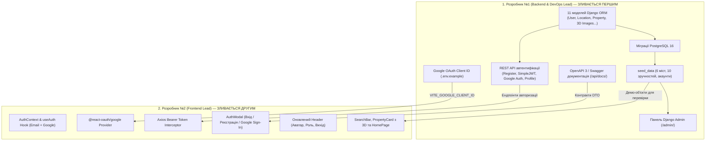

# Загальний план координації: Фаза 1 (Схема БД, Автентифікація та Wireframe-каркас)
## Навчальний клон сервісу бронювання житла Booking.com 3D

Цей каталог містить покрокові інструкції для **двох розробників** для виконання завдань **Фази 1** (Тиждень 1–2) відповідно до [Дорожньої карти проєкту](../roadmap/phases-and-milestones.md), [Архітектури системи](../architecture/system-overview.md) та [Схеми бази даних](../architecture/database-schema.md).

---

## 👥 Спеціалізація та індивідуальні інструкції

| Розробник | Роль у проєкті | Посилання на інструкцію | Ключові модулі | Головний артефакт Фази 1 |
| :---: | :--- | :--- | :--- | :--- |
| **Розробник №1** | **Backend & DevOps Lead** | [dev-1-backend-devops.md](dev-1-backend-devops.md) | 11 моделей Django ORM, міграції, `seed_data`, Django Admin, SimpleJWT, реєстрація, Google Sign-In, профіль, Permissions, Swagger UI | 11 таблиць PostgreSQL 16, тестові дані (6 міст, 10 зручностей, 3 акаунти, 2 помешкання), REST API `/api/auth/register/`, `/api/auth/token/`, `/api/auth/google/`, `/api/users/profile/` |
| **Розробник №2** | **Frontend Lead** | [dev-2-frontend.md](dev-2-frontend.md) | React 18, `AuthContext`, Google Sign-In, модалки входу, Wireframes на Tailwind | Авторизація гостя (Email + Google), оновлена шапка з профілем, SearchBar та PropertyCard з 3D-бейдж |

---

## 🔄 Схема командної взаємодії у Фазі 1



---

## 🌿 Регламент роботи з Git у Фазі 1

### 1. Назви робочих гілок:
- **Розробник №1**: `feature/phase1-backend-models-and-auth`
- **Розробник №2**: `feature/phase1-frontend-auth-and-wireframes`

### 2. Суворий двоетапний порядок злиття (Strict Merge Order):
Оскільки клієнтський функціонал безпосередньо спирається на ендпоінти бекенду, злиття виконується за чітким 2-кроковим протоколом:

1. **PR №1 (Розробник №1 — Backend & DevOps Lead)**:
   - Включає 11 моделей Django ORM, міграції, команду `seed_data`, налаштування Django Admin, повний модуль SimpleJWT + Google Auth та документацію Swagger.
   - Розробник №2 переглядає PR, перевіряє схему Swagger та надає **Approve**.
   - Розробник №1 зливає PR у `main`.
2. **PR №2 (Розробник №2 — Frontend Lead)**:
   - Після того, як PR №1 увіллють у `main`, Розробник №2 підтягує актуальну гілку `main` (`git pull origin main`), тестує наскрізну авторизацію у браузері з живим сервером і відкриває PR.
   - Розробник №1 переглядає та апрувить PR, після чого зливає його в `main`.

---

## 🧪 Спільний інтеграційний тест (Sprint 1 Smoke Test)

Перед закриттям Фази 1 команда збирається на спільне наскрізне тестування:

1. **Крок 1: Оновлення репозиторію та запуск**:
   ```bash
   git checkout main
   git pull origin main
   docker compose up -d
   docker compose exec backend python manage.py migrate
   docker compose exec backend python manage.py seed_data
   ```
2. **Крок 2: Перевірка бази та адміністративної панелі**:
   - Відкрити `http://localhost:8000/admin/`.
   - Увійти як `admin@booking3d.com` / `admin12345`.
   - Перевірити наявність 6 локацій, 10 зручностей та 2 тестових помешкань.
3. **Крок 3: Перевірка API через Swagger UI та REST Client**:
   - **Swagger UI**: Відкрити `http://localhost:8000/api/docs/`, протестувати `POST /api/auth/register/`, `POST /api/auth/token/`, авторизуватися кнопкою **Authorize 🔓** (вставити токен) та перевірити захищений профіль `GET /api/users/profile/`.
   - **REST Client (`.http`)**: Відкрити файл [`docs/phase-1/api-tests.http`](api-tests.http) у VS Code або JetBrains HTTP Client та переконатися у проходженні тестових запитів із динамічною передачею токенів.
4. **Крок 4: Перевірка клієнтського застосунку React**:
   - Відкрити `http://localhost:5173/`.
   - Натиснути кнопку **"Реєстрація"** у шапці ➔ ввести дані нового користувача.
   - Перевірити, що після створення акаунту модальне вікно закрилося, а в шапці з'явилося ім'я з бейджем ролі.
   - Оновити сторінку (F5) ➔ сесія повинна зберегтися з `localStorage`.
   - Перевірити наявність пошукового рядка (`SearchBar`) та карток житла з бейджем "3D Тур".

---

## ✅ Загальний критерій готовності (Definition of Done) Фази 1

Фаза 1 вважається завершеною, коли:
- [x] Реалізовано 11 моделей Django ORM та успішно застосовано міграції у PostgreSQL 16.
- [x] Наповнено базу тестовими даними за допомогою команди `seed_data`.
- [x] Працює повний цикл автентифікації на бекенді (SimpleJWT, Google OAuth, профіль).
- [x] На фронтенді підключено `AuthContext`, збереження сесії, Axios Bearer interceptor та модалку `AuthModal`.
- [x] Зверстано чорнові Wireframe-компоненти (`SearchBar`, `PropertyCard` з 3D-бейджем, `HomePage`).
- [x] Усі Pull Requests успішно протестовані та об'єднані в `main`.
