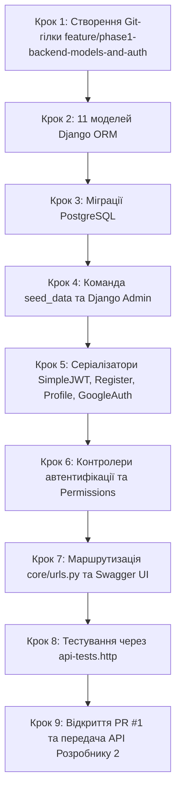

# Інструкція для Розробника №1: Backend & DevOps Lead
## Фаза 1: 11 моделей Django ORM, Міграції PostgreSQL, Сідер seed_data, SimpleJWT та Автентифікація API

---

> **Паспорт ролі:**
> - **Спеціалізація:** Backend Developer & DevOps Lead
> - **Стек:** Python 3.11+, Django 5+, Django ORM, PostgreSQL 16, SimpleJWT, DRF, drf-spectacular (OpenAPI 3), Google OAuth API, Django Admin, Management Commands
> - **Термін виконання:** Тиждень 1–2 (Фаза 1)
> - **Головний результат:** Повна реалізація 11 сутностей бази даних у Django ORM згідно з архітектурною схемою, генерація та застосування міграцій у PostgreSQL 16, автоматичний сідер даних (`python manage.py seed_data`) із тестовими містами, зручностями та об'єктами; повнофункціональний модуль реєстрації, автентифікації та профілів користувачів (`POST /api/auth/register/`, `POST /api/auth/token/`, `POST /api/auth/google/`, `GET /api/users/profile/`); інтерактивна документація в Swagger UI та набір `.http` тестів; створення та злиття PR №1 у `main`.

---

## 1. Мета та очікувані артефакти Фази 1

У команді з двох розробників ви об'єднуєте проєктування бази даних та бізнес-логіку API. Це дає величезну перевагу: моделі, серіалізатори та ендпоінти створюються в одному узгодженому ланцюжку без ризику невідповідності полів чи конфліктів у Git.

### 📦 Результати (Deliverables) Розробника №1:
1. **11 моделей Django ORM** із первинними ключами `UUIDField(default=uuid.uuid4)`:
   - `apps/users/models.py`: `User` (розширення `AbstractUser` з ролями та `email` як логіном).
   - `apps/properties/models.py`: `Location`, `Amenity`, `Property`, `PropertyImage`, `Property3DImage`.
   - `apps/bookings/models.py`: `Booking` з індексами для швидкого пошуку зайнятих дат.
   - `apps/reviews/models.py`: `Review` (оцінка 1–10) та `Favorite` (обрані помешкання).
2. Налаштування `AUTH_USER_MODEL = 'users.User'` у `backend/core/settings.py`.
3. Успішно створені та застосовані міграції у PostgreSQL 16.
4. Django Management Command `python manage.py seed_data`, яка автоматично наповнює базу 6 містами, 10 зручностями, 3 тестовими акаунтами та 2 помешканнями з 3D-бейдж.
5. Налаштування `admin.py` для всіх моделей у панелі керування Django Admin.
6. Модуль автентифікації SimpleJWT:
   - `POST /api/auth/register/` — реєстрація з хешуванням пароля та валідацією.
   - `POST /api/auth/token/` — вхід із поверненням JWT-пари та DTO користувача (`id`, `email`, `role`, `first_name`, `last_name`).
   - `POST /api/auth/token/refresh/` — оновлення access-токена.
   - `POST /api/auth/google/` — верифікація Google ID token та видача JWT.
   - `GET /api/users/profile/` та `PATCH /api/users/profile/` — захищений профіль.
7. Дозволи DRF (`IsOwnerOrReadOnly`, `IsPropertyOwner`, `IsAdminRole`).
8. Оновлена схема OpenAPI 3 у Swagger UI (`/api/docs/`) та успішно пройдені тести з `docs/phase-1/api-tests.http`.
9. Оновлення `.env.example` та передача `GOOGLE_CLIENT_ID` Розробнику №2.
10. Відкриття та злиття PR №1 у `main`.

---

## 2. Необхідні передумови

- Фаза 0 завершена: контейнери `booking_postgres` та `booking_backend` підняті через `docker compose up -d`.
- Ендпоінт `GET /api/health/` повертає `status: "ok"`.

---

## 3. Покроковий план реалізації



---

### Крок 1. Підготовка робочої гілки в Git

```bash
cd /home/skmelyuk/Documents/projects/Booking
git checkout main
git pull origin main
git checkout -b feature/phase1-backend-models-and-auth
```

---

### Крок 2. Реалізація 11 моделей Django ORM

#### 2.1. Модель користувача `User` (`backend/apps/users/models.py`):
```python
import uuid
from django.db import models
from django.contrib.auth.models import AbstractUser

class User(AbstractUser):
    """
    Кастомна модель користувача платформи Booking 3D.
    Логіном є email.
    """
    class Role(models.TextChoices):
        GUEST = 'GUEST', 'Гість'
        USER = 'USER', 'Зареєстрований користувач'
        OWNER = 'OWNER', 'Власник житла'
        ADMIN = 'ADMIN', 'Адміністратор платформи'

    id = models.UUIDField(primary_key=True, default=uuid.uuid4, editable=False)
    email = models.EmailField(unique=True, verbose_name="Email адреса")
    phone = models.CharField(max_length=30, blank=True, null=True, verbose_name="Номер телефону")
    role = models.CharField(
        max_length=20,
        choices=Role.choices,
        default=Role.USER,
        verbose_name="Роль у системі"
    )
    avatar = models.ImageField(upload_to='avatars/', blank=True, null=True, verbose_name="Аватар")
    created_at = models.DateTimeField(auto_now_add=True, verbose_name="Дата реєстрації")

    USERNAME_FIELD = 'email'
    REQUIRED_FIELDS = ['username', 'first_name', 'last_name']

    class Meta:
        db_table = 'users'
        verbose_name = 'Користувач'
        verbose_name_plural = 'Користувачі'

    def __str__(self):
        return f"{self.email} ({self.get_role_display()})"
```

Переконайтеся, що в `backend/core/settings.py` вказано:
```python
AUTH_USER_MODEL = 'users.User'
```

#### 2.2. Моделі нерухомості та 3D-рендерів (`backend/apps/properties/models.py`):
```python
import uuid
from django.db import models
from django.conf import settings

class Location(models.Model):
    id = models.UUIDField(primary_key=True, default=uuid.uuid4, editable=False)
    country = models.CharField(max_length=100, default='Україна')
    city = models.CharField(max_length=100, db_index=True)
    address = models.CharField(max_length=255)
    latitude = models.DecimalField(max_digits=9, decimal_places=6, null=True, blank=True)
    longitude = models.DecimalField(max_digits=9, decimal_places=6, null=True, blank=True)

    class Meta:
        db_table = 'locations'
        verbose_name = 'Локація'
        verbose_name_plural = 'Локації'

    def __str__(self):
        return f"{self.city}, {self.address}"

class Amenity(models.Model):
    id = models.UUIDField(primary_key=True, default=uuid.uuid4, editable=False)
    name = models.CharField(max_length=100, unique=True)
    icon = models.CharField(max_length=50, blank=True, help_text="Lucide icon name")

    class Meta:
        db_table = 'amenities'
        verbose_name = 'Зручність'
        verbose_name_plural = 'Зручності'

    def __str__(self):
        return self.name

class Property(models.Model):
    class PropertyType(models.TextChoices):
        APARTMENT = 'APARTMENT', 'Апартаменти'
        HOTEL = 'HOTEL', 'Готельний номер'
        VILLA = 'VILLA', 'Вілла / Котедж'
        HOSTEL = 'HOSTEL', 'Хостел'

    id = models.UUIDField(primary_key=True, default=uuid.uuid4, editable=False)
    owner = models.ForeignKey(settings.AUTH_USER_MODEL, on_delete=models.CASCADE, related_name='properties')
    location = models.ForeignKey(Location, on_delete=models.PROTECT, related_name='properties')
    title = models.CharField(max_length=200, db_index=True)
    description = models.TextField()
    property_type = models.CharField(max_length=20, choices=PropertyType.choices, default=PropertyType.APARTMENT)
    price_per_night = models.DecimalField(max_digits=10, decimal_places=2, db_index=True)
    max_guests = models.PositiveSmallIntegerField(default=2)
    bedrooms = models.PositiveSmallIntegerField(default=1)
    bathrooms = models.PositiveSmallIntegerField(default=1)
    has_3d_tour = models.BooleanField(default=False, db_index=True, help_text="Бейдж наявності 3D туру")
    is_active = models.BooleanField(default=True)
    rating = models.DecimalField(max_digits=3, decimal_places=2, default=0.0)
    reviews_count = models.PositiveIntegerField(default=0)
    amenities = models.ManyToManyField(Amenity, related_name='properties', blank=True)
    created_at = models.DateTimeField(auto_now_add=True)
    updated_at = models.DateTimeField(auto_now=True)

    class Meta:
        db_table = 'properties'
        verbose_name = 'Помешкання'
        verbose_name_plural = 'Помешкання'
        ordering = ['-created_at']

    def __str__(self):
        return f"{self.title} ({self.location.city})"

class PropertyImage(models.Model):
    id = models.UUIDField(primary_key=True, default=uuid.uuid4, editable=False)
    property = models.ForeignKey(Property, on_delete=models.CASCADE, related_name='images')
    image = models.ImageField(upload_to='properties/photos/')
    is_cover = models.BooleanField(default=False)
    order = models.PositiveSmallIntegerField(default=0)

    class Meta:
        db_table = 'property_images'
        ordering = ['order']

class Property3DImage(models.Model):
    class RoomType(models.TextChoices):
        LIVING_ROOM = 'LIVING_ROOM', 'Вітальня'
        BEDROOM = 'BEDROOM', 'Спальня'
        KITCHEN = 'KITCHEN', 'Кухня'
        BATHROOM = 'BATHROOM', 'Ванна кімната'
        TERRACE = 'TERRACE', 'Тераса'

    id = models.UUIDField(primary_key=True, default=uuid.uuid4, editable=False)
    property = models.ForeignKey(Property, on_delete=models.CASCADE, related_name='images_3d')
    room_type = models.CharField(max_length=30, choices=RoomType.choices, default=RoomType.LIVING_ROOM)
    angle_name = models.CharField(max_length=100, help_text="Наприклад: Ракурс від входу, Панорама ліжка")
    image_webp = models.ImageField(upload_to='properties/3d_renders/', help_text="Оптимізований WebP-рендер з 3ds Max")
    camera_fov = models.PositiveSmallIntegerField(default=75)
    order = models.PositiveSmallIntegerField(default=0)

    class Meta:
        db_table = 'property_3d_images'
        ordering = ['order']
```

#### 2.3. Моделі бронювань (`backend/apps/bookings/models.py`):
```python
import uuid
from django.db import models
from django.conf import settings
from apps.properties.models import Property

class Booking(models.Model):
    class Status(models.TextChoices):
        PENDING = 'PENDING', 'Очікує підтвердження'
        CONFIRMED = 'CONFIRMED', 'Підтверджено'
        CANCELLED = 'CANCELLED', 'Скасовано'
        COMPLETED = 'COMPLETED', 'Завершено'

    id = models.UUIDField(primary_key=True, default=uuid.uuid4, editable=False)
    user = models.ForeignKey(settings.AUTH_USER_MODEL, on_delete=models.CASCADE, related_name='bookings')
    property = models.ForeignKey(Property, on_delete=models.PROTECT, related_name='bookings')
    check_in = models.DateField(db_index=True)
    check_out = models.DateField(db_index=True)
    guests_count = models.PositiveSmallIntegerField(default=1)
    total_price = models.DecimalField(max_digits=10, decimal_places=2)
    status = models.CharField(max_length=20, choices=Status.choices, default=Status.PENDING)
    created_at = models.DateTimeField(auto_now_add=True)

    class Meta:
        db_table = 'bookings'
        indexes = [
            models.Index(fields=['property', 'check_in', 'check_out']),
        ]
```

#### 2.4. Моделі відгуків та обраного (`backend/apps/reviews/models.py`):
```python
import uuid
from django.db import models
from django.conf import settings
from apps.properties.models import Property

class Review(models.Model):
    id = models.UUIDField(primary_key=True, default=uuid.uuid4, editable=False)
    user = models.ForeignKey(settings.AUTH_USER_MODEL, on_delete=models.CASCADE, related_name='reviews')
    property = models.ForeignKey(Property, on_delete=models.CASCADE, related_name='reviews')
    rating = models.PositiveSmallIntegerField(help_text="Оцінка від 1 до 10")
    comment = models.TextField()
    created_at = models.DateTimeField(auto_now_add=True)

    class Meta:
        db_table = 'reviews'
        unique_together = ('user', 'property')

class Favorite(models.Model):
    id = models.UUIDField(primary_key=True, default=uuid.uuid4, editable=False)
    user = models.ForeignKey(settings.AUTH_USER_MODEL, on_delete=models.CASCADE, related_name='favorites')
    property = models.ForeignKey(Property, on_delete=models.CASCADE, related_name='favorited_by')
    created_at = models.DateTimeField(auto_now_add=True)

    class Meta:
        db_table = 'favorites'
        unique_together = ('user', 'property')
```

---

### Крок 3. Генерація та застосування міграцій

У корені проєкту запустіть міграції через Docker:

```bash
docker compose exec backend python manage.py makemigrations users properties bookings reviews
docker compose exec backend python manage.py migrate
```

---

### Крок 4. Сідер тестових даних (`seed_data`) та Django Admin

1. **Створіть команду `seed_data`**:
   Створіть файл `backend/apps/properties/management/commands/seed_data.py`:
   ```python
   from django.core.management.base import BaseCommand
   from django.contrib.auth import get_user_model
   from apps.properties.models import Location, Amenity, Property
   from decimal import Decimal

   User = get_user_model()

   class Command(BaseCommand):
       help = 'Наповнює базу тестовими містами, зручностями, акаунтами та помешканнями'

       def handle(self, *args, **kwargs):
           self.stdout.write("Початок наповнення бази даних...")

           # 1. Тестові акаунти
           admin, _ = User.objects.get_or_create(
               email='admin@booking3d.com',
               defaults={'username': 'admin', 'role': 'ADMIN', 'is_staff': True, 'is_superuser': True}
           )
           admin.set_password('admin12345')
           admin.save()

           owner, _ = User.objects.get_or_create(
               email='owner@booking3d.com',
               defaults={'username': 'owner', 'first_name': 'Олена', 'last_name': 'Петренко', 'role': 'OWNER'}
           )
           owner.set_password('owner12345')
           owner.save()

           guest, _ = User.objects.get_or_create(
               email='guest@booking3d.com',
               defaults={'username': 'guest', 'first_name': 'Тарас', 'last_name': 'Шевченко', 'role': 'USER'}
           )
           guest.set_password('guest12345')
           guest.save()

           # 2. Локації
           locations = [
               Location.objects.get_or_create(city='Київ', address='вул. Хрещатик, 22', latitude=50.4501, longitude=30.5234)[0],
               Location.objects.get_or_create(city='Львів', address='площа Ринок, 10', latitude=49.8429, longitude=24.0311)[0],
               Location.objects.get_or_create(city='Одеса', address='вул. Дерибасівська, 1', latitude=46.4825, longitude=30.7233)[0],
               Location.objects.get_or_create(city='Буковель', address='урочище Вишні, 15', latitude=48.3541, longitude=24.4128)[0],
               Location.objects.get_or_create(city='Яремче', address='вул. Свободи, 45', latitude=48.4594, longitude=24.5566)[0],
               Location.objects.get_or_create(city='Івано-Франківськ', address='вул. Шевченка, 12', latitude=48.9226, longitude=24.7111)[0],
           ]

           # 3. Зручності
           amenities_data = [
               ('Wi-Fi', 'Wifi'), ('Кондиціонер', 'AirVent'), ('Кухня', 'Utensils'),
               ('Парковка', 'Car'), ('3D Тур інтер\'єру', 'Box'), ('Балкон / Тераса', 'Sun'),
               ('Басейн', 'Waves'), ('Джакузі', 'Bath'), ('Дозволено з тваринами', 'PawPrint'),
               ('Робоче місце', 'Laptop')
           ]
           amenities = [Amenity.objects.get_or_create(name=name, icon=icon)[0] for name, icon in amenities_data]

           # 4. Тестові помешкання
           prop1, _ = Property.objects.get_or_create(
               title='Сучасна 3D Studio в центрі Львова',
               owner=owner,
               location=locations[1],
               defaults={
                   'description': 'Затишні світлі апартаменти біля ратуші. Перегляньте повний 3D-тур!',
                   'property_type': 'APARTMENT',
                   'price_per_night': Decimal('1650.00'),
                   'max_guests': 2,
                   'bedrooms': 1,
                   'bathrooms': 1,
                   'has_3d_tour': True,
                   'rating': Decimal('9.6'),
                   'reviews_count': 18
               }
           )
           prop1.amenities.set(amenities[:5])

           prop2, _ = Property.objects.get_or_create(
               title='Панорамний люкс з терасою біля Хрещатика',
               owner=owner,
               location=locations[0],
               defaults={
                   'description': 'Ексклюзивний номер готелю з видом на вечірній Київ та 3D-моделлю спальні.',
                   'property_type': 'HOTEL',
                   'price_per_night': Decimal('2800.00'),
                   'max_guests': 4,
                   'bedrooms': 2,
                   'bathrooms': 2,
                   'has_3d_tour': True,
                   'rating': Decimal('9.8'),
                   'reviews_count': 42
               }
           )
           prop2.amenities.set(amenities)

           self.stdout.write(self.style.SUCCESS("Базу даних успішно наповнено!"))
   ```

2. **Виконайте сідер**:
   ```bash
   docker compose exec backend python manage.py seed_data
   ```

3. **Зареєструйте моделі в Django Admin (`backend/apps/properties/admin.py`)**:
   ```python
   from django.contrib import admin
   from .models import Location, Amenity, Property, PropertyImage, Property3DImage

   class PropertyImageInline(admin.TabularInline):
       model = PropertyImage
       extra = 1

   class Property3DImageInline(admin.TabularInline):
       model = Property3DImage
       extra = 1

   @admin.register(Property)
   class PropertyAdmin(admin.ModelAdmin):
       list_display = ('title', 'location', 'price_per_night', 'property_type', 'has_3d_tour', 'rating')
       list_filter = ('has_3d_tour', 'property_type', 'location__city')
       search_fields = ('title', 'location__city')
       inlines = [PropertyImageInline, Property3DImageInline]

   admin.site.register(Location)
   admin.site.register(Amenity)
   ```

---

### Крок 5. Серіалізатори SimpleJWT, реєстрації та профілю

Створіть `backend/apps/users/serializers.py`:

```python
from rest_framework import serializers
from django.contrib.auth import get_user_model
from django.contrib.auth.password_validation import validate_password
from rest_framework_simplejwt.serializers import TokenObtainPairSerializer

User = get_user_model()

class UserRegisterSerializer(serializers.ModelSerializer):
    password = serializers.CharField(write_only=True, required=True, validators=[validate_password])
    password_confirm = serializers.CharField(write_only=True, required=True)

    class Meta:
        model = User
        fields = ('id', 'email', 'first_name', 'last_name', 'phone', 'role', 'password', 'password_confirm')
        read_only_fields = ('id',)

    def validate(self, attrs):
        if attrs['password'] != attrs['password_confirm']:
            raise serializers.ValidationError({"password": "Паролі не співпадають."})
        return attrs

    def create(self, validated_data):
        validated_data.pop('password_confirm')
        user = User.objects.create_user(
            username=validated_data['email'],
            email=validated_data['email'],
            password=validated_data['password'],
            first_name=validated_data.get('first_name', ''),
            last_name=validated_data.get('last_name', ''),
            phone=validated_data.get('phone', ''),
            role=validated_data.get('role', User.Role.USER)
        )
        return user

class CustomTokenObtainPairSerializer(TokenObtainPairSerializer):
    """Розширення SimpleJWT: повертає токени разом із профілем користувача"""
    def validate(self, attrs):
        data = super().validate(attrs)
        data['user'] = {
            'id': str(self.user.id),
            'email': self.user.email,
            'first_name': self.user.first_name,
            'last_name': self.user.last_name,
            'role': self.user.role,
            'avatar': self.user.avatar.url if self.user.avatar else None
        }
        return data

class UserProfileSerializer(serializers.ModelSerializer):
    class Meta:
        model = User
        fields = ('id', 'email', 'first_name', 'last_name', 'phone', 'role', 'avatar', 'created_at')
        read_only_fields = ('id', 'email', 'role', 'created_at')

class GoogleAuthSerializer(serializers.Serializer):
    id_token = serializers.CharField(required=True, help_text="Google OAuth ID Token від клієнта")
```

---

### Крок 6. Контролери (Views) та класи дозволів (Permissions)

1. **Створіть `backend/apps/users/permissions.py`**:
   ```python
   from rest_framework import permissions

   class IsOwnerOrReadOnly(permissions.BasePermission):
       def has_object_permission(self, request, view, obj):
           if request.method in permissions.SAFE_METHODS:
               return True
           return obj.user == request.user or request.user.role == 'ADMIN'

   class IsPropertyOwner(permissions.BasePermission):
       def has_permission(self, request, view):
           return request.user.is_authenticated and request.user.role in ['OWNER', 'ADMIN']
   ```

2. **Створіть `backend/apps/users/views.py`**:
   ```python
   import os
   from rest_framework import generics, status
   from rest_framework.views import APIView
   from rest_framework.response import Response
   from rest_framework.permissions import AllowAny, IsAuthenticated
   from rest_framework_simplejwt.views import TokenObtainPairView
   from rest_framework_simplejwt.tokens import RefreshToken
   from drf_spectacular.utils import extend_schema
   from django.contrib.auth import get_user_model
   import urllib.request
   import json

   from .serializers import (
       UserRegisterSerializer,
       CustomTokenObtainPairSerializer,
       UserProfileSerializer,
       GoogleAuthSerializer
   )

   User = get_user_model()

   class RegisterView(generics.CreateAPIView):
       queryset = User.objects.all()
       permission_classes = (AllowAny,)
       serializer_class = UserRegisterSerializer

       @extend_schema(summary="Реєстрація користувача", description="Створює нового користувача (гостя або власника)")
       def post(self, request, *args, **kwargs):
           return super().post(request, *args, **kwargs)

   class CustomTokenObtainPairView(TokenObtainPairView):
       serializer_class = CustomTokenObtainPairSerializer

       @extend_schema(summary="Вхід (Отримання JWT)", description="Повертає пару access/refresh токенів та об'єкт користувача")
       def post(self, request, *args, **kwargs):
           return super().post(request, *args, **kwargs)

   class UserProfileView(generics.RetrieveUpdateAPIView):
       permission_classes = (IsAuthenticated,)
       serializer_class = UserProfileSerializer

       @extend_schema(summary="Отримати свій профіль")
       def get_object(self):
           return self.request.user

   class GoogleAuthView(APIView):
       permission_classes = (AllowAny,)
       serializer_class = GoogleAuthSerializer

       @extend_schema(summary="Вхід / Реєстрація через Google", request=GoogleAuthSerializer)
       def post(self, request):
           serializer = self.serializer_class(data=request.data)
           serializer.is_valid(raise_exception=True)
           id_token_str = serializer.validated_data['id_token']

           try:
               # Верифікація токена через Google OAuth endpoint
               req = urllib.request.Request(f"https://oauth2.googleapis.com/tokeninfo?id_token={id_token_str}")
               with urllib.request.urlopen(req) as resp:
                   idinfo = json.loads(resp.read().decode('utf-8'))

               email = idinfo.get('email')
               first_name = idinfo.get('given_name', '')
               last_name = idinfo.get('family_name', '')

               user, created = User.objects.get_or_create(
                   email=email,
                   defaults={
                       'username': email,
                       'first_name': first_name,
                       'last_name': last_name,
                       'role': User.Role.USER
                   }
               )

               refresh = RefreshToken.for_user(user)
               return Response({
                   'access': str(refresh.access_token),
                   'refresh': str(refresh),
                   'user': {
                       'id': str(user.id),
                       'email': user.email,
                       'first_name': user.first_name,
                       'last_name': user.last_name,
                       'role': user.role
                   },
                   'is_new_user': created
               }, status=status.HTTP_200_OK)
           except Exception as e:
               return Response({"error": f"Invalid Google token: {str(e)}"}, status=status.HTTP_400_BAD_REQUEST)
   ```

---

### Крок 7. Маршрутизація `urls.py`

1. **Створіть `backend/apps/users/urls.py`**:
   ```python
   from django.urls import path
   from rest_framework_simplejwt.views import TokenRefreshView
   from .views import (
       RegisterView,
       CustomTokenObtainPairView,
       GoogleAuthView,
       UserProfileView
   )

   urlpatterns = [
       path('auth/register/', RegisterView.as_view(), name='auth-register'),
       path('auth/token/', CustomTokenObtainPairView.as_view(), name='auth-token'),
       path('auth/token/refresh/', TokenRefreshView.as_view(), name='auth-token-refresh'),
       path('auth/google/', GoogleAuthView.as_view(), name='auth-google'),
       path('users/profile/', UserProfileView.as_view(), name='user-profile'),
   ]
   ```

2. **Підключіть у `backend/core/urls.py`**:
   ```python
   from django.contrib import admin
   from django.urls import path, include
   from django.conf import settings
   from django.conf.urls.static import static
   from drf_spectacular.views import SpectacularAPIView, SpectacularSwaggerView
   from core.views import HealthCheckView

   urlpatterns = [
       path('admin/', admin.site.urls),
       path('api/health/', HealthCheckView.as_view(), name='api-health'),
       path('api/', include('apps.users.urls')),
       path('api/schema/', SpectacularAPIView.as_view(), name='schema'),
       path('api/docs/', SpectacularSwaggerView.as_view(url_name='schema'), name='swagger-ui'),
   ]

   if settings.DEBUG:
       urlpatterns += static(settings.MEDIA_URL, document_root=settings.MEDIA_ROOT)
   ```

---

### Крок 8. Smoke Test через Swagger UI та `api-tests.http`

1. Відкрийте `http://localhost:8000/api/docs/`:
   - Переконайтеся, що всі 5 ендпоінтів авторизації відображаються у Swagger UI.
2. Протестуйте ендпоінти за допомогою готового файлу [`docs/phase-1/api-tests.http`](api-tests.http) у VS Code.

---

### Крок 9. Відкриття Pull Request №1 та передача API Розробнику №2

1. **Зафіксуйте зміни у Git та запушіть**:
   ```bash
   git add .
   git commit -m "feat(backend): 11 ORM models, seed_data, and SimpleJWT authentication API"
   git push -u origin feature/phase1-backend-models-and-auth
   ```
2. **Створіть Pull Request №1 на GitHub**:
   - Призначте Розробника №2 рев'юером.
   - Після погодження злийте PR у `main`.
3. **Повідомте Розробника №2**, що `main` готовий до інтеграції фронтенду.
