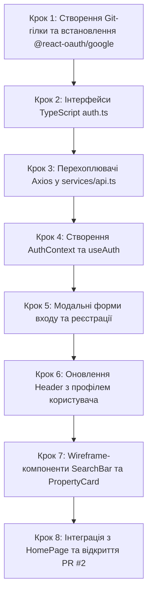

# Інструкція для Розробника №2: Frontend Lead
## Фаза 1: Модуль автентифікації (AuthContext), Модалки входу/реєстрації та Wireframe-каркаси

---

> **Паспорт ролі:**
> - **Спеціалізація:** Frontend Lead / Client Application Developer
> - **Стек:** React 18, TypeScript, Tailwind CSS, Lucide React, Axios (Interceptors), `@react-oauth/google`, React Router v6, Context API
> - **Термін виконання:** Тиждень 1–2 (Фаза 1)
> - **Головний результат:** Повна клієнтська система автентифікації (збереження JWT у localStorage, автоматичне додавання заголовка Bearer через Axios, модальні вікна реєстрації та входу, оновлена шапка з профілем), а також чорнова Wireframe-верстка головних компонентів сайту: пошуковий рядок (`SearchBar`), картка помешкання з бейджем 3D-туру (`PropertyCard`) та адаптивна сітка (`PropertyGrid`); створення PR №2 та спільне тестування.

---

## 1. Мета та очікувані артефакти Фази 1

У Фазі 1 ви підключаєте клієнтський інтерфейс до готового REST API Розробника №1 (Backend) та закладаєте візуальний каркас головних компонентів за чорно-білими **Wireframes** від UX-дизайнера (Дизайнер №2).

### 📦 Результати (Deliverables) Розробника №2:
1. Контекст авторизації `AuthContext` та кастомний хук `useAuth`: методи `login`, `register`, `googleLogin`, `logout`, стан `user` та `isAuthenticated`.
2. Налаштування перехоплювачів Axios (`api.ts`): автоматична підстановка `Authorization: Bearer <token>` та обробка 401 помилок.
3. Інтерактивні форми авторизації `LoginForm` та реєстрації `RegisterForm` (модальне вікно `AuthModal` з Google Sign-In).
4. Оновлений `Header`: відображення кнопок "Увійти" / "Реєстрація" для гостей або імені користувача, бейджа ролі та кнопки "Вийти" для авторизованих осіб.
5. Wireframe-компоненти:
   - `SearchBar`: вибір міста, дат заїзду/виїзду та кількості гостей.
   - `PropertyCard`: картка житла з бейджем **"3D Тур"**, фото, ціною за ніч та рейтингом.
   - `PropertyGrid`: адаптивна сітка зі станом завантаження (скелетони).
6. Оновлена головна сторінка `HomePage` з робочим каталогом.
7. Відкриття та злиття PR №2 у `main` після тестування з бекендом.

---

## 2. Необхідні передумови

- Фаза 0 завершена: проєкт у `frontend/` запускається командою `npm run dev`.
- Розробник №1 завершив та злив PR №1 у `main` (доступні ендпоінти `/api/auth/register/`, `/api/auth/token/`, `/api/auth/google/`).

---

## 3. Покроковий план реалізації



---

### Крок 1. Підготовка робочої гілки в Git та встановлення бібліотек

```bash
cd /home/skmelyuk/Documents/projects/Booking
git checkout main
git pull origin main
git checkout -b feature/phase1-frontend-auth-and-wireframes

cd frontend
npm install @react-oauth/google
```

Переконайтеся, що у `frontend/.env.development` додано:
```env
VITE_API_URL=http://localhost:8000/api
VITE_GOOGLE_CLIENT_ID=your-google-client-id.apps.googleusercontent.com
```

---

### Крок 2. Інтерфейси TypeScript (`src/types/auth.ts`)

Створіть `frontend/src/types/auth.ts`:

```typescript
export type UserRole = 'GUEST' | 'USER' | 'OWNER' | 'ADMIN';

export interface User {
  id: string;
  email: string;
  first_name: string;
  last_name: string;
  role: UserRole;
  phone?: string;
  avatar?: string;
}

export interface AuthResponse {
  access: string;
  refresh: string;
  user: User;
  is_new_user?: boolean;
}

export interface RegisterPayload {
  email: string;
  password: string;
  password_confirm: string;
  first_name: string;
  last_name: string;
  role?: UserRole;
}
```

---

### Крок 3. Налаштування перехоплювачів Axios (`src/services/api.ts`)

Оновіть `frontend/src/services/api.ts`:

```typescript
import axios from 'axios';
import { AuthResponse, RegisterPayload } from '../types/auth';

const API_BASE_URL = import.meta.env.VITE_API_URL || 'http://localhost:8000/api';

export const api = axios.create({
  baseURL: API_BASE_URL,
  headers: {
    'Content-Type': 'application/json',
  },
});

// Автоматичне підставлення токена
api.interceptors.request.use((config) => {
  const token = localStorage.getItem('access_token');
  if (token && config.headers) {
    config.headers.Authorization = `Bearer ${token}`;
  }
  return config;
});

// Обробка 401 помилок (скидання токена)
api.interceptors.response.use(
  (response) => response,
  (error) => {
    if (error.response?.status === 401) {
      localStorage.removeItem('access_token');
      localStorage.removeItem('refresh_token');
      localStorage.removeItem('user_data');
    }
    return Promise.reject(error);
  }
);

export const authService = {
  login: async (email: string, password: string): Promise<AuthResponse> => {
    const response = await api.post<AuthResponse>('/auth/token/', { email, password });
    return response.data;
  },
  register: async (data: RegisterPayload): Promise<User> => {
    const response = await api.post<User>('/auth/register/', data);
    return response.data;
  },
  googleLogin: async (idToken: string): Promise<AuthResponse> => {
    const response = await api.post<AuthResponse>('/auth/google/', { id_token: idToken });
    return response.data;
  },
  getProfile: async (): Promise<User> => {
    const response = await api.get<User>('/users/profile/');
    return response.data;
  },
};
```

---

### Крок 4. Створення `AuthContext` та хука `useAuth`

Створіть `frontend/src/context/AuthContext.tsx`:

```tsx
import React, { createContext, useContext, useState, useEffect } from 'react';
import { User, AuthResponse, RegisterPayload } from '../types/auth';
import { authService } from '../services/api';

interface AuthContextType {
  user: User | null;
  isAuthenticated: boolean;
  login: (email: string, password: string) => Promise<void>;
  register: (data: RegisterPayload) => Promise<void>;
  googleLogin: (idToken: string) => Promise<void>;
  logout: () => void;
}

const AuthContext = createContext<AuthContextType | undefined>(undefined);

export const AuthProvider: React.FC<{ children: React.ReactNode }> = ({ children }) => {
  const [user, setUser] = useState<User | null>(() => {
    const saved = localStorage.getItem('user_data');
    return saved ? JSON.parse(saved) : null;
  });

  const saveAuthSession = (data: AuthResponse) => {
    localStorage.setItem('access_token', data.access);
    localStorage.setItem('refresh_token', data.refresh);
    localStorage.setItem('user_data', JSON.stringify(data.user));
    setUser(data.user);
  };

  const login = async (email: string, password: string) => {
    const data = await authService.login(email, password);
    saveAuthSession(data);
  };

  const register = async (payload: RegisterPayload) => {
    await authService.register(payload);
    await login(payload.email, payload.password);
  };

  const googleLogin = async (idToken: string) => {
    const data = await authService.googleLogin(idToken);
    saveAuthSession(data);
  };

  const logout = () => {
    localStorage.removeItem('access_token');
    localStorage.removeItem('refresh_token');
    localStorage.removeItem('user_data');
    setUser(null);
  };

  return (
    <AuthContext.Provider value={{ user, isAuthenticated: !!user, login, register, googleLogin, logout }}>
      {children}
    </AuthContext.Provider>
  );
};

export const useAuth = () => {
  const context = useContext(AuthContext);
  if (!context) throw new Error('useAuth must be used within an AuthProvider');
  return context;
};
```

---

### Крок 5. Модальне вікно авторизації (`AuthModal.tsx`)

Створіть `frontend/src/components/auth/AuthModal.tsx` із вкладками Входу, Реєстрації та кнопкою Google Sign-In через `@react-oauth/google`.

---

### Крок 6. Оновлення `Header.tsx` з профілем користувача

Оновіть `frontend/src/components/layout/Header.tsx`, щоб він відображав:
- Якщо `!isAuthenticated`: кнопки "Зареєструватися" та "Увійти" (відкривають `AuthModal`).
- Якщо `isAuthenticated`: ім'я, прізвище, бейдж ролі (`GUEST`, `USER`, `OWNER`, `ADMIN`) та кнопку "Вийти".

---

### Крок 7. Чорнові Wireframe-компоненти (Tailwind)

Створіть компоненти згідно з чорно-білими макетами UX-дизайнера:

1. **`SearchBar.tsx` (`frontend/src/components/home/SearchBar.tsx`)**:
   - Поле вибору міста / локації.
   - Вибір дати заїзду та виїзду.
   - Вибір кількості дорослих та дітей.
   - Жовта кнопка пошуку Booking (`bg-booking-yellow`).

2. **`PropertyCard.tsx` (`frontend/src/components/property/PropertyCard.tsx`)**:
   - Зображення помешкання з фірмовим бейджем **"3D Тур"** (`bg-booking-badge3d-light text-booking-badge3d`).
   - Назва об'єкта, локація (місто).
   - Ціна за ніч (`грн`).
   - Оцінка рейтингу (наприклад, `9.6`).

3. **`PropertyGrid.tsx` (`frontend/src/components/property/PropertyGrid.tsx`)**:
   - Адаптивна сітка `grid grid-cols-1 md:grid-cols-2 lg:grid-cols-3 gap-6`.

---

### Крок 8. Інтеграція, Smoke Test та створення PR №2

1. Оновіть `frontend/src/pages/HomePage.tsx`, вставивши `SearchBar` та `PropertyGrid`.
2. Запустіть проєкт (`npm run dev`) та переконайтеся у відсутності помилок TypeScript.
3. Протестуйте зв'язок з бекендом Розробника №1:
   - Зареєструйте нового користувача через форму.
   - Перевірте вхід та збереження сесії при оновленні сторінки (F5).
4. Зафіксуйте зміни у Git та відкрийте PR №2:
   ```bash
   git add .
   git commit -m "feat(frontend): AuthContext, AuthModal with Google OAuth, and Wireframe components"
   git push -u origin feature/phase1-frontend-auth-and-wireframes
   ```
5. Розробник №1 перевіряє PR №2 і зливає його в `main`.
