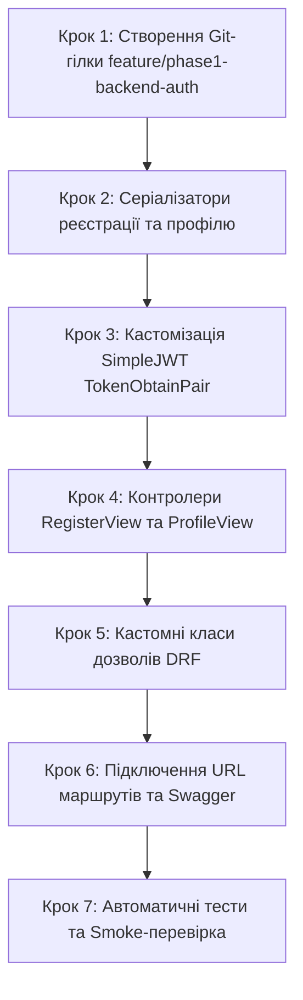

# Інструкція для Студента №1: Backend Core & API
## Фаза 1: Модуль аутентифікації, JWT (SimpleJWT), Серіалізатори користувачів та Дозволи DRF

---

> **Паспорт ролі:**
> - **Спеціалізація:** Backend Developer (Core API & Authentication)
> - **Стек:** Python 3.11+, Django 5+, Django REST Framework (DRF), SimpleJWT, drf-spectacular (OpenAPI 3), bcrypt / PBKDF2
> - **Термін виконання:** Тиждень 1–2 (Фаза 1)
> - **Головний результат:** Повнофункціональний модуль реєстрації, автентифікації та профілів користувачів (`/api/auth/` та `/api/users/profile/`), кастомізовані JWT токени з ролями користувача, захищені ендпоінти, кастомні дозволи (Permissions) та інтерактивна документація в Swagger UI.

---

## 1. Мета та очікувані артефакти Фази 1

У Фазі 1 ви реалізуєте безпечний шар автентифікації користувачів платформи Booking.com 3D. Ваша робота базується на моделі `User`, створеній Студентом №2 у додатку `apps.users`. Ви маєте надати зручний та захищений інтерфейс для Студента №3 (Frontend), щоб користувачі могли реєструватися (як звичайні гості `USER` або як власники помешкань `OWNER`), отримувати пару Access/Refresh токенів та редагувати свій профіль.

### 📦 Результати (Deliverables) Студента №1:
1. Ендпоінт реєстрації `POST /api/auth/register/` з повною валідацією email, складності пароля та автоматичним хешуванням.
2. Кастомізований ендпоінт входу `POST /api/auth/token/`, що повертає не лише JWT-токени, а й дані користувача (`id`, `email`, `first_name`, `last_name`, `role`).
3. Ендпоінт оновлення токена `POST /api/auth/token/refresh/`.
4. Ендпоінти особистого профілю `GET /api/users/profile/` та `PUT/PATCH /api/users/profile/`.
5. Класи кастомних дозволів DRF: `IsOwnerOrReadOnly`, `IsPropertyOwner`, `IsAdminRole`.
6. Повна OpenAPI 3 / Swagger документація всіх створених методів з прикладами відповідей.

---

## 2. Необхідні передумови

Перед початком виконання переконайтеся, що:
- **Фаза 0 успішно завершена**: контейнери `db` (PostgreSQL 16) та `backend` (Django 5) підняті.
- **Студент №2 створив модель `User`**: у додатку `apps.users.models` є клас `User(AbstractUser)` з полями `email`, `role`, `phone`, `avatar` (див. інструкцію Студента №2).
- Ваша робоча гілка синхронізована з актуальним `main`.

---

## 3. Покроковий план реалізації



### Крок 1. Підготовка робочої гілки в Git

Отримайте свіжий код з гілки `main` (де вже присутня модель `User` від Студента №2):
```bash
git checkout main
git pull origin main
git checkout -b feature/phase1-backend-auth
```

---

### Крок 2. Створення серіалізаторів користувачів (`apps/users/serializers.py`)

Створіть файл `backend/apps/users/serializers.py`. Серіалізатори відповідають за валідацію вхідних даних при реєстрації та серіалізацію профілю:

```python
from rest_framework import serializers
from django.contrib.auth import get_user_model
from django.contrib.auth.password_validation import validate_password
from rest_framework_simplejwt.serializers import TokenObtainPairSerializer

User = get_user_model()

class UserRegisterSerializer(serializers.ModelSerializer):
    """Серіалізатор реєстрації нового користувача"""
    password = serializers.CharField(
        write_only=True,
        required=True,
        validators=[validate_password],
        style={'input_type': 'password'}
    )
    password_confirm = serializers.CharField(
        write_only=True,
        required=True,
        style={'input_type': 'password'}
    )

    class Meta:
        model = User
        fields = (
            'id', 'email', 'username', 'first_name', 'last_name',
            'phone', 'role', 'password', 'password_confirm'
        )
        read_only_fields = ('id',)
        extra_kwargs = {
            'username': {'required': False},
            'first_name': {'required': True},
            'last_name': {'required': True},
        }

    def validate(self, attrs):
        if attrs['password'] != attrs['password_confirm']:
            raise serializers.ValidationError({"password": "Паролі не співпадають."})
        return attrs

    def create(self, validated_data):
        validated_data.pop('password_confirm')
        password = validated_data.pop('password')

        # Якщо username не передано, використовуємо email як username
        if not validated_data.get('username'):
            validated_data['username'] = validated_data['email']

        # За замовчуванням дозволено реєструватися як USER або OWNER
        role = validated_data.get('role', User.Role.USER)
        if role not in [User.Role.USER, User.Role.OWNER]:
            validated_data['role'] = User.Role.USER

        user = User.objects.create_user(
            password=password,
            **validated_data
        )
        return user


class UserProfileSerializer(serializers.ModelSerializer):
    """Серіалізатор відображення та редагування профілю користувача"""
    class Meta:
        model = User
        fields = (
            'id', 'email', 'username', 'first_name', 'last_name',
            'phone', 'role', 'avatar', 'date_joined'
        )
        read_only_fields = ('id', 'email', 'role', 'date_joined')


class CustomTokenObtainPairSerializer(TokenObtainPairSerializer):
    """
    Кастомізований серіалізатор JWT:
    додає в корисне навантаження (payload) та у відповідь роль і дані користувача
    """
    @classmethod
    def get_token(cls, user):
        token = super().get_token(user)
        # Додаємо кастомні claims усередину JWT токена
        token['email'] = user.email
        token['role'] = user.role
        token['first_name'] = user.first_name
        token['last_name'] = user.last_name
        return token

    def validate(self, attrs):
        data = super().validate(attrs)
        # Додаємо об'єкт користувача у тіло JSON відповіді
        data['user'] = {
            'id': str(self.user.id),
            'email': self.user.email,
            'first_name': self.user.first_name,
            'last_name': self.user.last_name,
            'role': self.user.role,
            'phone': self.user.phone,
        }
        return data


class GoogleAuthSerializer(serializers.Serializer):
    """Серіалізатор для автентифікації через Google ID Token"""
    credential = serializers.CharField(
        required=True,
        help_text="Google ID Token (credential), отриманий клієнтським застосунком через Google Identity Services"
    )
```

> [!NOTE]
> Для роботи Google Auth переконайтеся, що в `backend/requirements.txt` додано бібліотеки:
> ```text
> google-auth>=2.28.0
> requests>=2.31.0
> ```
> А у `backend/core/settings.py` додано:
> ```python
> GOOGLE_CLIENT_ID = os.getenv('GOOGLE_CLIENT_ID', '')
> ```

---

### Крок 3. Створення класів кастомних дозволів (`apps/users/permissions.py`)

Створіть файл `backend/apps/users/permissions.py`:

```python
from rest_framework import permissions
from django.contrib.auth import get_user_model

User = get_user_model()

class IsOwnerOrReadOnly(permissions.BasePermission):
    """
    Дозволяє читання будь-кому, але редагування лише автору/власнику об'єкта.
    """
    def has_object_permission(self, request, view, obj):
        if request.method in permissions.SAFE_METHODS:
            return True
        owner = getattr(obj, 'owner', getattr(obj, 'user', None))
        return owner == request.user or request.user.role == User.Role.ADMIN


class IsOwnerRole(permissions.BasePermission):
    """
    Дозволяє доступ лише користувачам із роллю Власника житла (OWNER) або Адміністратора (ADMIN).
    """
    def has_permission(self, request, view):
        return (
            request.user.is_authenticated and
            request.user.role in [User.Role.OWNER, User.Role.ADMIN]
        )


class IsAdminRole(permissions.BasePermission):
    """
    Дозволяє доступ лише Адміністраторам платформи.
    """
    def has_permission(self, request, view):
        return (
            request.user.is_authenticated and
            (request.user.role == User.Role.ADMIN or request.user.is_staff)
        )
```

---

### Крок 4. Створення контролерів API (`apps/users/views.py`)

Оновіть файл `backend/apps/users/views.py`:

```python
from rest_framework import generics, permissions, status
from rest_framework.response import Response
from rest_framework_simplejwt.views import TokenObtainPairView
from django.contrib.auth import get_user_model
from drf_spectacular.utils import extend_schema, extend_schema_view

from rest_framework.views import APIView
from rest_framework_simplejwt.tokens import RefreshToken
from google.oauth2 import id_token
from google.auth.transport import requests as google_requests
from django.conf import settings

from .serializers import (
    UserRegisterSerializer,
    UserProfileSerializer,
    CustomTokenObtainPairSerializer,
    GoogleAuthSerializer,
)

User = get_user_model()

@extend_schema(
    tags=["Автентифікація"],
    summary="Отримання JWT токенів (Логін)",
    description="Приймає email та password, повертає access токен (60 хв), refresh токен (7 днів) та дані користувача."
)
class CustomTokenObtainPairView(TokenObtainPairView):
    serializer_class = CustomTokenObtainPairSerializer


@extend_schema(
    tags=["Автентифікація"],
    summary="Реєстрація нового користувача",
    description="Створює нового користувача з роллю USER (гість) або OWNER (власник житла)."
)
class RegisterView(generics.CreateAPIView):
    queryset = User.objects.all()
    permission_classes = [permissions.AllowAny]
    serializer_class = UserRegisterSerializer

    def create(self, request, *args, **kwargs):
        serializer = self.get_serializer(data=request.data)
        serializer.is_valid(raise_exception=True)
        user = serializer.save()
        
        # Повертаємо профіль створеного користувача
        profile_serializer = UserProfileSerializer(user)
        return Response({
            "message": "Користувача успішно зареєстровано.",
            "user": profile_serializer.data
        }, status=status.HTTP_201_CREATED)


@extend_schema(
    tags=["Автентифікація"],
    summary="Вхід / Реєстрація через Google ID Token",
    description=(
        "Приймає Google credential (ID Token), валідує його через Google API. "
        "Якщо користувача з таким email ще немає, автоматично реєструє його з роллю 'USER'. "
        "Повертає пару SimpleJWT access/refresh токенів та об'єкт користувача."
    ),
    request=GoogleAuthSerializer,
    responses={200: dict, 400: dict}
)
class GoogleAuthView(APIView):
    permission_classes = [permissions.AllowAny]

    def post(self, request):
        serializer = GoogleAuthSerializer(data=request.data)
        serializer.is_valid(raise_exception=True)
        credential = serializer.validated_data['credential']

        # Перевірка Google токена
        try:
            google_client_id = getattr(settings, 'GOOGLE_CLIENT_ID', None) or None
            id_info = id_token.verify_oauth2_token(
                credential,
                google_requests.Request(),
                google_client_id
            )
        except Exception as e:
            return Response(
                {"detail": f"Невалідний Google токен: {str(e)}"},
                status=status.HTTP_400_BAD_REQUEST
            )

        email = id_info.get('email')
        if not email:
            return Response(
                {"detail": "Google токен не містить email адреси."},
                status=status.HTTP_400_BAD_REQUEST
            )

        first_name = id_info.get('given_name', '')
        last_name = id_info.get('family_name', '')

        # Пошук або створення користувача (за замовчуванням роль USER - Гість)
        user, created = User.objects.get_or_create(
            email=email,
            defaults={
                'username': email,
                'first_name': first_name,
                'last_name': last_name,
                'role': User.Role.USER,
            }
        )

        # Генерація SimpleJWT пари токенів з claims
        refresh = RefreshToken.for_user(user)
        refresh['email'] = user.email
        refresh['role'] = user.role
        refresh['first_name'] = user.first_name
        refresh['last_name'] = user.last_name

        return Response({
            "access": str(refresh.access_token),
            "refresh": str(refresh),
            "user": {
                "id": str(user.id),
                "email": user.email,
                "first_name": user.first_name,
                "last_name": user.last_name,
                "role": user.role,
                "phone": user.phone,
            },
            "is_new_user": created
        }, status=status.HTTP_200_OK)


@extend_schema_view(
    get=extend_schema(
        tags=["Користувачі"],
        summary="Отримання профілю поточного користувача",
        description="Повертає інформацію про авторизованого користувача на основі Bearer токена."
    ),
    put=extend_schema(
        tags=["Користувачі"],
        summary="Повне оновлення профілю",
        description="Оновлює ім'я, прізвище, номер телефону або аватар."
    ),
    patch=extend_schema(
        tags=["Користувачі"],
        summary="Часткове оновлення профілю"
    )
)
class UserProfileView(generics.RetrieveUpdateAPIView):
    serializer_class = UserProfileSerializer
    permission_classes = [permissions.IsAuthenticated]

    def get_object(self):
        return self.request.user
```

---

### Крок 5. Підключення маршрутів додатку (`apps/users/urls.py` та `core/urls.py`)

Створіть файл `backend/apps/users/urls.py`:

```python
from django.urls import path
from rest_framework_simplejwt.views import TokenRefreshView
from .views import (
    RegisterView,
    CustomTokenObtainPairView,
    GoogleAuthView,
    UserProfileView,
)

urlpatterns = [
    # Ендпоінти автентифікації
    path('auth/register/', RegisterView.as_view(), name='auth-register'),
    path('auth/token/', CustomTokenObtainPairView.as_view(), name='token-obtain-pair'),
    path('auth/token/refresh/', TokenRefreshView.as_view(), name='token-refresh'),
    path('auth/google/', GoogleAuthView.as_view(), name='auth-google'),

    # Ендпоінти профілю
    path('users/profile/', UserProfileView.as_view(), name='user-profile'),
]
```

Оновіть головний маршрутизатор `backend/core/urls.py`, щоб він підключав маршрути користувачів:

```python
from django.contrib import admin
from django.urls import path, include
from django.conf import settings
from django.conf.urls.static import static
from drf_spectacular.views import (
    SpectacularAPIView,
    SpectacularSwaggerView,
    SpectacularRedocView,
)
from core.views import HealthCheckView

urlpatterns = [
    path('admin/', admin.site.urls),

    # Health Check
    path('api/health/', HealthCheckView.as_view(), name='health-check'),

    # Модуль автентифікації та користувачів
    path('api/', include('apps.users.urls')),

    # Документація Swagger / OpenAPI
    path('api/schema/', SpectacularAPIView.as_view(), name='schema'),
    path('api/docs/', SpectacularSwaggerView.as_view(url_name='schema'), name='swagger-ui'),
    path('api/redoc/', SpectacularRedocView.as_view(url_name='schema'), name='redoc'),
]

if settings.DEBUG:
    urlpatterns += static(settings.MEDIA_URL, document_root=settings.MEDIA_ROOT)
    urlpatterns += static(settings.STATIC_URL, document_root=settings.STATIC_ROOT)
```

---

## 4. Комплексне тестування працездатності API (Smoke & Integration Testing)

Для всебічної перевірки розробленого REST API підготовлено два зручні інструменти: інтерактивний **Swagger UI** та швидкий **REST Client** (`.http`-колекція із автоматичним прокиданням токенів).

---

### 4.1. Тестування через інтерактивний Swagger UI (OpenAPI 3)

Браузерний інтерфейс Swagger UI дозволяє візуально тестувати API, переглядати схеми запитів та відповідей, а також валідувати DTO-контракти.

1. **Відкрийте Swagger UI**:
   Перейдіть у браузері за адресою: [http://localhost:8000/api/docs/](http://localhost:8000/api/docs/)
   Переконайтеся, що всі ендпоінти розділені за тегами: **Автентифікація**, **Користувачі** та **Core**.

2. **Тестування реєстрації нового користувача (`POST /api/auth/register/`)**:
   - Розгорніть блок `POST /api/auth/register/` та натисніть кнопку **Try it out** праворуч.
   - Заповніть тіло запиту (Request body):
     ```json
     {
       "email": "swagger_user@booking3d.com",
       "first_name": "Оксана",
       "last_name": "Петренко",
       "phone": "+380509876543",
       "role": "USER",
       "password": "StrongPassword123!",
       "password_confirm": "StrongPassword123!"
     }
     ```
   - Натисніть **Execute**.
   - **Очікувана відповідь:** HTTP `201 Created` із JSON-об'єктом створеного користувача (поле `id` згенеровано як UUID, пароль приховано).

3. **Тестування отримання JWT пари токенів (`POST /api/auth/token/`)**:
   - Розгорніть ендпоінт `POST /api/auth/token/` ➔ натисніть **Try it out**.
   - Введіть email та пароль зареєстрованого користувача:
     ```json
     {
       "email": "swagger_user@booking3d.com",
       "password": "StrongPassword123!"
     }
     ```
   - Натисніть **Execute**.
   - **Очікувана відповідь:** HTTP `200 OK` із полями `access`, `refresh` та вкладеним об'єктом `user`.
   - **Скопіюйте значення поля `access`** (довгий рядок без лапок).

4. **Авторизація у Swagger UI через кнопку "Authorize" 🔓**:
   > [!IMPORTANT]
   > **Правило введення токена:** У наших налаштуваннях `SPECTACULAR_SETTINGS` використовується схема `type: 'http', scheme: 'bearer'`.
   > Це означає, що Swagger UI автоматично додає заголовок `Bearer` перед токеном!
   > Тому у поле введення вставляйте **виключно сам токен** (без слова `Bearer `).
   > *Якщо помилково ввести `Bearer eyJ...`, запит відправиться як `Bearer Bearer eyJ...` і сервер поверне `401 Unauthorized`.*

   - Натисніть кнопку **Authorize** (іконка відкритого замка 🔓 вгорі праворуч сторінки).
   - У вікні `BearerAuth (http, Bearer)` вставте скопійований `access` токен у поле **Value**.
   - Натисніть **Authorize** ➔ **Close**. Тепер іконка замка біля захищених ендпоінтів стала закритою (🔒).

5. **Тестування захищеного ендпоінта профілю (`GET /api/users/profile/`)**:
   - Розгорніть `GET /api/users/profile/` ➔ натисніть **Try it out** ➔ **Execute**.
   - **Очікувана відповідь:** HTTP `200 OK` із повними даними поточного авторизованого користувача.

6. **Тестування часткового оновлення профілю (`PATCH /api/users/profile/`)**:
   - Розгорніть `PATCH /api/users/profile/` ➔ **Try it out**.
   - Передайте змінені поля:
     ```json
     {
       "first_name": "Оксана-Марія",
       "phone": "+380501112233"
     }
     ```
   - Натисніть **Execute** ➔ переконайтеся, що отримано статус `200 OK` із оновленими даними.

7. **Тестування ендпоінта Google Sign-In (`POST /api/auth/google/`)**:
   - Розгорніть `POST /api/auth/google/` ➔ **Try it out**.
   - Перевірте роботу валідації на некоректному токені:
     ```json
     {
       "credential": "dummy_test_token"
     }
     ```
   - Натисніть **Execute** ➔ переконайтеся, що бекенд коректно відхиляє невалідний токен із кодом `400 Bad Request` ("Невалідний або прострочений Google ID токен").

8. **Скидання авторизації**:
   - Знову натисніть **Authorize 🔒** ➔ натисніть **Logout** ➔ **Close**.
   - Повторно виконайте `GET /api/users/profile/` ➔ переконайтеся, що тепер повертається статус `401 Unauthorized` ("Authentication credentials were not provided.").

---

### 4.2. Тестування через розширення REST Client (VS Code / JetBrains HTTP Client)

Для швидкої щоденної розробки без перемикання у браузер створено готовий файл тестових запитів [`docs/phase-1/api-tests.http`](api-tests.http).

#### Переваги використання REST Client:
* **Не потрібно копіювати токен вручну**: завдяки директиві `# @name login` токен із відповіді автоматично підставляється у всі наступні запити змінною `{{login.response.body.access}}`!
* **Колекція зберігається у Git**: уся команда має однакові актуальні тестові сценарії.
* **Миттєвий запуск в IDE**: один клік по кнопці **Send Request** поруч із запитом.

#### Як встановити та користуватися у VS Code:
1. Відкрийте вкладку Extensions (`Ctrl+Shift+X` або `Cmd+Shift+X`).
2. Встановіть розширення **REST Client** (автор: *Huachao Mao*, ID: `humao.rest-client`).
3. Відкрийте файл [`docs/phase-1/api-tests.http`](api-tests.http) у VS Code.
4. Над кожним блоком запиту з'явиться синє посилання **`Send Request`**.
5. Натисніть **Send Request** ➔ праворуч відкриється панель із детальним переглядом HTTP-відповіді.

#### Структура та сценарії у `api-tests.http`:
Файл покриває всі основні та граничні сценарії Фази 1:
1. **Health Check**: `GET {{baseUrl}}/health/` — перевірка працездатності контейнерів.
2. **Реєстрація**:
   - Нового гостя з роллю `USER` (`POST {{baseUrl}}/auth/register/`)
   - Нового орендодавця з роллю `OWNER`
3. **Автентифікація (JWT Login)**:
   - Вхід тестового користувача (`user@booking3d.com` / `user12345`)
   - Вхід орендодавця (`owner@booking3d.com` / `owner12345`)
   - Вхід адміністратора (`admin@booking3d.com` / `admin12345`)
4. **Захищений профіль користувача**:
   - Читання профілю через автоматичний токен: `Authorization: Bearer {{authToken}}`
   - Оновлення профілю через `PATCH {{baseUrl}}/users/profile/`
5. **Оновлення токена (Refresh Flow)**:
   - `POST {{baseUrl}}/auth/token/refresh/` із підстановкою `{{refreshToken}}`
   - Перевірка доступу з новим `access` токеном.
6. **Google OAuth 2.0**:
   - `POST {{baseUrl}}/auth/google/` з передачею `credential`.
7. **Негативні тести (обробка помилок)**:
   - Реєстрація з невідповідними паролями (`400 Bad Request`)
   - Спроба реєстрації з вже існуючим email (`400 Bad Request`)
   - Вхід з невірним паролем (`401 Unauthorized`)
   - Запит до профілю без токена (`401 Unauthorized`)
   - Запит до профілю з невалідним токеном (`401 Unauthorized`)

> [!TIP]
> Ви можете скопіювати цей файл також у робочу директорію бекенду: `backend/api_tests.http`.

---

### 4.3. Альтернативне консольне тестування через cURL

Для перевірки з командного рядка сервера чи в CI/CD скриптах:

#### 1. Реєстрація користувача:
```bash
curl -X POST http://localhost:8000/api/auth/register/ \
  -H "Content-Type: application/json" \
  -d '{
    "email": "curl_user@booking3d.com",
    "password": "StrongPassword123!",
    "password_confirm": "StrongPassword123!",
    "first_name": "Іван",
    "last_name": "Франко",
    "phone": "+380501234567",
    "role": "USER"
  }'
```

#### 2. Вхід та отримання JWT токенів:
```bash
curl -X POST http://localhost:8000/api/auth/token/ \
  -H "Content-Type: application/json" \
  -d '{
    "email": "curl_user@booking3d.com",
    "password": "StrongPassword123!"
  }'
```

#### 3. Запит до захищеного профілю:
```bash
TOKEN="<вставте_отриманий_access_token>"
curl -X GET http://localhost:8000/api/users/profile/ \
  -H "Authorization: Bearer $TOKEN"
```

#### 4. Тест верифікації Google токена:
```bash
curl -X POST http://localhost:8000/api/auth/google/ \
  -H "Content-Type: application/json" \
  -d '{"credential": "<google_id_token>"}'
```

---

## 5. Протокол взаємодії з іншими студентами команди

| З ким взаємодієте | Що передаєте | Що очікуєте взамін |
| :--- | :--- | :--- |
| **Студент №2** *(Database)* | Вимоги до полів моделі `User` (`email` як username, вибір `Role.choices`, телефон, аватар). Потребу в `GOOGLE_CLIENT_ID` у `.env`. | Застосовані міграції моделі `User` у PostgreSQL та тестові користувачі з сідера `seed_data`. |
| **Студент №3** *(Frontend)* | Ендпоінти `/api/auth/register/`, `/api/auth/token/`, `/api/auth/google/`, структуру JSON-відповіді з об'єктом `user`. | Підтвердження успішної реєстрації та входу через React модальне вікно (включаючи кнопку Google). |

---

## 6. Збереження змін у Git (Коли та як комітити)

### 6.1. Атомарні коміти:
```bash
# 1. Після оновлення залежностей та налаштувань:
git add backend/requirements.txt backend/core/settings.py
git commit -m "chore(deps): add google-auth, requests and configure GOOGLE_CLIENT_ID"

# 2. Після створення серіалізаторів:
git add backend/apps/users/serializers.py
git commit -m "feat(auth): add user registration, profile, custom jwt, and google serializers"

# 3. Після створення класів дозволів:
git add backend/apps/users/permissions.py
git commit -m "feat(auth): implement custom drf permissions for user roles and object ownership"

# 4. Після створення контролерів та маршрутизації:
git add backend/apps/users/views.py backend/apps/users/urls.py backend/core/urls.py
git commit -m "feat(auth): implement register, token login, google oauth, and profile api endpoints"
```

### 6.2. Push та Pull Request:
```bash
git push -u origin feature/phase1-backend-auth
```
- Створіть Pull Request на GitHub.
- Дочекайтеся злиття PR Студента №2 (моделі БД), підтягніть свіжий `main` і злийте свій PR **другим**.

---

## 7. Чеклист готовності (Definition of Done)

- [ ] Модель `User` успішно імпортується через `get_user_model()`.
- [ ] Ендпоінт `POST /api/auth/register/` створює користувача та хешує пароль.
- [ ] Валідація пароля перевіряє довжину та співпадіння з `password_confirm`.
- [ ] `POST /api/auth/token/` повертає `access`, `refresh` та об'єкт `user`.
- [ ] Ендпоінт `POST /api/auth/google/` валідує Google ID Token, реєструє нового користувача з роллю `USER` та повертає JWT.
- [ ] `GET /api/users/profile/` повертає 401 Unauthorized без токена та 200 OK з валідним Bearer токеном.
- [ ] Усі нові методи задокументовані та протестовані в Swagger UI (`/api/docs/`) за допомогою кнопки Authorize 🔓.
- [ ] Усі сценарії з файлу `api-tests.http` успішно виконуються в розширенні REST Client (VS Code / JetBrains).
- [ ] Створено Pull Request у Git.
