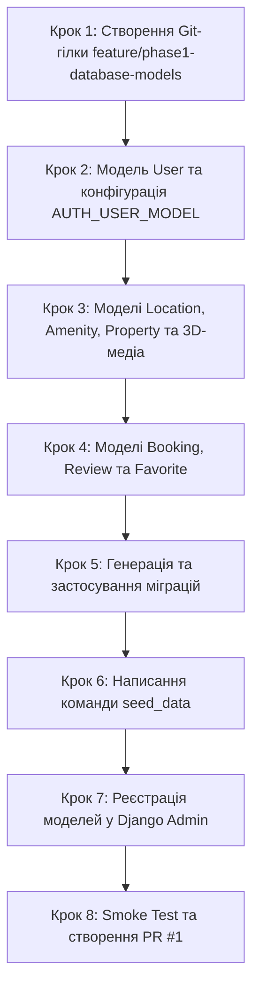

# Інструкція для Студента №2: Backend & Database
## Фаза 1: Спроєктування 11 моделей Django ORM, Міграції PostgreSQL, Сідер демо-даних та Django Admin

---

> **Паспорт ролі:**
> - **Спеціалізація:** Backend Developer / Database Lead
> - **Стек:** Python 3.11+, Django 5+, Django ORM, PostgreSQL 16, UUIDv4, Django Admin (`/admin/`), Management Commands
> - **Термін виконання:** Тиждень 1–2 (Фаза 1)
> - **Головний результат:** Повна реалізація 11 сутностей бази даних у Django ORM згідно з архітектурною схемою, генерація та застосування міграцій, автоматичний сідер даних (`python manage.py seed_data`) із тестовими містами, зручностями та об'єктами, а також повноцінно налаштована панель керування Django Admin.

---

## 1. Мета та очікувані артефакти Фази 1

У Фазі 1 ви створюєте серце бази даних всієї платформи. Ви маєте перетворити концептуальну ER-діаграму та схему бази даних (розділ 2 документа `database-schema.md`) на реальні моделі Django ORM у чотирьох додатках (`apps.users`, `apps.properties`, `apps.bookings`, `apps.reviews`). 

> [!IMPORTANT]
> **Ви відкриваєте цикл розробки Фази 1!**
> Студент №1 не зможе реалізувати реєстрацію без вашої моделі `User`, а Студент №3 не зможе відобразити каталог без тестових даних із вашого сідера. Ваш Pull Request має бути завершений і злитий **першим**.

### 📦 Результати (Deliverables) Студента №2:
1. 11 моделей Django ORM з первинними ключами `UUIDField(default=uuid.uuid4)`:
   - `apps/users/models.py`: `User` (розширення `AbstractUser` з ролями та `email` як логіном).
   - `apps/properties/models.py`: `Location`, `Amenity`, `Property`, `PropertyImage`, `Property3DImage`.
   - `apps/bookings/models.py`: `Booking` з індексами для швидкого пошуку зайнятих дат.
   - `apps/reviews/models.py`: `Review` (оцінка 1–10) та `Favorite` (обрані помешкання).
2. Налаштування `AUTH_USER_MODEL = 'users.User'` у `backend/core/settings.py`.
3. Успішно створені та застосовані міграції у базі PostgreSQL.
4. Django Management Command `python manage.py seed_data`, яка автоматично наповнює базу 6 містами, 10 зручностями, тестовими акаунтами та 3 демо-об'єктами.
5. Налаштування `admin.py` для всіх моделей у Django Admin.
6. Оновлення `.env.example` та `.env` параметром `GOOGLE_CLIENT_ID` (для роботи Google Auth Студента №1 та №3).

> [!TIP]
> **Як отримати Google Client ID для команди:**
> 1. Відкрийте [Google Cloud Console](https://console.cloud.google.com/) ➔ створіть проєкт `booking-3d`.
> 2. У розділі **APIs & Services ➔ Credentials** створіть **OAuth 2.0 Client ID** (тип: *Web application*).
> 3. Додайте в **Authorized JavaScript origins**: `http://localhost:5173`, `http://localhost:8000`, `http://127.0.0.1:5173`.
> 4. Скопіюйте **Client ID** та додайте в `.env` (`GOOGLE_CLIENT_ID=...`) і передайте Студенту №3 для `frontend/.env`.

---

## 2. Необхідні передумови

- Робочий контейнер `db` (PostgreSQL 16) запущений у Docker: `docker compose up -d`.
- Базові міграції Фази 0 застосовані.

---

## 3. Покроковий план реалізації



### Крок 1. Підготовка робочої гілки в Git

```bash
git checkout main
git pull origin main
git checkout -b feature/phase1-database-models
```

---

### Крок 2. Модель користувача `User` (`apps/users/models.py`)

Оновіть файл `backend/apps/users/models.py`:

```python
import uuid
from django.db import models
from django.contrib.auth.models import AbstractUser

class User(AbstractUser):
    """
    Кастомна модель користувача платформи Booking 3D.
    Логіном є email.
    """
    class Role(models.TextChoices):
        GUEST = 'GUEST', 'Гість'
        USER = 'USER', 'Зареєстрований користувач'
        OWNER = 'OWNER', 'Власник житла'
        ADMIN = 'ADMIN', 'Адміністратор платформи'

    id = models.UUIDField(primary_key=True, default=uuid.uuid4, editable=False)
    email = models.EmailField(unique=True, verbose_name="Email адреса")
    phone = models.CharField(max_length=30, blank=True, null=True, verbose_name="Номер телефону")
    role = models.CharField(
        max_length=20,
        choices=Role.choices,
        default=Role.USER,
        verbose_name="Роль у системі"
    )
    avatar = models.ImageField(upload_to='avatars/', blank=True, null=True, verbose_name="Аватар")

    USERNAME_FIELD = 'email'
    REQUIRED_FIELDS = ['username', 'first_name', 'last_name']

    class Meta:
        verbose_name = "Користувач"
        verbose_name_plural = "Користувачі"

    def __str__(self):
        return f"{self.email} ({self.get_role_display()})"
```

Перевірте файл `backend/core/settings.py` — додайте директиву кастомної моделі:
```python
AUTH_USER_MODEL = 'users.User'
```

---

### Крок 3. Моделі нерухомості, локацій та 3D-медіа (`apps/properties/models.py`)

Оновіть файл `backend/apps/properties/models.py`:

```python
import uuid
from django.db import models
from django.conf import settings
from django.core.validators import MinValueValidator

class Location(models.Model):
    """Географічна локація (місто, країна, координати)"""
    id = models.UUIDField(primary_key=True, default=uuid.uuid4, editable=False)
    city = models.CharField(max_length=100, verbose_name="Місто")
    country = models.CharField(max_length=100, verbose_name="Країна")
    latitude = models.DecimalField(max_digits=9, decimal_places=6, null=True, blank=True, verbose_name="Широта")
    longitude = models.DecimalField(max_digits=9, decimal_places=6, null=True, blank=True, verbose_name="Довгота")

    class Meta:
        verbose_name = "Локація"
        verbose_name_plural = "Локації"
        unique_together = ('city', 'country')

    def __str__(self):
        return f"{self.city}, {self.country}"


class Amenity(models.Model):
    """Зручність житла (Wi-Fi, Басейн, Паркінг тощо)"""
    id = models.UUIDField(primary_key=True, default=uuid.uuid4, editable=False)
    name = models.CharField(max_length=64, unique=True, verbose_name="Назва зручності")
    icon_name = models.CharField(max_length=64, verbose_name="Назва іконки (Lucide)")
    category = models.CharField(max_length=64, default='General', verbose_name="Категорія")

    class Meta:
        verbose_name = "Зручність"
        verbose_name_plural = "Зручності"

    def __str__(self):
        return self.name


class Property(models.Model):
    """Об'єкт житла для оренди"""
    class PropertyType(models.TextChoices):
        APARTMENT = 'APARTMENT', 'Апартаменти'
        HOTEL = 'HOTEL', 'Готельний номер'
        VILLA = 'VILLA', 'Вілла / Котедж'
        STUDIO = 'STUDIO', 'Студія'

    id = models.UUIDField(primary_key=True, default=uuid.uuid4, editable=False)
    owner = models.ForeignKey(
        settings.AUTH_USER_MODEL,
        on_delete=models.CASCADE,
        related_name='properties',
        verbose_name="Власник житла"
    )
    location = models.ForeignKey(
        Location,
        on_delete=models.RESTRICT,
        related_name='properties',
        verbose_name="Локація"
    )
    title = models.CharField(max_length=255, verbose_name="Назва оголошення")
    description = models.TextField(verbose_name="Детальний опис")
    property_type = models.CharField(
        max_length=32,
        choices=PropertyType.choices,
        default=PropertyType.APARTMENT,
        verbose_name="Тип помешкання"
    )
    address = models.CharField(max_length=255, verbose_name="Вулиця та номер будинку")
    price_per_night = models.DecimalField(
        max_digits=10,
        decimal_places=2,
        validators=[MinValueValidator(0.01)],
        verbose_name="Ціна за 1 ніч (USD/UAH)"
    )
    cleaning_fee = models.DecimalField(
        max_digits=10,
        decimal_places=2,
        default=0.00,
        verbose_name="Плата за прибирання"
    )
    max_guests = models.PositiveIntegerField(default=2, verbose_name="Макс. кількість гостей")
    bedrooms_count = models.PositiveIntegerField(default=1, verbose_name="Кількість спалень")
    bathrooms_count = models.PositiveIntegerField(default=1, verbose_name="Кількість санвузлів")
    amenities = models.ManyToManyField(
        Amenity,
        related_name='properties',
        blank=True,
        verbose_name="Зручності"
    )
    rating_avg = models.DecimalField(max_digits=3, decimal_places=2, default=0.00, verbose_name="Середній рейтинг (1–10)")
    reviews_count = models.PositiveIntegerField(default=0, verbose_name="Кількість відгуків")
    is_active = models.BooleanField(default=True, verbose_name="Активне для пошуку")
    created_at = models.DateTimeField(auto_now_add=True, verbose_name="Дата створення")

    class Meta:
        verbose_name = "Об'єкт житла"
        verbose_name_plural = "Об'єкти житла"
        ordering = ['-created_at']

    def __str__(self):
        return f"{self.title} ({self.location.city})"


class PropertyImage(models.Model):
    """Звичайні фотографії фасаду та кімнат"""
    id = models.UUIDField(primary_key=True, default=uuid.uuid4, editable=False)
    property = models.ForeignKey(
        Property,
        on_delete=models.CASCADE,
        related_name='images',
        verbose_name="Житло"
    )
    image = models.ImageField(upload_to='properties/photos/', verbose_name="Файл фотографії")
    is_cover = models.BooleanField(default=False, verbose_name="Головне фото (обкладинка)")
    display_order = models.PositiveIntegerField(default=0, verbose_name="Порядок відображення")

    class Meta:
        verbose_name = "Фотографія житла"
        verbose_name_plural = "Фотографії житла"
        ordering = ['display_order']


class Property3DImage(models.Model):
    """
    3D-візуалізація інтер'єру з Autodesk 3ds Max (Corona Renderer / V-Ray).
    Ключова особливість платформи Booking 3D.
    """
    class RoomType(models.TextChoices):
        LIVING_ROOM = 'LIVING_ROOM', 'Вітальня'
        BEDROOM = 'BEDROOM', 'Спальня'
        KITCHEN = 'KITCHEN', 'Кухня'
        BATHROOM = 'BATHROOM', 'Ванна кімната'

    id = models.UUIDField(primary_key=True, default=uuid.uuid4, editable=False)
    property = models.ForeignKey(
        Property,
        on_delete=models.CASCADE,
        related_name='images_3d',
        verbose_name="Житло"
    )
    image = models.ImageField(upload_to='properties/3d_renders/', verbose_name="3D-рендер (WebP)")
    room_type = models.CharField(
        max_length=64,
        choices=RoomType.choices,
        default=RoomType.LIVING_ROOM,
        verbose_name="Кімната приміщення"
    )
    camera_angle = models.CharField(max_length=64, verbose_name="Ракурс камери (Кутова, Зверху, Панорама)")
    render_engine = models.CharField(max_length=32, default='Corona', verbose_name="Рушій рендерингу (Corona / V-Ray)")
    display_order = models.PositiveIntegerField(default=0, verbose_name="Порядок показу")
    created_at = models.DateTimeField(auto_now_add=True)

    class Meta:
        verbose_name = "3D-візуалізація інтер'єру"
        verbose_name_plural = "3D-візуалізації інтер'єрів"
        ordering = ['display_order']

    def __str__(self):
        return f"3D {self.get_room_type_display()} - {self.property.title}"
```

---

### Крок 4. Моделі бронювання, відгуків та обраного (`apps/bookings` та `apps/reviews`)

#### 4.1. Модель бронювання `apps/bookings/models.py`:
```python
import uuid
from django.db import models
from django.conf import settings
from apps.properties.models import Property

class Booking(models.Model):
    """Бронювання житла з захистом від overbooking"""
    class Status(models.TextChoices):
        PENDING = 'PENDING', 'Очікує підтвердження'
        CONFIRMED = 'CONFIRMED', 'Підтверджено'
        CANCELLED = 'CANCELLED', 'Скасовано'
        COMPLETED = 'COMPLETED', 'Завершено'

    id = models.UUIDField(primary_key=True, default=uuid.uuid4, editable=False)
    user = models.ForeignKey(
        settings.AUTH_USER_MODEL,
        on_delete=models.RESTRICT,
        related_name='bookings',
        verbose_name="Гість"
    )
    property = models.ForeignKey(
        Property,
        on_delete=models.RESTRICT,
        related_name='bookings',
        verbose_name="Заброньоване житло"
    )
    check_in = models.DateField(verbose_name="Дата заїзду")
    check_out = models.DateField(verbose_name="Дата виїзду")
    guests_count = models.PositiveIntegerField(default=1, verbose_name="Кількість гостей")
    nights_count = models.PositiveIntegerField(verbose_name="Кількість ночей")
    total_price = models.DecimalField(max_digits=10, decimal_places=2, verbose_name="Підсумкова вартість")
    status = models.CharField(
        max_length=32,
        choices=Status.choices,
        default=Status.CONFIRMED,
        verbose_name="Статус бронювання"
    )
    payment_status = models.CharField(max_length=32, default='PAID_MOCK', verbose_name="Статус оплати")
    created_at = models.DateTimeField(auto_now_add=True, verbose_name="Дата створення")

    class Meta:
        verbose_name = "Бронювання"
        verbose_name_plural = "Бронювання"
        indexes = [
            models.Index(fields=['property', 'check_in', 'check_out']),
            models.Index(fields=['user']),
        ]
        ordering = ['-created_at']

    def __str__(self):
        return f"Бронювання #{str(self.id)[:8]} - {self.property.title} ({self.check_in} - {self.check_out})"
```

#### 4.2. Моделі відгуків та обраного `apps/reviews/models.py`:
```python
import uuid
from django.db import models
from django.conf import settings
from django.core.validators import MinValueValidator, MaxValueValidator
from apps.properties.models import Property
from apps.bookings.models import Booking

class Review(models.Model):
    """Відгук гостя з оцінкою від 1 до 10"""
    id = models.UUIDField(primary_key=True, default=uuid.uuid4, editable=False)
    user = models.ForeignKey(
        settings.AUTH_USER_MODEL,
        on_delete=models.CASCADE,
        related_name='reviews',
        verbose_name="Автор відгуку"
    )
    property = models.ForeignKey(
        Property,
        on_delete=models.CASCADE,
        related_name='reviews',
        verbose_name="Житло"
    )
    booking = models.OneToOneField(
        Booking,
        on_delete=models.SET_NULL,
        null=True,
        blank=True,
        related_name='review',
        verbose_name="Пов'язане бронювання"
    )
    rating = models.IntegerField(
        validators=[MinValueValidator(1), MaxValueValidator(10)],
        verbose_name="Оцінка (1-10)"
    )
    comment = models.TextField(verbose_name="Текст відгуку")
    created_at = models.DateTimeField(auto_now_add=True, verbose_name="Дата публікації")

    class Meta:
        verbose_name = "Відгук"
        verbose_name_plural = "Відгуки"
        ordering = ['-created_at']

    def __str__(self):
        return f"Відгук {self.rating}/10 від {self.user.email} на {self.property.title}"


class Favorite(models.Model):
    """Збережене житло користувача"""
    id = models.UUIDField(primary_key=True, default=uuid.uuid4, editable=False)
    user = models.ForeignKey(
        settings.AUTH_USER_MODEL,
        on_delete=models.CASCADE,
        related_name='favorites',
        verbose_name="Користувач"
    )
    property = models.ForeignKey(
        Property,
        on_delete=models.CASCADE,
        related_name='favorited_by',
        verbose_name="Обране житло"
    )
    created_at = models.DateTimeField(auto_now_add=True)

    class Meta:
        verbose_name = "Обране"
        verbose_name_plural = "Обрані помешкання"
        unique_together = ('user', 'property')

    def __str__(self):
        return f"{self.user.email} -> {self.property.title}"
```

---

### Крок 5. Генерація та застосування міграцій у PostgreSQL

Виконайте створення файлів міграцій та їх застосування всередині контейнера:

```bash
# 1. Генерація файлів міграцій для всіх 4 додатків
docker compose exec backend python manage.py makemigrations users properties bookings reviews

# 2. Застосування міграцій до PostgreSQL 16
docker compose exec backend python manage.py migrate
```

---

### Крок 6. Створення Django Management Command `seed_data`

Створіть директорії та файл команди:
```bash
mkdir -p backend/apps/properties/management/commands/
touch backend/apps/properties/management/__init__.py
touch backend/apps/properties/management/commands/__init__.py
```

Створіть файл `backend/apps/properties/management/commands/seed_data.py`:

```python
from django.core.management.base import BaseCommand
from django.contrib.auth import get_user_model
from apps.properties.models import Location, Amenity, Property, PropertyImage, Property3DImage
from decimal import Decimal

User = get_user_model()

class Command(BaseCommand):
    help = "Наповнення бази даних початковими демо-даними (користувачі, локації, зручності, житло)"

    def handle(self, *args, **kwargs):
        self.stdout.write(self.style.WARNING("Запуск наповнення демо-даними..."))

        # 1. Тестові користувачі
        admin_user, _ = User.objects.get_or_create(
            email="admin@booking3d.com",
            defaults={
                "username": "admin@booking3d.com",
                "first_name": "Головний",
                "last_name": "Адміністратор",
                "role": User.Role.ADMIN,
                "is_staff": True,
                "is_superuser": True
            }
        )
        admin_user.set_password("admin12345")
        admin_user.save()

        owner_user, _ = User.objects.get_or_create(
            email="owner@booking3d.com",
            defaults={
                "username": "owner@booking3d.com",
                "first_name": "Олексій",
                "last_name": "Власник",
                "role": User.Role.OWNER,
                "phone": "+380501112233"
            }
        )
        owner_user.set_password("owner12345")
        owner_user.save()

        guest_user, _ = User.objects.get_or_create(
            email="user@booking3d.com",
            defaults={
                "username": "user@booking3d.com",
                "first_name": "Марія",
                "last_name": "Мандрівниця",
                "role": User.Role.USER,
                "phone": "+380674445566"
            }
        )
        guest_user.set_password("user12345")
        guest_user.save()
        self.stdout.write(self.style.SUCCESS("✓ Тестові акаунти створено (admin, owner, user)"))

        # 2. Локації (6 міст)
        locations_data = [
            {"city": "Київ", "country": "Україна", "latitude": Decimal("50.450100"), "longitude": Decimal("30.523400")},
            {"city": "Львів", "country": "Україна", "latitude": Decimal("49.839683"), "longitude": Decimal("24.029717")},
            {"city": "Одеса", "country": "Україна", "latitude": Decimal("46.482526"), "longitude": Decimal("30.723309")},
            {"city": "Буковель", "country": "Україна", "latitude": Decimal("48.355100"), "longitude": Decimal("24.412400")},
            {"city": "Варшава", "country": "Польща", "latitude": Decimal("52.229676"), "longitude": Decimal("21.012229")},
            {"city": "Барселона", "country": "Іспанія", "latitude": Decimal("41.385064"), "longitude": Decimal("2.173404")},
        ]
        created_locations = {}
        for loc in locations_data:
            obj, _ = Location.objects.get_or_create(city=loc["city"], country=loc["country"], defaults=loc)
            created_locations[loc["city"]] = obj
        self.stdout.write(self.style.SUCCESS(f"✓ Створено {len(created_locations)} локацій"))

        # 3. Зручності (10 базових зручностей з іконками Lucide)
        amenities_data = [
            {"name": "Швидкісний Wi-Fi", "icon_name": "wifi", "category": "Зв'язок"},
            {"name": "Басейн", "icon_name": "waves", "category": "Відпочинок"},
            {"name": "Безкоштовний паркінг", "icon_name": "car", "category": "Паркування"},
            {"name": "Кондиціонер", "icon_name": "wind", "category": "Клімат"},
            {"name": "Власна кухня", "icon_name": "utensils", "category": "Харчування"},
            {"name": "Телевізор 4K", "icon_name": "tv", "category": "Медіа"},
            {"name": "Робоче місце", "icon_name": "laptop", "category": "Робота"},
            {"name": "Пральна машина", "icon_name": "shirt", "category": "Побут"},
            {"name": "Можна з тваринами", "icon_name": "dog", "category": "Правила"},
            {"name": "Сніданок включено", "icon_name": "coffee", "category": "Харчування"},
        ]
        created_amenities = []
        for am in amenities_data:
            obj, _ = Amenity.objects.get_or_create(name=am["name"], defaults=am)
            created_amenities.append(obj)
        self.stdout.write(self.style.SUCCESS(f"✓ Створено {len(created_amenities)} зручностей"))

        # 4. Демо-об'єкти житла
        prop1, _ = Property.objects.get_or_create(
            title="Сучасні апартаменти в центрі Києва з 3D-туром",
            defaults={
                "owner": owner_user,
                "location": created_locations["Київ"],
                "description": "Просторі апартаменти з дизайнерським ремонтом, змодельовані у 3ds Max. Панорамні вікна, італійські меблі та чудове розташування.",
                "property_type": Property.PropertyType.APARTMENT,
                "address": "вул. Хрещатик, 24",
                "price_per_night": Decimal("75.00"),
                "cleaning_fee": Decimal("15.00"),
                "max_guests": 4,
                "bedrooms_count": 2,
                "bathrooms_count": 1,
                "rating_avg": Decimal("9.40"),
                "reviews_count": 12,
            }
        )
        prop1.amenities.set(created_amenities[:6])

        prop2, _ = Property.objects.get_or_create(
            title="Затишний панорамний номер з видом на Карпати",
            defaults={
                "owner": owner_user,
                "location": created_locations["Буковель"],
                "description": "Готельний номер люкс із терасою, сауною та прямим виходом до витягів. Перегляньте повний 3D-тур кімнати.",
                "property_type": Property.PropertyType.HOTEL,
                "address": "Урочище Вишні, 15",
                "price_per_night": Decimal("120.00"),
                "cleaning_fee": Decimal("20.00"),
                "max_guests": 2,
                "bedrooms_count": 1,
                "bathrooms_count": 1,
                "rating_avg": Decimal("9.80"),
                "reviews_count": 28,
            }
        )
        prop2.amenities.set(created_amenities)

        self.stdout.write(self.style.SUCCESS("✓ Створено 2 демо-об'єкти житла"))
        self.stdout.write(self.style.SUCCESS("🎉 Базу даних успішно наповнено!"))
```

Запустіть сідер даних:
```bash
docker compose exec backend python manage.py seed_data
```

---

### Крок 7. Реєстрація всіх моделей у Django Admin

Оновіть файли `admin.py`:

#### 7.1. `backend/apps/users/admin.py`:
```python
from django.contrib import admin
from django.contrib.auth.admin import UserAdmin
from .models import User

@admin.register(User)
class CustomUserAdmin(UserAdmin):
    list_display = ('email', 'first_name', 'last_name', 'role', 'is_staff', 'is_active')
    list_filter = ('role', 'is_staff', 'is_active')
    search_fields = ('email', 'first_name', 'last_name')
    ordering = ('email',)
```

#### 7.2. `backend/apps/properties/admin.py`:
```python
from django.contrib import admin
from .models import Location, Amenity, Property, PropertyImage, Property3DImage

class PropertyImageInline(admin.TabularInline):
    model = PropertyImage
    extra = 1

class Property3DImageInline(admin.TabularInline):
    model = Property3DImage
    extra = 1

@admin.register(Property)
class PropertyAdmin(admin.ModelAdmin):
    list_display = ('title', 'location', 'property_type', 'price_per_night', 'rating_avg', 'is_active')
    list_filter = ('property_type', 'location', 'is_active')
    search_fields = ('title', 'description', 'address')
    inlines = [PropertyImageInline, Property3DImageInline]

admin.site.register(Location)
admin.site.register(Amenity)
admin.site.register(PropertyImage)
admin.site.register(Property3DImage)
```

#### 7.3. `backend/apps/bookings/admin.py`:
```python
from django.contrib import admin
from .models import Booking

@admin.register(Booking)
class BookingAdmin(admin.ModelAdmin):
    list_display = ('id', 'user', 'property', 'check_in', 'check_out', 'total_price', 'status')
    list_filter = ('status', 'check_in')
    search_fields = ('user__email', 'property__title')
```

#### 7.4. `backend/apps/reviews/admin.py`:
```python
from django.contrib import admin
from .models import Review, Favorite

admin.site.register(Review)
admin.site.register(Favorite)
```

---

### Крок 8. Оновлення шаблонів оточення (`.env.example`)

Як лід бази даних та інфраструктури, оновіть файли шаблонів змінних середовища для бекенду та фронтенду, додавши параметри Google OAuth 2.0:

**`backend/.env.example`**:
```env
DEBUG=True
SECRET_KEY=django-insecure-change-this-in-production-key-12345
ALLOWED_HOSTS=localhost,127.0.0.1,backend

# PostgreSQL Database
POSTGRES_DB=booking_db
POSTGRES_USER=booking_user
POSTGRES_PASSWORD=booking_pass_secret
POSTGRES_HOST=db
POSTGRES_PORT=5432

# Google OAuth 2.0
GOOGLE_CLIENT_ID=your-google-client-id.apps.googleusercontent.com
```

**`frontend/.env.example`**:
```env
VITE_API_URL=http://localhost:8000/api
VITE_GOOGLE_CLIENT_ID=your-google-client-id.apps.googleusercontent.com
```

---

## 4. Перевірка працездатності (Smoke Testing)

1. Перевірте застосування міграцій:
   ```bash
   docker compose exec backend python manage.py showmigrations
   ```
   Усі міграції `users`, `properties`, `bookings`, `reviews` повинні мати позначку `[X]`.

2. Перевірте Django Admin у браузері `http://localhost:8000/admin/`:
   - Увійдіть як `admin@booking3d.com` / `admin12345`.
   - Переконайтеся, що всі моделі (Users, Locations, Amenities, Properties, Bookings, Reviews) доступні для редагування.

---

## 5. Протокол взаємодії з іншими студентами команди

| З ким взаємодієте | Що передаєте | Що очікуєте взамін |
| :--- | :--- | :--- |
| **Студент №1** *(Backend Core)* | Готову модель `User` та тестові акаунти для тестування авторизації. Значення `GOOGLE_CLIENT_ID`. Повідомлення про злиття вашого PR. | Серіалізатори та API реєстрації й профілю. |
| **Студент №3** *(Frontend)* | Тестові логіни/паролі (`user@booking3d.com` / `user12345`), список зручностей та `VITE_GOOGLE_CLIENT_ID`. | Інтеграцію форм авторизації та карток каталогу. |

---

## 6. Збереження змін у Git (Коли та як комітити)

### 6.1. Атомарні коміти:
```bash
# 1. Модель користувача:
git add backend/apps/users/models.py backend/core/settings.py
git commit -m "feat(users): create custom User model with roles and email login"

# 2. Моделі нерухомості та 3D-медіа:
git add backend/apps/properties/models.py
git commit -m "feat(properties): create models for Location, Amenity, Property, and Property3DImage"

# 3. Моделі бронювання, відгуків та обраного:
git add backend/apps/bookings/models.py backend/apps/reviews/models.py
git commit -m "feat(bookings): implement Booking, Review, and Favorite models"

# 4. Файли міграцій:
git add backend/apps/*/migrations/
git commit -m "chore(db): generate initial database migrations for all 11 models"

# 5. Сідер демо-даних та адмінка:
git add backend/apps/properties/management/ backend/apps/*/admin.py
git commit -m "feat(seed): add seed_data command and customize django admin"

# 6. Оновлення конфігурацій оточення:
git add backend/.env.example frontend/.env.example
git commit -m "chore(env): add GOOGLE_CLIENT_ID to backend and frontend env templates"
```

### 6.2. Push та Pull Request (Зливається ПЕРШИМ):
```bash
git push -u origin feature/phase1-database-models
```
- Створіть PR на GitHub з описом списку моделей.
- Отримайте Approve від Студента №1 та Студента №3.
- Натисніть **Merge pull request** у `main`.
- Оновіть локальну гілку `main` та повідомте Студента №1!

---

## 7. Чеклист готовності (Definition of Done)

- [ ] Усі 11 моделей Django ORM створено згідно зі схемою `database-schema.md`.
- [ ] Параметр `AUTH_USER_MODEL = 'users.User'` додано в `settings.py`.
- [ ] Міграції згенеровано та без помилок застосовано до PostgreSQL.
- [ ] Команда `seed_data` наповнює базу тестовими користувачами, містами та житлом.
- [ ] Усі моделі відображаються та редагуються в Django Admin.
- [ ] Шаблони оточення `backend/.env.example` та `frontend/.env.example` містять `GOOGLE_CLIENT_ID`.
- [ ] PR злито в `main` першим серед розробників.
