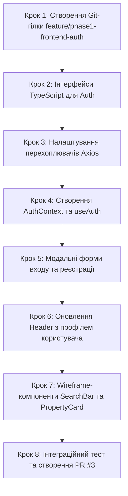

# Інструкція для Студента №3: Frontend Developer
## Фаза 1: Модуль автентифікації (AuthContext), Модалки входу/реєстрації та Чорнові Wireframe-компоненти

---

> **Паспорт ролі:**
> - **Спеціалізація:** Frontend Lead / Client Application Developer
> - **Стек:** React 18, TypeScript, Tailwind CSS, Lucide React, Axios (Interceptors), React Router v6, Context API
> - **Термін виконання:** Тиждень 1–2 (Фаза 1)
> - **Головний результат:** Повна клієнтська система автентифікації (збереження JWT у localStorage, автоматичне додавання заголовка Bearer через Axios, модальні вікна реєстрації та входу, оновлена шапка з профілем), а також чорнова Wireframe-верстка головних компонентів сайту: пошуковий рядок (`SearchBar`), картка помешкання з бейджем 3D-туру (`PropertyCard`) та адаптивна сітка (`PropertyGrid`).

---

## 1. Мета та очікувані артефакти Фази 1

У Фазі 1 ви пов'язуєте клієнтський інтерфейс із бекенд-модулем автентифікації Студента №1 та закладаєте візуальний каркас головних компонентів за чорно-білими **Wireframes** від UX-дизайнера (Дизайнер №2).

### 📦 Результати (Deliverables) Студента №3:
1. Контекст авторизації `AuthContext` та кастомний хук `useAuth`: методи `login`, `register`, `logout`, стан `user` та `isAuthenticated`.
2. Налаштування перехоплювачів Axios (`api.ts`): автоматична підстановка `Authorization: Bearer <token>` та очищення сесії при статусі 401.
3. Інтерактивні форми авторизації `LoginForm` та реєстрації `RegisterForm` (модальне вікно `AuthModal`).
4. Оновлений `Header`: відображення кнопок "Увійти" / "Реєстрація" для гостей або імені користувача, бейджа ролі та кнопки "Вийти" для авторизованих осіб.
5. Wireframe-компоненти:
   - `SearchBar`: вибір напрямку, дат та кількості гостей.
   - `PropertyCard`: картка житла з бейджем **"3D Тур"**, фото, ціною за ніч та рейтингом.
   - `PropertyGrid`: адаптивна сітка зі станом завантаження (скелетони).
6. Оновлена головна сторінка `HomePage` з робочим каталогом.

---

## 2. Необхідні передумови

- Фаза 0 завершена: проєкт у `frontend/` запускається командою `npm run dev`.
- Студент №1 та №2 опублікували ендпоінти `/api/auth/register/` та `/api/auth/token/`.

---

## 3. Покроковий план реалізації



### Крок 1. Підготовка робочої гілки в Git та встановлення бібліотек

Підтягніть зміни з гілки `main`:
```bash
git checkout main
git pull origin main
git checkout -b feature/phase1-frontend-auth
```
Перейдіть у папку клієнта та встановіть бібліотеку Google Identity Services для React:
```bash
cd frontend
npm install @react-oauth/google
```

Додайте змінну клієнтського Google ID у `frontend/.env` та `frontend/.env.example`:
```env
VITE_API_URL=http://localhost:8000/api
VITE_GOOGLE_CLIENT_ID=your-google-client-id.apps.googleusercontent.com
```

---

### Крок 2. Інтерфейси TypeScript (`src/types/auth.ts`)

Створіть файл `frontend/src/types/auth.ts`:

```typescript
export type UserRole = 'GUEST' | 'USER' | 'OWNER' | 'ADMIN';

export interface User {
  id: string;
  email: string;
  first_name: string;
  last_name: string;
  role: UserRole;
  phone?: string;
  avatar?: string;
}

export interface AuthResponse {
  access: string;
  refresh: string;
  user: User;
  is_new_user?: boolean;
}

export interface RegisterPayload {
  email: string;
  password: string;
  password_confirm: string;
  first_name: string;
  last_name: string;
  phone?: string;
  role?: 'USER' | 'OWNER';
}

export interface LoginPayload {
  email: string;
  password: string;
}
```

---

### Крок 3. Налаштування перехоплювачів Axios (`src/services/api.ts`)

Оновіть файл `frontend/src/services/api.ts`, щоб токен авторизації автоматично додавався до кожного HTTP-запиту:

```typescript
import axios from 'axios';
import { HealthCheckResponse } from '../types';
import { AuthResponse, LoginPayload, RegisterPayload, User } from '../types/auth';

const API_BASE_URL = import.meta.env.VITE_API_URL || 'http://localhost:8000/api';

export const apiClient = axios.create({
  baseURL: API_BASE_URL,
  timeout: 8000,
  headers: {
    'Content-Type': 'application/json',
  },
});

// Request Interceptor: додає Bearer токен із localStorage
apiClient.interceptors.request.use(
  (config) => {
    const token = localStorage.getItem('access_token');
    if (token && config.headers) {
      config.headers.Authorization = `Bearer ${token}`;
    }
    return config;
  },
  (error) => Promise.reject(error)
);

// Response Interceptor: очищення токена при закінченні сесії (401 Unauthorized)
apiClient.interceptors.response.use(
  (response) => response,
  (error) => {
    if (error.response?.status === 401) {
      localStorage.removeItem('access_token');
      localStorage.removeItem('refresh_token');
      localStorage.removeItem('user_data');
    }
    return Promise.reject(error);
  }
);

// --- API Функції автентифікації ---
export const authApi = {
  login: async (payload: LoginPayload): Promise<AuthResponse> => {
    const response = await apiClient.post<AuthResponse>('/auth/token/', payload);
    return response.data;
  },
  register: async (payload: RegisterPayload): Promise<{ message: string; user: User }> => {
    const response = await apiClient.post<{ message: string; user: User }>('/auth/register/', payload);
    return response.data;
  },
  googleLogin: async (credential: string): Promise<AuthResponse> => {
    const response = await apiClient.post<AuthResponse>('/auth/google/', { credential });
    return response.data;
  },
  getProfile: async (): Promise<User> => {
    const response = await apiClient.get<User>('/users/profile/');
    return response.data;
  },
  updateProfile: async (payload: Partial<User>): Promise<User> => {
    const response = await apiClient.patch<User>('/users/profile/', payload);
    return response.data;
  },
};

export const checkBackendHealth = async (): Promise<HealthCheckResponse> => {
  const response = await apiClient.get<HealthCheckResponse>('/health/');
  return response.data;
};
```

---

### Крок 4. Створення AuthContext та хука `useAuth` (`src/context/AuthContext.tsx`)

Створіть директорію `frontend/src/context/` та файл `AuthContext.tsx`:

```tsx
import React, { createContext, useContext, useState, useEffect, ReactNode } from 'react';
import { User, LoginPayload, RegisterPayload } from '../types/auth';
import { authApi } from '../services/api';

interface AuthContextType {
  user: User | null;
  token: string | null;
  isAuthenticated: boolean;
  isLoading: boolean;
  login: (credentials: LoginPayload) => Promise<void>;
  register: (data: RegisterPayload) => Promise<void>;
  loginWithGoogle: (credential: string) => Promise<void>;
  logout: () => void;
}

const AuthContext = createContext<AuthContextType | undefined>(undefined);

export const AuthProvider: React.FC<{ children: ReactNode }> = ({ children }) => {
  const [user, setUser] = useState<User | null>(null);
  const [token, setToken] = useState<string | null>(null);
  const [isLoading, setIsLoading] = useState<boolean>(true);

  // Відновлення сесії при першому завантаженні застосунку
  useEffect(() => {
    const savedToken = localStorage.getItem('access_token');
    const savedUser = localStorage.getItem('user_data');

    if (savedToken && savedUser) {
      try {
        setToken(savedToken);
        setUser(JSON.parse(savedUser));
      } catch {
        localStorage.clear();
      }
    }
    setIsLoading(false);
  }, []);

  const login = async (credentials: LoginPayload) => {
    setIsLoading(true);
    try {
      const data = await authApi.login(credentials);
      setToken(data.access);
      setUser(data.user);
      localStorage.setItem('access_token', data.access);
      localStorage.setItem('refresh_token', data.refresh);
      localStorage.setItem('user_data', JSON.stringify(data.user));
    } finally {
      setIsLoading(false);
    }
  };

  const register = async (data: RegisterPayload) => {
    setIsLoading(true);
    try {
      await authApi.register(data);
      // Автоматичний вхід після успішної реєстрації
      await login({ email: data.email, password: data.password });
    } finally {
      setIsLoading(false);
    }
  };

  const loginWithGoogle = async (credential: string) => {
    setIsLoading(true);
    try {
      const data = await authApi.googleLogin(credential);
      setToken(data.access);
      setUser(data.user);
      localStorage.setItem('access_token', data.access);
      localStorage.setItem('refresh_token', data.refresh);
      localStorage.setItem('user_data', JSON.stringify(data.user));
    } finally {
      setIsLoading(false);
    }
  };

  const logout = () => {
    setToken(null);
    setUser(null);
    localStorage.removeItem('access_token');
    localStorage.removeItem('refresh_token');
    localStorage.removeItem('user_data');
  };

  return (
    <AuthContext.Provider
      value={{
        user,
        token,
        isAuthenticated: !!token && !!user,
        isLoading,
        login,
        register,
        loginWithGoogle,
        logout,
      }}
    >
      {children}
    </AuthContext.Provider>
  );
};

export const useAuth = (): AuthContextType => {
  const context = useContext(AuthContext);
  if (!context) {
    throw new Error('useAuth must be used within an AuthProvider');
  }
  return context;
};
```

---

### Крок 5. Модальне вікно автентифікації (`src/components/auth/AuthModal.tsx`)

Створіть папку `frontend/src/components/auth/` та файл `AuthModal.tsx`:

```tsx
import React, { useState } from 'react';
import { X, Lock, Mail, User as UserIcon, Phone, AlertCircle } from 'lucide-react';
import { GoogleLogin } from '@react-oauth/google';
import { useAuth } from '../../context/AuthContext';

interface AuthModalProps {
  isOpen: boolean;
  onClose: () => void;
  initialMode?: 'login' | 'register';
}

export const AuthModal: React.FC<AuthModalProps> = ({ isOpen, onClose, initialMode = 'login' }) => {
  const [isLogin, setIsLogin] = useState(initialMode === 'login');
  const [email, setEmail] = useState('');
  const [password, setPassword] = useState('');
  const [passwordConfirm, setPasswordConfirm] = useState('');
  const [firstName, setFirstName] = useState('');
  const [lastName, setLastName] = useState('');
  const [phone, setPhone] = useState('');
  const [role, setRole] = useState<'USER' | 'OWNER'>('USER');
  const [error, setError] = useState<string | null>(null);

  const { login, register, loginWithGoogle, isLoading } = useAuth();

  if (!isOpen) return null;

  const handleSubmit = async (e: React.FormEvent) => {
    e.preventDefault();
    setError(null);

    try {
      if (isLogin) {
        await login({ email, password });
      } else {
        if (password !== passwordConfirm) {
          setError('Паролі не співпадають!');
          return;
        }
        await register({
          email,
          password,
          password_confirm: passwordConfirm,
          first_name: firstName,
          last_name: lastName,
          phone,
          role,
        });
      }
      onClose();
    } catch (err: any) {
      const errorMsg =
        err.response?.data?.detail ||
        err.response?.data?.message ||
        (err.response?.data?.password && err.response.data.password[0]) ||
        'Помилка виконання запиту. Перевірте введені дані.';
      setError(errorMsg);
    }
  };

  const handleGoogleSuccess = async (credentialResponse: any) => {
    setError(null);
    try {
      if (credentialResponse.credential) {
        await loginWithGoogle(credentialResponse.credential);
        onClose();
      } else {
        setError('Не отримано токен від Google.');
      }
    } catch (err: any) {
      const errorMsg =
        err.response?.data?.error ||
        err.response?.data?.detail ||
        'Помилка авторизації через Google. Спробуйте ще раз.';
      setError(errorMsg);
    }
  };

  return (
    <div className="fixed inset-0 z-50 flex items-center justify-center bg-black/60 backdrop-blur-sm p-4">
      <div className="bg-white rounded-2xl max-w-md w-full p-6 shadow-2xl relative animate-in fade-in zoom-in-95 duration-200">
        <button
          onClick={onClose}
          className="absolute top-4 right-4 text-gray-400 hover:text-gray-700 p-1 rounded-lg"
        >
          <X className="w-5 h-5" />
        </button>

        <h2 className="text-2xl font-extrabold text-primary mb-2">
          {isLogin ? 'Вхід у Booking 3D' : 'Реєстрація акаунту'}
        </h2>
        <p className="text-sm text-gray-500 mb-6">
          {isLogin
            ? 'Увійдіть для бронювання житла з інтерактивними 3D-турами'
            : 'Створіть акаунт гостя або зареєструйтесь як власник житла'}
        </p>

        {error && (
          <div className="mb-4 p-3 bg-red-50 border border-red-200 text-red-700 rounded-xl text-sm flex items-start space-x-2">
            <AlertCircle className="w-4 h-4 mt-0.5 flex-shrink-0" />
            <span>{error}</span>
          </div>
        )}

        {/* Швидкий вхід через Google */}
        <div className="mb-4 flex flex-col items-center">
          <GoogleLogin
            onSuccess={handleGoogleSuccess}
            onError={() => setError('Помилка Google Sign-In')}
            shape="pill"
            size="large"
            width="100%"
            text={isLogin ? 'signin_with' : 'signup_with'}
          />
        </div>

        {/* Розділювач */}
        <div className="relative my-4">
          <div className="absolute inset-0 flex items-center">
            <div className="w-full border-t border-gray-200"></div>
          </div>
          <div className="relative flex justify-center text-xs">
            <span className="px-2 bg-white text-gray-400 font-medium">або через email</span>
          </div>
        </div>

        <form onSubmit={handleSubmit} className="space-y-4">
          {!isLogin && (
            <>
              <div className="grid grid-cols-2 gap-3">
                <div>
                  <label className="block text-xs font-semibold text-gray-700 mb-1">Ім'я</label>
                  <input
                    type="text"
                    required
                    value={firstName}
                    onChange={(e) => setFirstName(e.target.value)}
                    className="w-full px-3 py-2 border rounded-xl text-sm outline-none focus:border-primary"
                    placeholder="Іван"
                  />
                </div>
                <div>
                  <label className="block text-xs font-semibold text-gray-700 mb-1">Прізвище</label>
                  <input
                    type="text"
                    required
                    value={lastName}
                    onChange={(e) => setLastName(e.target.value)}
                    className="w-full px-3 py-2 border rounded-xl text-sm outline-none focus:border-primary"
                    placeholder="Коваль"
                  />
                </div>
              </div>

              <div>
                <label className="block text-xs font-semibold text-gray-700 mb-1">Телефон</label>
                <div className="relative">
                  <Phone className="w-4 h-4 text-gray-400 absolute left-3 top-2.5" />
                  <input
                    type="tel"
                    value={phone}
                    onChange={(e) => setPhone(e.target.value)}
                    className="w-full pl-9 pr-3 py-2 border rounded-xl text-sm outline-none focus:border-primary"
                    placeholder="+380 50 123 45 67"
                  />
                </div>
              </div>

              <div>
                <label className="block text-xs font-semibold text-gray-700 mb-1">Тип акаунту</label>
                <div className="grid grid-cols-2 gap-2">
                  <button
                    type="button"
                    onClick={() => setRole('USER')}
                    className={`py-2 text-xs font-bold rounded-xl border transition-all ${
                      role === 'USER' ? 'bg-primary text-white border-primary' : 'bg-gray-50 text-gray-700'
                    }`}
                  >
                    Гість (Оренда)
                  </button>
                  <button
                    type="button"
                    onClick={() => setRole('OWNER')}
                    className={`py-2 text-xs font-bold rounded-xl border transition-all ${
                      role === 'OWNER' ? 'bg-primary text-white border-primary' : 'bg-gray-50 text-gray-700'
                    }`}
                  >
                    Власник помешкання
                  </button>
                </div>
              </div>
            </>
          )}

          <div>
            <label className="block text-xs font-semibold text-gray-700 mb-1">Email адреса</label>
            <div className="relative">
              <Mail className="w-4 h-4 text-gray-400 absolute left-3 top-2.5" />
              <input
                type="email"
                required
                value={email}
                onChange={(e) => setEmail(e.target.value)}
                className="w-full pl-9 pr-3 py-2 border rounded-xl text-sm outline-none focus:border-primary"
                placeholder="you@booking3d.com"
              />
            </div>
          </div>

          <div>
            <label className="block text-xs font-semibold text-gray-700 mb-1">Пароль</label>
            <div className="relative">
              <Lock className="w-4 h-4 text-gray-400 absolute left-3 top-2.5" />
              <input
                type="password"
                required
                value={password}
                onChange={(e) => setPassword(e.target.value)}
                className="w-full pl-9 pr-3 py-2 border rounded-xl text-sm outline-none focus:border-primary"
                placeholder="••••••••"
              />
            </div>
          </div>

          {!isLogin && (
            <div>
              <label className="block text-xs font-semibold text-gray-700 mb-1">Підтвердження пароля</label>
              <div className="relative">
                <Lock className="w-4 h-4 text-gray-400 absolute left-3 top-2.5" />
                <input
                  type="password"
                  required
                  value={passwordConfirm}
                  onChange={(e) => setPasswordConfirm(e.target.value)}
                  className="w-full pl-9 pr-3 py-2 border rounded-xl text-sm outline-none focus:border-primary"
                  placeholder="••••••••"
                />
              </div>
            </div>
          )}

          <button
            type="submit"
            disabled={isLoading}
            className="w-full py-3 bg-accent hover:bg-accent-hover text-primary font-bold rounded-xl transition-all shadow-md disabled:opacity-50 mt-2"
          >
            {isLoading ? 'Зачекайте...' : isLogin ? 'Увійти' : 'Створити акаунт'}
          </button>
        </form>

        <div className="mt-6 text-center text-xs text-gray-500">
          {isLogin ? (
            <span>
              Ще не маєте акаунту?{' '}
              <button onClick={() => setIsLogin(false)} className="text-primary font-bold underline">
                Зареєструватися
              </button>
            </span>
          ) : (
            <span>
              Вже зареєстровані?{' '}
              <button onClick={() => setIsLogin(true)} className="text-primary font-bold underline">
                Увійти
              </button>
            </span>
          )}
        </div>
      </div>
    </div>
  );
};
```

---

### Крок 6. Оновлення `Header.tsx` з підтримкою авторизації

Оновіть файл `frontend/src/components/layout/Header.tsx`, додавши інтеграцію з `useAuth` та модальне вікно:

```tsx
import React, { useEffect, useState } from 'react';
import { Link, useLocation } from 'react-router-dom';
import { Box, Home, Search, User as UserIcon, Building, Wifi, WifiOff, LogOut } from 'lucide-react';
import { checkBackendHealth } from '../../services/api';
import { useAuth } from '../../context/AuthContext';
import { AuthModal } from '../auth/AuthModal';

export const Header: React.FC = () => {
  const [backendStatus, setBackendStatus] = useState<'checking' | 'online' | 'offline'>('checking');
  const [apiVersion, setApiVersion] = useState<string>('');
  const [isAuthModalOpen, setIsAuthModalOpen] = useState(false);
  const [authModalMode, setAuthModalMode] = useState<'login' | 'register'>('login');

  const { user, isAuthenticated, logout } = useAuth();
  const location = useLocation();

  useEffect(() => {
    const verifyConnection = async () => {
      try {
        const data = await checkBackendHealth();
        if (data.status === 'ok') {
          setBackendStatus('online');
          setApiVersion(data.version);
        } else {
          setBackendStatus('offline');
        }
      } catch {
        setBackendStatus('offline');
      }
    };

    verifyConnection();
    const interval = setInterval(verifyConnection, 15000);
    return () => clearInterval(interval);
  }, []);

  const openAuth = (mode: 'login' | 'register') => {
    setAuthModalMode(mode);
    setIsAuthModalOpen(true);
  };

  return (
    <>
      <header className="bg-primary text-white shadow-md sticky top-0 z-40">
        <div className="max-w-7xl mx-auto px-4 sm:px-6 lg:px-8">
          <div className="flex justify-between items-center h-16">
            {/* Логотип */}
            <Link to="/" className="flex items-center space-x-2 text-xl font-bold tracking-tight">
              <span>Booking</span>
              <span className="bg-badge3d text-white text-xs px-2 py-0.5 rounded-full font-extrabold flex items-center space-x-1">
                <Box className="w-3.5 h-3.5 inline mr-1" /> 3D
              </span>
            </Link>

            {/* Навігація */}
            <nav className="hidden md:flex space-x-1">
              <Link to="/" className="px-3 py-2 rounded-md text-sm font-medium hover:bg-primary-light">
                Головна
              </Link>
              <Link to="/search" className="px-3 py-2 rounded-md text-sm font-medium hover:bg-primary-light">
                Пошук житла
              </Link>
              {isAuthenticated && (
                <Link to="/cabinet" className="px-3 py-2 rounded-md text-sm font-medium hover:bg-primary-light">
                  Мої бронювання
                </Link>
              )}
            </nav>

            {/* Блок користувача та статус API */}
            <div className="flex items-center space-x-3">
              {/* Статус бекенду */}
              <div className="hidden sm:flex items-center space-x-2 text-xs bg-primary-dark/80 px-2.5 py-1 rounded-full border border-blue-900">
                {backendStatus === 'online' ? (
                  <span className="text-green-400 flex items-center">
                    <Wifi className="w-3.5 h-3.5 mr-1" /> API v{apiVersion}
                  </span>
                ) : (
                  <span className="text-red-400 flex items-center">
                    <WifiOff className="w-3.5 h-3.5 mr-1" /> Offline
                  </span>
                )}
              </div>

              {/* Авторизація */}
              {isAuthenticated && user ? (
                <div className="flex items-center space-x-2 bg-primary-dark px-3 py-1.5 rounded-xl border border-blue-800">
                  <div className="w-7 h-7 rounded-full bg-accent text-primary font-bold flex items-center justify-center text-xs">
                    {user.first_name[0] || 'U'}
                  </div>
                  <div className="text-left text-xs leading-tight">
                    <p className="font-bold text-white">{user.first_name}</p>
                    <span className="text-[10px] text-accent uppercase font-extrabold">{user.role}</span>
                  </div>
                  <button
                    onClick={logout}
                    title="Вийти"
                    className="ml-2 text-gray-400 hover:text-white p-1 rounded"
                  >
                    <LogOut className="w-4 h-4" />
                  </button>
                </div>
              ) : (
                <div className="flex items-center space-x-2">
                  <button
                    onClick={() => openAuth('login')}
                    className="px-3 py-1.5 text-xs font-bold text-white hover:bg-primary-light rounded-lg transition"
                  >
                    Увійти
                  </button>
                  <button
                    onClick={() => openAuth('register')}
                    className="px-3 py-1.5 text-xs font-bold bg-accent hover:bg-accent-hover text-primary rounded-lg transition shadow-sm"
                  >
                    Реєстрація
                  </button>
                </div>
              )}
            </div>
          </div>
        </div>
      </header>

      {/* Модалка */}
      <AuthModal
        isOpen={isAuthModalOpen}
        onClose={() => setIsAuthModalOpen(false)}
        initialMode={authModalMode}
      />
    </>
  );
};
```

---

### Крок 7. Wireframe-компоненти: SearchBar та PropertyCard

#### 7.1. Пошуковий блок `frontend/src/components/search/SearchBar.tsx`:
```tsx
import React, { useState } from 'react';
import { Search, Calendar, Users, MapPin } from 'lucide-react';
import { useNavigate } from 'react-router-dom';

export const SearchBar: React.FC = () => {
  const [city, setCity] = useState('');
  const [guests, setGuests] = useState(2);
  const navigate = useNavigate();

  const handleSearch = (e: React.FormEvent) => {
    e.preventDefault();
    navigate(`/search?city=${encodeURIComponent(city)}&guests=${guests}`);
  };

  return (
    <form
      onSubmit={handleSearch}
      className="bg-accent p-1.5 rounded-2xl shadow-xl max-w-5xl mx-auto grid grid-cols-1 md:grid-cols-4 gap-1.5"
    >
      <div className="bg-white rounded-xl p-3 flex items-center space-x-3">
        <MapPin className="w-5 h-5 text-gray-400 flex-shrink-0" />
        <input
          type="text"
          placeholder="Куди прямуєте? (Київ, Львів...)"
          value={city}
          onChange={(e) => setCity(e.target.value)}
          className="w-full text-sm outline-none text-gray-800 placeholder-gray-400"
        />
      </div>

      <div className="bg-white rounded-xl p-3 flex items-center space-x-3 cursor-pointer">
        <Calendar className="w-5 h-5 text-gray-400 flex-shrink-0" />
        <span className="text-sm text-gray-600">Заїзд — Виїзд</span>
      </div>

      <div className="bg-white rounded-xl p-3 flex items-center space-x-3">
        <Users className="w-5 h-5 text-gray-400 flex-shrink-0" />
        <select
          value={guests}
          onChange={(e) => setGuests(Number(e.target.value))}
          className="w-full text-sm outline-none bg-transparent text-gray-700 cursor-pointer"
        >
          <option value={1}>1 дорослий</option>
          <option value={2}>2 дорослих</option>
          <option value={3}>3 гостей</option>
          <option value={4}>4+ гостей</option>
        </select>
      </div>

      <button
        type="submit"
        className="bg-primary hover:bg-primary-dark text-white font-bold rounded-xl py-3 px-6 text-sm flex items-center justify-center space-x-2 transition shadow"
      >
        <Search className="w-4 h-4" />
        <span>Шукати житло</span>
      </button>
    </form>
  );
};
```

#### 7.2. Картка помешкання `frontend/src/components/property/PropertyCard.tsx`:
```tsx
import React from 'react';
import { Box, Star, MapPin, Heart } from 'lucide-react';
import { Link } from 'react-router-dom';

export interface PropertyCardProps {
  id: string;
  title: string;
  city: string;
  pricePerNight: number;
  ratingAvg: number;
  reviewsCount: number;
  has3D: boolean;
  coverImage?: string;
}

export const PropertyCard: React.FC<PropertyCardProps> = ({
  id,
  title,
  city,
  pricePerNight,
  ratingAvg,
  reviewsCount,
  has3D = true,
  coverImage,
}) => {
  return (
    <div className="bg-white rounded-2xl overflow-hidden border border-gray-200 shadow-sm hover:shadow-md transition-shadow group flex flex-col">
      {/* Прев'ю картинка */}
      <div className="relative aspect-[4/3] bg-gray-200 overflow-hidden">
        {coverImage ? (
          
        ) : (
          <div className="w-full h-full flex items-center justify-center text-gray-400 bg-gradient-to-tr from-gray-100 to-gray-200">
            <span className="text-xs font-semibold">Фото об'єкта</span>
          </div>
        )}

        {/* Бейдж 3D Тур */}
        {has3D && (
          <div className="absolute top-3 left-3 bg-badge3d text-white text-xs px-2.5 py-1 rounded-full font-extrabold flex items-center space-x-1 shadow-md">
            <Box className="w-3.5 h-3.5" />
            <span>3D Тур (3ds Max)</span>
          </div>
        )}

        {/* Кнопка "В обране" */}
        <button className="absolute top-3 right-3 p-1.5 rounded-full bg-white/80 hover:bg-white text-gray-700 hover:text-red-500 transition shadow">
          <Heart className="w-4 h-4" />
        </button>
      </div>

      {/* Тіло картки */}
      <div className="p-4 flex flex-col flex-grow justify-between space-y-3">
        <div>
          <div className="flex items-center space-x-1 text-xs text-gray-500 mb-1">
            <MapPin className="w-3.5 h-3.5 text-gray-400" />
            <span>{city}</span>
          </div>
          <Link to={`/properties/${id}`}>
            <h3 className="font-bold text-gray-900 group-hover:text-primary transition line-clamp-2 text-base">
              {title}
            </h3>
          </Link>
        </div>

        {/* Рейтинг та ціна */}
        <div className="pt-2 border-t border-gray-100 flex items-center justify-between">
          <div className="flex items-center space-x-1.5">
            <div className="bg-primary text-white font-bold text-xs px-2 py-1 rounded-lg">
              {ratingAvg.toFixed(1)}
            </div>
            <span className="text-xs text-gray-500">({reviewsCount} відгуків)</span>
          </div>
          <div className="text-right">
            <span className="text-xs text-gray-400">від </span>
            <span className="text-lg font-extrabold text-primary">${pricePerNight}</span>
            <span className="text-xs text-gray-500"> /ніч</span>
          </div>
        </div>
      </div>
    </div>
  );
};
```

#### 7.3. Оновлення головної сторінки (`frontend/src/pages/HomePage.tsx`):
Оновіть файл `frontend/src/pages/HomePage.tsx`, інтегрувавши створені компоненти `SearchBar` та сітку карток `PropertyCard` із бейджами 3D:

```tsx
import React from 'react';
import { Sparkles } from 'lucide-react';
import { SearchBar } from '../components/search/SearchBar';
import { PropertyCard, PropertyCardProps } from '../components/property/PropertyCard';

// Мокові дані для показу каталогу (відповідають локаціям із seed_data бекенду)
const MOCK_PROPERTIES: PropertyCardProps[] = [
  {
    id: 'prop-1',
    title: 'Панорамні апартаменти в центрі біля Оперного театру',
    city: 'Львів, Україна',
    pricePerNight: 85,
    ratingAvg: 9.8,
    reviewsCount: 34,
    has3D: true,
    coverImage: 'https://images.unsplash.com/photo-1502672260266-1c1ef2d93688?auto=format&fit=crop&w=800&q=80',
  },
  {
    id: 'prop-2',
    title: 'Сучасна 3D студія на Печерську з видом на Дніпро',
    city: 'Київ, Україна',
    pricePerNight: 95,
    ratingAvg: 9.5,
    reviewsCount: 48,
    has3D: true,
    coverImage: 'https://images.unsplash.com/photo-1522708323590-d24dbb6b0267?auto=format&fit=crop&w=800&q=80',
  },
  {
    id: 'prop-3',
    title: 'Затишне шале у Карпатах з панорамною спальнею та спа',
    city: 'Буковель, Україна',
    pricePerNight: 140,
    ratingAvg: 9.9,
    reviewsCount: 52,
    has3D: true,
    coverImage: 'https://images.unsplash.com/photo-1542314831-068cd1dbfeeb?auto=format&fit=crop&w=800&q=80',
  },
  {
    id: 'prop-4',
    title: 'Апартаменти біля моря з терасою та видом на захід',
    city: 'Одеса, Україна',
    pricePerNight: 70,
    ratingAvg: 9.2,
    reviewsCount: 19,
    has3D: false,
    coverImage: 'https://images.unsplash.com/photo-1560448204-e02f11c3d0e2?auto=format&fit=crop&w=800&q=80',
  },
];

export const HomePage: React.FC = () => {
  return (
    <div className="space-y-10 pb-12">
      {/* Hero Banner з фірмовим градієнтом */}
      <div className="bg-gradient-to-r from-primary to-primary-light rounded-3xl p-8 sm:p-12 text-white shadow-xl relative overflow-hidden">
        <div className="relative z-10 max-w-3xl space-y-4">
          <div className="inline-flex items-center space-x-2 bg-badge3d/30 border border-badge3d px-3 py-1 rounded-full text-xs font-semibold uppercase tracking-wider">
            <Sparkles className="w-3.5 h-3.5 text-accent" />
            <span>Інноваційний 3D перегляд</span>
          </div>
          <h1 className="text-3xl sm:text-5xl font-black tracking-tight leading-tight">
            Знайдіть ідеальне житло з інтерактивними 3D-турами
          </h1>
          <p className="text-base sm:text-lg text-blue-100 max-w-2xl">
            Оглядайте точні просторові 3D-візуалізації кімнат, створені в Autodesk 3ds Max, ще до оформлення бронювання.
          </p>
        </div>

        {/* Пошуковий блок SearchBar */}
        <div className="mt-8 relative z-10">
          <SearchBar />
        </div>
      </div>

      {/* Каталог рекомендованих помешкань */}
      <section className="space-y-6">
        <div className="flex items-center justify-between">
          <div>
            <h2 className="text-2xl font-black text-gray-900 tracking-tight">
              Популярні помешкання з 3D-турами
            </h2>
            <p className="text-sm text-gray-500 mt-1">
              Перевірені апартаменти та будинки з детальними 3ds Max візуалізаціями
            </p>
          </div>
        </div>

        {/* Сітка карток помешкань */}
        <div className="grid grid-cols-1 sm:grid-cols-2 lg:grid-cols-4 gap-6">
          {MOCK_PROPERTIES.map((property) => (
            <PropertyCard key={property.id} {...property} />
          ))}
        </div>
      </section>
    </div>
  );
};
```

#### 7.4. Підключення `AuthProvider` та `GoogleOAuthProvider` у `src/App.tsx`:
Оберніть застосунок у провайдери Google та Auth:
```tsx
import React from 'react';
import { BrowserRouter, Routes, Route } from 'react-router-dom';
import { GoogleOAuthProvider } from '@react-oauth/google';
import { AuthProvider } from './context/AuthContext';
import { MainLayout } from './components/layout/MainLayout';
import { HomePage } from './pages/HomePage';
// ... інші імпорти

const GOOGLE_CLIENT_ID = import.meta.env.VITE_GOOGLE_CLIENT_ID || '';

export const App: React.FC = () => {
  return (
    <GoogleOAuthProvider clientId={GOOGLE_CLIENT_ID}>
      <AuthProvider>
        <BrowserRouter>
          <Routes>
            <Route path="/" element={<MainLayout />}>
              <Route index element={<HomePage />} />
              {/* інші роути */}
            </Route>
          </Routes>
        </BrowserRouter>
      </AuthProvider>
    </GoogleOAuthProvider>
  );
};

export default App;
```

---

## 4. Перевірка працездатності (Smoke Testing)

1. Запустіть клієнт: `npm run dev`.
2. Перевірте звичайну реєстрацію та вхід:
   - Відкрийте `http://localhost:5173/`.
   - Натисніть кнопку **"Реєстрація"** у шапці.
   - Заповніть форму новим користувачем (`test_ui@booking3d.com`).
   - Натисніть **"Створити акаунт"** — переконайтеся, що модалка закрилася, а в шапці з'явилося ваше ім'я з бейджем `USER`.
   - Оновіть сторінку в браузері (F5) — переконайтеся, що сесія збереглася (токен у `localStorage`).
   - Натисніть іконку виходу (LogOut) — переконайтеся, що повернулися кнопки "Увійти" / "Реєстрація".
3. Перевірте вхід під тестовим користувачем із бази (`user@booking3d.com` / `user12345`).
4. **Перевірте реєстрацію / вхід через Google:**
   - Натисніть "Увійти" або "Реєстрація".
   - Натисніть кнопку **"Sign in with Google"** (кнопка Google Identity Services).
   - У спливаючому вікні Google оберіть обліковий запис.
   - Перевірте у вкладці Network браузера успішний запит `POST /api/auth/google/` з кодом `200 OK`.
   - Переконайтеся, що користувач автоматично увійшов у систему, в шапці з'явилося ім'я з Google акаунту та бейдж `USER`.

---

## 5. Протокол взаємодії з іншими студентами команди

| З ким взаємодієте | Що передаєте | Що очікуєте взамін |
| :--- | :--- | :--- |
| **Студент №1** *(Backend Core)* | Зворотний зв'язок щодо роботи ендпоінтів реєстрації, логіну та `POST /api/auth/google/`. | Актуальні Swagger ендпоінти. |
| **Студент №2** *(Database)* | Повідомлення про готовність відображення зручностей та міст. | Тестові дані з команди `seed_data` та `GOOGLE_CLIENT_ID`. |
| **Дизайнер №2** *(UX/UI Lead)* | Демонстрацію чорнової верстки SearchBar та карток житла на відповідність Wireframes. | Figma UI Kit для Фази 2. |

---

## 6. Збереження змін у Git (Коли та як комітити)

### 6.1. Атомарні коміти:
```bash
# 1. Залежності, типи та клієнт API:
git add frontend/package.json frontend/package-lock.json frontend/src/types/auth.ts frontend/src/services/api.ts
git commit -m "feat(auth): define auth interfaces and configure axios with google login api"

# 2. Контекст авторизації та Google Provider:
git add frontend/src/context/AuthContext.tsx frontend/src/App.tsx frontend/.env.example
git commit -m "feat(auth): implement AuthProvider and GoogleOAuthProvider wrapper"

# 3. Модалка та оновлена шапка:
git add frontend/src/components/auth/ frontend/src/components/layout/Header.tsx
git commit -m "feat(auth): add AuthModal with email, Google Sign-In and header user profile"

# 4. Wireframe-компоненти каталогу:
git add frontend/src/components/search/ frontend/src/components/property/ frontend/src/pages/HomePage.tsx
git commit -m "feat(wireframes): create SearchBar, PropertyCard and integrate into HomePage with 3d badge"
```

### 6.2. Push та Pull Request (Зливається ТРЕТІМ):
```bash
# Підтягніть main після злиття PR Студента 2 і Студента 1:
git fetch origin
git merge origin/main
git push -u origin feature/phase1-frontend-auth
```
- Створіть PR на GitHub та запросіть рев'ю.

---

## 7. Чеклист готовності (Definition of Done)

- [ ] `AuthContext` керує станом авторизації та зберігає JWT у `localStorage`.
- [ ] Підключено `@react-oauth/google` у `src/App.tsx` та налаштовано `VITE_GOOGLE_CLIENT_ID`.
- [ ] У `AuthModal.tsx` реалізовано кнопку Google Sign-In, яка викликає `POST /api/auth/google/`.
- [ ] Axios автоматично додає заголовок `Authorization: Bearer <token>`.
- [ ] Форми входу та реєстрації відправляють запити до бекенду та обробляють помилки.
- [ ] У `Header` відображається профіль користувача або кнопки авторизації.
- [ ] Компонент `PropertyCard` містить фірмовий фіолетовий бейдж **"3D Тур (3ds Max)"**.
- [ ] `npm run build` проходить без помилок компіляції.
- [ ] PR злито в `main`.
