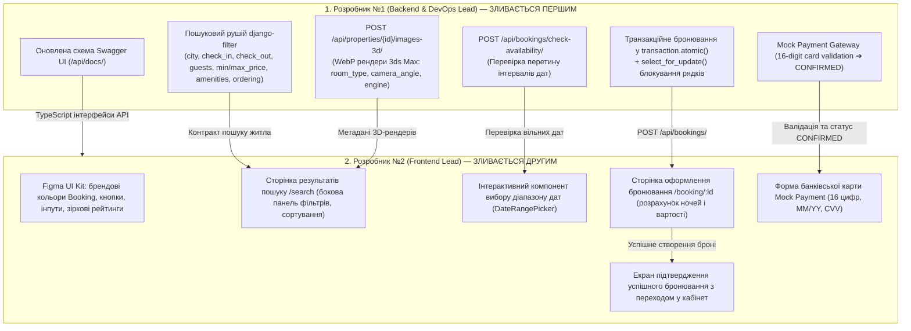

# Загальний план координації: Фаза 2 (UI Kit, Каталог, Бронювання та 3D-рендеринг)
## Навчальний клон сервісу бронювання житла Booking.com 3D

Цей каталог містить вичерпні покрокові інструкції для **двох розробників** для виконання завдань **Фази 2** (Тиждень 2–3) відповідно до [Дорожньої карти проєкту](../roadmap/phases-and-milestones.md), [Архітектури системи](../architecture/system-overview.md), [Схеми бази даних](../architecture/database-schema.md) та [Життєвого циклу бронювання](../architecture/booking-lifecycle.md).

---

## 👥 Спеціалізація та індивідуальні інструкції

| Розробник | Роль у проєкті | Посилання на інструкцію | Ключові модулі | Головний артефакт Фази 2 |
| :---: | :--- | :--- | :--- | :--- |
| **Розробник №1** | **Backend & DevOps Lead** | [dev-1-backend-devops.md](dev-1-backend-devops.md) | `PropertyViewSet`, `django-filter`, перевірка доступності дат (`check-availability`), транзакційний захист від overbooking (`transaction.atomic()` + `select_for_update()`), модуль збереження 3D-рендерів `Property3DImage`, Mock Payment | REST API `/api/properties/` (фільтри, пошук, пагінація), `/api/bookings/check-availability/`, `/api/bookings/` (транзакційне бронювання), завантаження 3D WebP-рендерів |
| **Розробник №2** | **Frontend Lead** | [dev-2-frontend.md](dev-2-frontend.md) | React 18, Figma UI Kit (кольори, кнопки, бейджі, зіркові рейтинги), сторінка каталогу `/search`, фільтри, вибір дат, сторінка бронювання `/booking/:id`, Mock-оплата карткою | Готовий клієнтський каталог з динамічною фільтрацією та сортуванням, компонент календаря дат, повноцінний екран бронювання житла з валідацією картки та успішним підтвердженням |

---

## 🔄 Схема командної взаємодії у Фазі 2



---

## 🌿 Регламент роботи з Git у Фазі 2

### 1. Назви робочих гілок:
- **Розробник №1**: `feature/phase2-backend-search-and-booking`
- **Розробник №2**: `feature/phase2-frontend-catalog-and-checkout`

### 2. Суворий двоетапний порядок злиття (Strict Merge Order):
Оскільки інтерфейс пошуку та екран створення бронювання безпосередньо залежать від фільтрації та транзакційної логіки сервера, злиття виконується у чіткій послідовності:

1. **PR №1 (Розробник №1 — Backend & DevOps Lead)**:
   - Фільтрація каталогу `GET /api/properties/` з підтримкою `django-filter`, перевірка доступності `POST /api/bookings/check-availability/`, транзакційне створення бронювання `POST /api/bookings/` із блокуванням `select_for_update()`, сервіс збереження 3D-рендерів.
   - Розробник №2 тестує ендпоінти через Swagger UI та тестовий файл [`docs/phase-2/api-tests.http`](api-tests.http), перевіряє схеми DTO та надає **Approve**.
   - Розробник №1 зливає PR у `main`.

2. **PR №2 (Розробник №2 — Frontend Lead)**:
   - Після вливання PR №1 Розробник №2 підтягує актуальну гілку `main` (`git pull origin main`), підключає сторінку пошуку `/search`, компонент календаря та сторінку `/booking/:id` до живого бекенду.
   - Проводить тестування наскрізного ланцюжка: Пошук житла ➔ Фільтрація за містом та ціною ➔ Вибір дат ➔ Оформлення бронювання з тестовою карткою ➔ Отримання статусу `CONFIRMED`.
   - Розробник №1 проводить код-рев'ю, надає **Approve** та зливає PR у `main`.

---

## 🧪 Спільний інтеграційний тест (Sprint 2 Smoke Test)

Перед закриттям Фази 2 команда збирається на спільне наскрізне тестування всього бізнес-ланцюжка:

1. **Крок 1: Оновлення репозиторію та запуск інфраструктури**:
   ```bash
   git checkout main
   git pull origin main
   docker compose up -d
   docker compose exec backend python manage.py migrate
   docker compose exec backend python manage.py test apps.bookings apps.properties
   ```

2. **Крок 2: Автоматизовані тести через REST Client (`api-tests.http`)**:
   - Відкрити файл [`docs/phase-2/api-tests.http`](api-tests.http) у VS Code або JetBrains HTTP Client.
   - Виконати сценарії секції 1 (Вхід клієнта та орендодавця).
   - Виконати сценарії пошуку помешкань за містом, гостями та діапазоном дат.
   - Виконати перевірку доступності дат (`check-availability`).
   - Створити тестове бронювання (`POST /api/bookings/`) і переконатися у отриманні статусу `CONFIRMED` та імітації оплати `PAID_MOCK`.
   - **Тест на захист від Overbooking**: надіслати повторний запит на бронювання того ж об'єкта на ті самі дати ➔ переконатися в отриманні відповіді `400 Bad Request` з повідомленням про зайняті дати.

3. **Крок 3: Перевірка клієнтського застосунку React**:
   - Відкрити `http://localhost:5173/`.
   - На головній сторінці у пошуковому рядку `SearchBar` обрати місто (наприклад, "Львів"), дати заїзду/виїзду та 2 гостей ➔ натиснути "Знайти".
   - Перевірити перехід на сторінку `/search` з оновленими query-параметрами в URL.
   - Перевірити роботу фільтрів: перетягнути повзунок ціни, увімкнути чекбокс "Wi-Fi" та фільтр "Тільки з 3D туром".
   - Натиснути на картку об'єкта ➔ натиснути кнопку "Забронювати" ➔ перехід на сторінку `/booking/:id`.
   - Перевірити автоматичний розрахунок вартості: $\text{ночі} \times \text{ціна} + \text{прибирання}$.
   - Заповнити форму тестової банківської картки `4111 2222 3333 4444`, `12/28`, `123` ➔ натиснути "Підтвердити бронювання".
   - Перевірити появу екрану успіху та збереження бронювання в базі даних.
   - Перевірити обробку помилки: спробувати забронювати з карткою, що закінчується на `0000` (наприклад, `4111 2222 3333 0000`) ➔ повинно з'явитися зрозуміле сповіщення про відмову банку.

---

## ✅ Загальний критерій готовності (Definition of Done) Фази 2

Фаза 2 вважається успішно завершеною, коли:
- [x] Реалізовано пошуковий рушій `GET /api/properties/` з гнучкою фільтрацією через `django-filter` (місто, ціна, гості, зручності, сортування).
- [x] Реалізовано ендпоінт перевірки зайнятості дат `POST /api/bookings/check-availability/`.
- [x] Реалізовано транзакційне створення бронювання з блокуванням рядків `select_for_update()` у `transaction.atomic()`, що гарантує захист від race conditions (подвійного бронювання).
- [x] Реалізовано механізм імітації оплати банківською карткою (Mock Payment Gateway) з валідацією полів та статусом `PAID_MOCK`.
- [x] Реалізовано збереження метаданих 3D-рендерів інтер'єру з 3ds Max (`room_type`, `camera_angle`, `render_engine`).
- [x] На фронтенді застосовано фірмовий UI Kit: кольори, типографіка, картки, кнопки та рейтинги зірок.
- [x] Зверстано сторінку результатів пошуку `/search` з боковою панеллю фільтрів, сортуванням та скелетонами завантаження.
- [x] Створено сторінку оформлення бронювання `/booking/:id` з валідацією форми гостя та маскою картки.
- [x] Усі наскрізні сценарії перевірено за допомогою `api-tests.http` та в браузері.
- [x] Усі Pull Requests переглянуті, схвалені та об'єднані в `main`.
