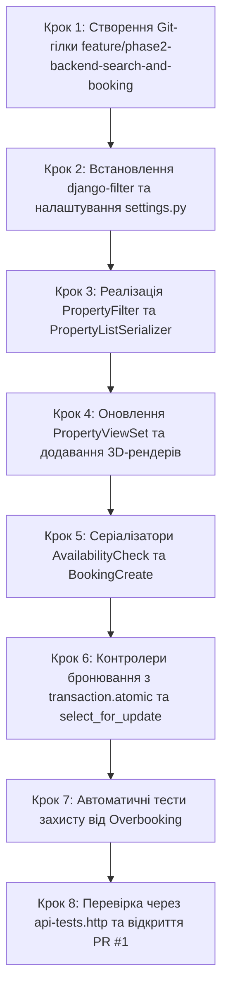

# Інструкція для Розробника №1: Backend & DevOps Lead
## Фаза 2: Пошуковий рушій (django-filter), Перевірка доступності, Транзакційне бронювання (select_for_update) та 3D-медіа

---

> **Паспорт ролі:**
> - **Спеціалізація:** Backend Developer & DevOps Lead
> - **Стек:** Python 3.11+, Django 5+, Django REST Framework (DRF), django-filter, PostgreSQL 16 (`select_for_update`), `transaction.atomic()`, Pillow, drf-spectacular (OpenAPI 3)
> - **Термін виконання:** Тиждень 2–3 (Фаза 2)
> - **Головний результат:** Повнофункціональний пошуковий рушій каталогу житла з багатопараметричною фільтрацією (`django-filter`), ендпоінт перевірки зайнятості дат, ендпоінт оформлення бронювання з транзакційним захистом від подвійного бронювання (Overbooking) за допомогою блокування записів `select_for_update()`, сервіс імітації оплати (Mock Payment Gateway), модуль завантаження та зберігання 3D-рендерів інтер'єру `Property3DImage` з метаданими кімнат і ракурсів; оновлення Swagger UI та створення PR №1 у `main`.

---

## 1. Мета та очікувані артефакти Фази 2

У Фазі 2 ви реалізуєте ключове бізнес-ядро сервісу — пошук житла за критеріями користувача та безпомилкове створення броні. Оскільки бронювання є критичною фінансовою транзакцією, ви забезпечуєте сувору ізоляцію транзакцій у PostgreSQL для запобігання ситуації, коли двоє гостей одночасно бронюють одне й те саме житло на однакові дати.

### 📦 Результати (Deliverables) Розробника №1:
1. **Пошуковий фільтр `PropertyFilter` (`apps/properties/filters.py`)**:
   - `city` — фільтрація за містом (нечутлива до регістру `icontains`).
   - `check_in` та `check_out` — відсікання помешкань, які мають перетини з підтвердженими бронюваннями на вказаний період.
   - `guests` — фільтрація за місткістю (`max_guests >= guests`).
   - `min_price` та `max_price` — діапазон вартості за ніч.
   - `property_type` — вибір типу житла (`APARTMENT`, `HOTEL`, `VILLA`, `STUDIO`).
   - `amenities` — фільтрація за списком ідентифікаторів зручностей (Wi-Fi, кондиціонер тощо).
   - `has_3d` — фільтр помешкань, що мають хоча б один 3D-рендер інтер'єру.
2. **Каталог житла `PropertyViewSet` (`apps/properties/views.py`)**:
   - `GET /api/properties/` — список з пагінацією (10 об'єктів на сторінку) та сортуванням (`ordering`: за ціною `price_per_night`, рейтингом `rating_avg`, новизною `created_at`).
   - `POST /api/properties/{id}/images-3d/` — завантаження 3D-рендерів з перевіркою типу кімнати (`room_type`), ракурсу камери (`camera_angle`) та рушія візуалізації (`render_engine`).
3. **Ендпоінт перевірки доступності дат (`apps/bookings/views.py`)**:
   - `POST /api/bookings/check-availability/` — повертає `available: true/false`, кількість ночей та повний фінансовий розрахунок вартості.
4. **Транзакційний ендпоінт створення бронювання (`apps/bookings/views.py`)**:
   - `POST /api/bookings/` — створення запису в статусі `CONFIRMED` усередині транзакції `transaction.atomic()`.
   - Застосування блокування рядків `select_for_update()` для запобігання стану гонитви (Race Condition).
   - Перевірка перетину дат за формулою: `check_in < new_check_out AND check_out > new_check_in`.
5. **Імітація оплати (Mock Payment Gateway)**:
   - Валідація картки: 16 цифр, валідний термін `MM/YY`, CVV 3 цифри.
   - Імітація статусу оплати `PAID_MOCK`. Якщо номер закінчується на `0000` — викидається помилка платіжного шлюзу `400 Bad Request` для тестування відмов.
6. **Документація OpenAPI 3**: оновлений Swagger UI (`/api/docs/`) з прикладами тіла запитів та відповідей.
7. **Набір автотестів `apps/bookings/tests.py`**: перевірка формули цін та перевірка захисту від подвійного бронювання.

---

## 2. Покроковий план реалізації



---

### Крок 1. Підготовка робочої гілки в Git

```bash
cd /home/skmelyuk/Documents/projects/Booking/booking-clone
git checkout main
git pull origin main
git checkout -b feature/phase2-backend-search-and-booking
```

---

### Крок 2. Налаштування `django-filter` у `backend/core/settings.py`

Переконайтеся, що пакет `django-filter` додано до `INSTALLED_APPS` та налаштовано бекенд фільтрації за замовчуванням у DRF:

```python
# backend/core/settings.py

INSTALLED_APPS = [
    # ...
    'rest_framework',
    'django_filters',
    'corsheaders',
    'drf_spectacular',
    'apps.users',
    'apps.properties',
    'apps.bookings',
    'apps.reviews',
]

REST_FRAMEWORK = {
    'DEFAULT_AUTHENTICATION_CLASSES': (
        'rest_framework_simplejwt.authentication.JWTAuthentication',
    ),
    'DEFAULT_FILTER_BACKENDS': (
        'django_filters.rest_framework.DjangoFilterBackend',
        'rest_framework.filters.OrderingFilter',
        'rest_framework.filters.SearchFilter',
    ),
    'DEFAULT_PAGINATION_CLASS': 'rest_framework.pagination.PageNumberPagination',
    'PAGE_SIZE': 10,
    'DEFAULT_SCHEMA_CLASS': 'drf_spectacular.openapi.AutoSchema',
}
```

---

### Крок 3. Реалізація багатопараметричного фільтра `PropertyFilter`

Створіть файл `backend/apps/properties/filters.py`:

```python
import django_filters
from django.db.models import Q, Exists, OuterRef
from .models import Property, Property3DImage
from apps.bookings.models import Booking

class PropertyFilter(django_filters.FilterSet):
    city = django_filters.CharFilter(field_name='location__city', lookup_expr='icontains', label='Місто')
    country = django_filters.CharFilter(field_name='location__country', lookup_expr='icontains', label='Країна')
    guests = django_filters.NumberFilter(field_name='max_guests', lookup_expr='gte', label='Мінімум гостей')
    min_price = django_filters.NumberFilter(field_name='price_per_night', lookup_expr='gte', label='Ціна від')
    max_price = django_filters.NumberFilter(field_name='price_per_night', lookup_expr='lte', label='Ціна до')
    property_type = django_filters.ChoiceFilter(choices=Property.PropertyType.choices, label='Тип житла')
    amenities = django_filters.BaseInFilter(field_name='amenities__id', distinct=True, label='ID зручностей')
    has_3d = django_filters.BooleanFilter(method='filter_has_3d', label='Лише з 3D туром')
    
    # Фільтрація вільних дат заїзду та виїзду
    check_in = django_filters.DateFilter(method='filter_by_dates', label='Дата заїзду (YYYY-MM-DD)')
    check_out = django_filters.DateFilter(method='filter_by_dates', label='Дата виїзду (YYYY-MM-DD)')

    class Meta:
        model = Property
        fields = ['city', 'country', 'guests', 'min_price', 'max_price', 'property_type', 'amenities', 'has_3d']

    def filter_has_3d(self, queryset, name, value):
        if value:
            return queryset.filter(images_3d__isnull=False).distinct()
        return queryset

    def filter_by_dates(self, queryset, name, value):
        # Отримуємо обидві дати з параметрів запиту
        check_in = self.data.get('check_in')
        check_out = self.data.get('check_out')

        if not check_in or not check_out:
            return queryset

        # Помешкання вважається зайнятим, якщо існує бронювання з перетином інтервалів:
        # existing_check_in < requested_check_out AND existing_check_out > requested_check_in
        conflict_bookings = Booking.objects.filter(
            property=OuterRef('pk'),
            status__in=[Booking.Status.PENDING, Booking.Status.CONFIRMED],
            check_in__lt=check_out,
            check_out__gt=check_in
        )

        return queryset.annotate(is_conflict=Exists(conflict_bookings)).filter(is_conflict=False)
```

---

### Крок 4. Серіалізатори каталогу та завантаження 3D-рендерів

Оновіть `backend/apps/properties/serializers.py`:

```python
from rest_framework import serializers
from .models import Property, PropertyImage, Property3DImage, Amenity, Location

class LocationSerializer(serializers.ModelSerializer):
    class Meta:
        model = Location
        fields = ['id', 'city', 'country', 'latitude', 'longitude']

class AmenitySerializer(serializers.ModelSerializer):
    class Meta:
        model = Amenity
        fields = ['id', 'name', 'icon_name', 'category']

class Property3DImageSerializer(serializers.ModelSerializer):
    class Meta:
        model = Property3DImage
        fields = ['id', 'image', 'room_type', 'camera_angle', 'render_engine', 'display_order', 'created_at']

class PropertyListSerializer(serializers.ModelSerializer):
    location = LocationSerializer(read_only=True)
    cover_image = serializers.SerializerMethodField()
    has_3d = serializers.SerializerMethodField()
    amenities = AmenitySerializer(many=True, read_only=True)

    class Meta:
        model = Property
        fields = [
            'id', 'title', 'property_type', 'address', 'price_per_night',
            'cleaning_fee', 'max_guests', 'bedrooms_count', 'bathrooms_count',
            'rating_avg', 'reviews_count', 'location', 'cover_image', 'has_3d', 'amenities'
        ]

    def get_cover_image(self, obj):
        cover = obj.images.filter(is_cover=True).first() or obj.images.first()
        if cover and cover.image:
            request = self.context.get('request')
            return request.build_absolute_uri(cover.image.url) if request else cover.image.url
        return None

    def get_has_3d(self, obj):
        return obj.images_3d.exists()

class Property3DUploadSerializer(serializers.ModelSerializer):
    class Meta:
        model = Property3DImage
        fields = ['image', 'room_type', 'camera_angle', 'render_engine', 'display_order']
```

Оновіть `backend/apps/properties/views.py`:

```python
from rest_framework import viewsets, permissions, status
from rest_framework.decorators import action
from rest_framework.response import Response
from drf_spectacular.utils import extend_schema, extend_schema_view
from .models import Property, Property3DImage
from .serializers import PropertyListSerializer, Property3DImageSerializer, Property3DUploadSerializer
from .filters import PropertyFilter

@extend_schema_view(
    list=extend_schema(summary="Пошук та каталог житла з фільтрами", tags=["Properties"]),
    retrieve=extend_schema(summary="Детальна інформація про житло", tags=["Properties"]),
)
class PropertyViewSet(viewsets.ReadOnlyModelViewSet):
    queryset = Property.objects.filter(is_active=True).select_related('location', 'owner').prefetch_related('images', 'images_3d', 'amenities')
    serializer_class = PropertyListSerializer
    filterset_class = PropertyFilter
    ordering_fields = ['price_per_night', 'rating_avg', 'created_at']
    ordering = ['-rating_avg']

    @extend_schema(
        summary="Завантаження 3D-рендеру інтер'єру (Власник або Адмін)",
        request=Property3DUploadSerializer,
        responses={201: Property3DImageSerializer},
        tags=["Properties 3D"]
    )
    @action(detail=True, methods=['post'], url_path='images-3d', permission_classes=[permissions.IsAuthenticated])
    def upload_3d_render(self, request, pk=None):
        prop = self.get_object()
        if prop.owner != request.user and not request.user.is_staff:
            return Response({"detail": "Ви не є власником цього помешкання."}, status=status.HTTP_403_FORBIDDEN)

        serializer = Property3DUploadSerializer(data=request.data)
        serializer.is_valid(raise_exception=True)
        render_3d = serializer.save(property=prop)
        return Response(Property3DImageSerializer(render_3d, context={'request': request}).data, status=status.HTTP_201_CREATED)
```

---

### Крок 5. Логіка перевірки доступності та серіалізатор бронювання з Mock Payment

Створіть `backend/apps/bookings/serializers.py`:

```python
from datetime import date
from rest_framework import serializers
from .models import Booking
from apps.properties.models import Property

class AvailabilityCheckSerializer(serializers.Serializer):
    property_id = serializers.UUIDField()
    check_in = serializers.DateField()
    check_out = serializers.DateField()
    guests_count = serializers.IntegerField(default=1, min_value=1)

    def validate(self, attrs):
        check_in = attrs.get('check_in')
        check_out = attrs.get('check_out')

        if check_in < date.today():
            raise serializers.ValidationError({"check_in": "Дата заїзду не може бути у минулому."})
        if check_out <= check_in:
            raise serializers.ValidationError({"check_out": "Дата виїзду повинна бути пізнішою за дату заїзду."})

        try:
            prop = Property.objects.get(id=attrs.get('property_id'), is_active=True)
        except Property.DoesNotExist:
            raise serializers.ValidationError({"property_id": "Помешкання не знайдено або воно деактивоване."})

        if attrs.get('guests_count') > prop.max_guests:
            raise serializers.ValidationError({"guests_count": f"Максимальна кількість гостей для цього житла: {prop.max_guests}."})

        attrs['property_obj'] = prop
        return attrs

class MockPaymentCardSerializer(serializers.Serializer):
    card_number = serializers.CharField(max_length=19)  # 16 цифр (або 4 групи по 4 цифри)
    exp_date = serializers.CharField(max_length=5)      # MM/YY
    cvv = serializers.CharField(max_length=4)           # 3-4 цифри
    card_holder = serializers.CharField(max_length=120)

    def validate_card_number(self, value):
        digits_only = value.replace(" ", "")
        if not digits_only.isdigit() or len(digits_only) != 16:
            raise serializers.ValidationError("Номер картки повинен містити рівно 16 цифр.")
        if digits_only.endswith("0000"):
            raise serializers.ValidationError("Платіж відхилено банком (тестова картка 0000).")
        return digits_only

    def validate_cvv(self, value):
        if not value.isdigit() or len(value) not in [3, 4]:
            raise serializers.ValidationError("CVV код повинен містити 3 або 4 цифри.")
        return value

class BookingCreateSerializer(serializers.ModelSerializer):
    property_id = serializers.UUIDField(write_only=True)
    payment_card = MockPaymentCardSerializer(write_only=True)

    class Meta:
        model = Booking
        fields = [
            'id', 'property_id', 'check_in', 'check_out', 'guests_count',
            'nights_count', 'total_price', 'status', 'payment_status',
            'payment_card', 'created_at'
        ]
        read_only_fields = ['id', 'nights_count', 'total_price', 'status', 'payment_status', 'created_at']

    def validate(self, attrs):
        check_in = attrs.get('check_in')
        check_out = attrs.get('check_out')

        if check_in < date.today():
            raise serializers.ValidationError({"check_in": "Дата заїзду не може бути у минулому."})
        if check_out <= check_in:
            raise serializers.ValidationError({"check_out": "Дата виїзду повинна бути пізнішою за дату заїзду."})

        try:
            prop = Property.objects.get(id=attrs.get('property_id'), is_active=True)
        except Property.DoesNotExist:
            raise serializers.ValidationError({"property_id": "Помешкання не знайдено."})

        if attrs.get('guests_count') > prop.max_guests:
            raise serializers.ValidationError({"guests_count": f"Перевищено ліміт гостей ({prop.max_guests})."})

        attrs['property_obj'] = prop
        return attrs
```

---

### Крок 6. Транзакційні контролери `transaction.atomic()` та `select_for_update()`

Створіть `backend/apps/bookings/views.py`:

```python
from django.db import transaction
from rest_framework import views, status, permissions
from rest_framework.response import Response
from drf_spectacular.utils import extend_schema
from .models import Booking
from .serializers import AvailabilityCheckSerializer, BookingCreateSerializer

class CheckAvailabilityView(views.APIView):
    permission_classes = [permissions.AllowAny]

    @extend_schema(
        summary="Перевірка доступності дат та попередній розрахунок ціни",
        request=AvailabilityCheckSerializer,
        responses={200: dict},
        tags=["Bookings"]
    )
    def post(self, request):
        serializer = AvailabilityCheckSerializer(data=request.data)
        serializer.is_valid(raise_exception=True)

        prop = serializer.validated_data['property_obj']
        check_in = serializer.validated_data['check_in']
        check_out = serializer.validated_data['check_out']

        is_busy = Booking.objects.filter(
            property=prop,
            status__in=[Booking.Status.PENDING, Booking.Status.CONFIRMED],
            check_in__lt=check_out,
            check_out__gt=check_in
        ).exists()

        nights = (check_out - check_in).days
        base_price = nights * prop.price_per_night
        total_price = base_price + prop.cleaning_fee

        return Response({
            "available": not is_busy,
            "property_id": str(prop.id),
            "check_in": check_in,
            "check_out": check_out,
            "nights_count": nights,
            "price_per_night": str(prop.price_per_night),
            "cleaning_fee": str(prop.cleaning_fee),
            "total_price": str(total_price),
            "message": "Дати вільні для бронювання" if not is_busy else "Обрані дати вже зайняті"
        })

class CreateBookingView(views.APIView):
    permission_classes = [permissions.IsAuthenticated]

    @extend_schema(
        summary="Створення бронювання з транзакційним захистом від Overbooking та Mock оплатою",
        request=BookingCreateSerializer,
        responses={201: BookingCreateSerializer},
        tags=["Bookings"]
    )
    def post(self, request):
        serializer = BookingCreateSerializer(data=request.data)
        serializer.is_valid(raise_exception=True)

        prop = serializer.validated_data['property_obj']
        check_in = serializer.validated_data['check_in']
        check_out = serializer.validated_data['check_out']
        guests = serializer.validated_data['guests_count']

        nights = (check_out - check_in).days
        total_price = (nights * prop.price_per_night) + prop.cleaning_fee

        # --- ТРАНЗАКЦІЙНИЙ БЛОК ІЗ ЗАХИСТОМ ВІД RACE CONDITIONS ---
        with transaction.atomic():
            # Блокуємо рядки існуючих бронювань для запобігання паралельним запитам
            conflict_exists = Booking.objects.select_for_update().filter(
                property=prop,
                status__in=[Booking.Status.PENDING, Booking.Status.CONFIRMED],
                check_in__lt=check_out,
                check_out__gt=check_in
            ).exists()

            if conflict_exists:
                return Response(
                    {"detail": "Обрані дати вже щойно були заброньовані іншим гостем. Будь ласка, оберіть інші дати."},
                    status=status.HTTP_400_BAD_REQUEST
                )

            booking = Booking.objects.create(
                user=request.user,
                property=prop,
                check_in=check_in,
                check_out=check_out,
                guests_count=guests,
                nights_count=nights,
                total_price=total_price,
                status=Booking.Status.CONFIRMED,
                payment_status='PAID_MOCK'
            )

        return Response(BookingCreateSerializer(booking).data, status=status.HTTP_201_CREATED)
```

Підключіть ендпоінти у `backend/core/urls.py`:

```python
# backend/core/urls.py
from django.urls import path, include
from rest_framework.routers import DefaultRouter
from apps.properties.views import PropertyViewSet
from apps.bookings.views import CheckAvailabilityView, CreateBookingView

router = DefaultRouter()
router.register(r'properties', PropertyViewSet, basename='property')

urlpatterns = [
    # ...
    path('api/', include(router.urls)),
    path('api/bookings/check-availability/', CheckAvailabilityView.as_view(), name='booking-check-availability'),
    path('api/bookings/', CreateBookingView.as_view(), name='booking-create'),
]
```

---

### Крок 7. Автоматичні тести захисту від Overbooking (`apps/bookings/tests.py`)

```python
from datetime import date, timedelta
from django.test import TestCase
from django.contrib.auth import get_user_model
from apps.properties.models import Property, Location
from apps.bookings.models import Booking

User = get_user_model()

class BookingOverbookingTests(TestCase):
    def setUp(self):
        self.user1 = User.objects.create_user(email='guest1@test.com', username='guest1', password='pass12345')
        self.user2 = User.objects.create_user(email='guest2@test.com', username='guest2', password='pass12345')
        self.owner = User.objects.create_user(email='owner@test.com', username='owner', role=User.Role.OWNER, password='pass12345')
        self.location = Location.objects.create(city='Львів', country='Україна')
        self.prop = Property.objects.create(
            owner=self.owner, location=self.location, title='3D Loft Lviv',
            description='Loft', address='вул. Руська, 1', price_per_night=1500.00,
            cleaning_fee=300.00, max_guests=3
        )

    def test_overbooking_conflict_rejected(self):
        in_date = date.today() + timedelta(days=5)
        out_date = date.today() + timedelta(days=10)

        # Перше бронювання успішне
        Booking.objects.create(
            user=self.user1, property=self.prop, check_in=in_date,
            check_out=out_date, guests_count=2, nights_count=5,
            total_price=7800.00, status=Booking.Status.CONFIRMED
        )

        # Спроба другого бронювання на перетин дат повинна виявити зайнятість
        overlap_exists = Booking.objects.filter(
            property=self.prop,
            status__in=[Booking.Status.CONFIRMED],
            check_in__lt=out_date - timedelta(days=2),
            check_out__gt=in_date + timedelta(days=1)
        ).exists()

        self.assertTrue(overlap_exists)
```

Запустіть тести:
```bash
docker compose exec backend python manage.py test apps.bookings
```

---

### Крок 8. Перевірка через REST Client та відкриття PR №1

1. Відкрийте файл [`docs/phase-2/api-tests.http`](api-tests.http) і протестуйте всі сценарії пошуку, перевірки доступності та бронювання.
2. Зробіть коміт та відправте гілку в репозиторій:
   ```bash
   git add .
   git commit -m "feat(phase-2): add property filters, availability check and transactional bookings"
   git push origin feature/phase2-backend-search-and-booking
   ```
3. Створіть PR №1 на GitHub, передайте документацію Розробнику №2 та після затвердження злийте у `main`.
