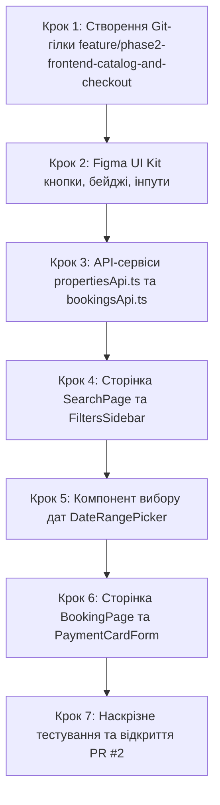

# Інструкція для Розробника №2: Frontend Lead
## Фаза 2: UI Kit, Сторінка пошуку та фільтрів (/search), Календар дат та Форма бронювання (/booking/:id)

---

> **Паспорт ролі:**
> - **Спеціалізація:** Frontend Lead / Client Application Developer
> - **Стек:** React 18, TypeScript, Tailwind CSS, Lucide React, Axios, React Router v6, Context API
> - **Термін виконання:** Тиждень 2–3 (Фаза 2)
> - **Головний результат:** Впровадження фірмового UI Kit за дизайн-системою Booking.com, реалізація повноцінної сторінки пошуку житла `/search` із боковою панеллю динамічних фільтрів (ціна, зручності, тип житла, тогл "Лише з 3D"), сортуванням карток та скелетонами завантаження; інтерактивний компонент вибору дат заїзду/виїзду; сторінка оформлення бронювання `/booking/:id` з автоматичним розрахунком ночей і вартості та валідованою формою Mock-оплати банківською карткою; відкриття PR №2.

---

## 1. Мета та очікувані артефакти Фази 2

У Фазі 2 ви трансформуєте чорнові Wireframes у завершений фірмовий інтерфейс на базі **Figma UI Kit** від UX/UI-дизайнера (Дизайнер №2). Користувач отримує можливість шукати помешкання у каталозі, фільтрувати їх за ключовими критеріями, перевіряти вільні дати та безпомилково здійснювати тестове бронювання.

### 📦 Результати (Deliverables) Розробника №2:
1. **Figma UI Kit & Компонентна база (`frontend/src/components/ui/`)**:
   - `Button`: варіанти `primary` (Booking Blue `#003580`), `secondary` (`#febb02`), `outline`, `ghost`, стани `loading` та `disabled`.
   - `Badge3D`: фірмовий бейдж з іконкою `Box` або `Sparkles` ("3D Тур інтер'єру").
   - `RatingBadge`: оцінка від 1.0 до 10.0 з колірною градацією (зелений `#008009` для $\ge 9.0$) та вербальним описом ("Відмінно", "Дуже добре").
2. **Сторінка результатів пошуку `/search` (`frontend/src/pages/SearchPage.tsx`)**:
   - Зчитування параметрів URL: `city`, `check_in`, `check_out`, `guests`.
   - Бокова панель `FiltersSidebar`: ціновий повзунок `min_price` / `max_price`, чекбокси зручностей, тип помешкання, перемикач `has_3d`.
   - Верхній рядок сортування (`ordering`): "Спочатку дешеві", "Найвищий рейтинг", "Новинки".
   - Відображення карток з фото, ціною за ніч, розрахунком за вказану кількість ночей та бейджем 3D.
   - Скелетони під час завантаження (`PropertyCardSkeleton`) та стан порожнього пошуку (`EmptySearchResults`).
3. **Компонент календаря діапазону дат (`DateRangePicker.tsx`)**:
   - Вибір `check_in` та `check_out` із блокуванням минулих дат.
4. **Сторінка бронювання `/booking/:id` (`frontend/src/pages/BookingPage.tsx`)**:
   - Блок підсумку житла (фото, назва, місто, рейтинг).
   - Калькулятор вартості: $\text{ночі} \times \text{ціна/ніч} + \text{прибирання} = \text{разом}$.
   - Форма даних гостя (ім'я, прізвище, email, телефон, побажання).
   - Форма картки `PaymentCardForm`: маска 16 цифр (`XXXX XXXX XXXX XXXX`), термін дії `MM/YY`, CVV, ім'я власника.
   - Обробка помилок: зрозуміле сповіщення, якщо картка закінчується на `0000` (імітація відмови банку).
5. **Екран успішного підтвердження**: перехід на `/booking/success/:id` або модальне вікно з квитанцією та переходом у кабінет.

---

## 2. Покроковий план реалізації



---

### Крок 1. Підготовка робочої гілки в Git

```bash
cd /home/skmelyuk/Documents/projects/Booking/booking-clone
git checkout main
git pull origin main
git checkout -b feature/phase2-frontend-catalog-and-checkout
```

---

### Крок 2. Базові компоненти UI Kit (`src/components/ui/`)

#### 2.1. Бейдж 3D-туру (`src/components/ui/Badge3D.tsx`):
```tsx
import React from 'react';
import { Box, Sparkles } from 'lucide-react';

interface Badge3DProps {
  size?: 'sm' | 'md';
  showSparkle?: boolean;
}

export const Badge3D: React.FC<Badge3DProps> = ({ size = 'md', showSparkle = true }) => {
  return (
    <span className={`inline-flex items-center gap-1.5 font-semibold rounded-full shadow-sm bg-gradient-to-r from-blue-700 to-indigo-800 text-white ${
      size === 'sm' ? 'px-2 py-0.5 text-xs' : 'px-3 py-1 text-xs tracking-wide'
    }`}>
      <Box className={size === 'sm' ? 'w-3 h-3' : 'w-3.5 h-3.5 animate-pulse'} />
      <span>3D ТУР</span>
      {showSparkle && <Sparkles className="w-3 h-3 text-yellow-300" />}
    </span>
  );
};
```

#### 2.2. Бейдж оцінки та рейтингу (`src/components/ui/RatingBadge.tsx`):
```tsx
import React from 'react';

interface RatingBadgeProps {
  rating: number;
  reviewsCount?: number;
}

export const RatingBadge: React.FC<RatingBadgeProps> = ({ rating, reviewsCount }) => {
  const getRatingLabel = (score: number) => {
    if (score >= 9.0) return 'Відмінно';
    if (score >= 8.0) return 'Дуже добре';
    if (score >= 7.0) return 'Добре';
    return 'Задовільно';
  };

  return (
    <div className="flex items-center gap-2">
      <div className="text-right">
        <div className="text-sm font-semibold text-gray-900">{getRatingLabel(rating)}</div>
        {reviewsCount !== undefined && (
          <div className="text-xs text-gray-500">{reviewsCount} відгуків</div>
        )}
      </div>
      <div className="flex items-center justify-center w-8 h-8 rounded-t-lg rounded-br-lg bg-[#003580] text-white font-bold text-sm shadow-sm">
        {rating.toFixed(1)}
      </div>
    </div>
  );
};
```

---

### Крок 3. Клієнтські API-сервіси (`src/services/`)

#### 3.1. `src/services/propertiesApi.ts`:
```typescript
import api from './api';

export interface LocationDTO {
  id: string;
  city: string;
  country: string;
}

export interface AmenityDTO {
  id: string;
  name: string;
  icon_name: string;
  category: string;
}

export interface PropertyItemDTO {
  id: string;
  title: string;
  property_type: string;
  address: string;
  price_per_night: string;
  cleaning_fee: string;
  max_guests: number;
  bedrooms_count: number;
  bathrooms_count: number;
  rating_avg: number;
  reviews_count: number;
  location: LocationDTO;
  cover_image: string | null;
  has_3d: boolean;
  amenities: AmenityDTO[];
}

export interface PropertySearchParams {
  city?: string;
  check_in?: string;
  check_out?: string;
  guests?: number;
  min_price?: number;
  max_price?: number;
  property_type?: string;
  has_3d?: boolean;
  ordering?: string;
  page?: number;
}

export const propertiesApi = {
  getProperties: async (params: PropertySearchParams) => {
    const response = await api.get('/properties/', { params });
    return response.data; // { count, next, previous, results: PropertyItemDTO[] }
  },
  getPropertyById: async (id: string) => {
    const response = await api.get(`/properties/${id}/`);
    return response.data;
  }
};
```

#### 3.2. `src/services/bookingsApi.ts`:
```typescript
import api from './api';

export interface AvailabilityPayload {
  property_id: string;
  check_in: string;
  check_out: string;
  guests_count: number;
}

export interface AvailabilityResponse {
  available: boolean;
  property_id: string;
  check_in: string;
  check_out: string;
  nights_count: number;
  price_per_night: string;
  cleaning_fee: string;
  total_price: string;
  message: string;
}

export interface MockPaymentCard {
  card_number: string;
  exp_date: string;
  cvv: string;
  card_holder: string;
}

export interface CreateBookingPayload {
  property_id: string;
  check_in: string;
  check_out: string;
  guests_count: number;
  payment_card: MockPaymentCard;
}

export const bookingsApi = {
  checkAvailability: async (payload: AvailabilityPayload): Promise<AvailabilityResponse> => {
    const response = await api.post('/bookings/check-availability/', payload);
    return response.data;
  },
  createBooking: async (payload: CreateBookingPayload) => {
    const response = await api.post('/bookings/', payload);
    return response.data;
  }
};
```

---

### Крок 4. Бокова панель фільтрів та сторінка `/search`

Створіть `src/pages/SearchPage.tsx`:

```tsx
import React, { useEffect, useState } from 'react';
import { useSearchParams, useNavigate } from 'react-router-dom';
import { propertiesApi, PropertyItemDTO, PropertySearchParams } from '../services/propertiesApi';
import { Badge3D } from '../components/ui/Badge3D';
import { RatingBadge } from '../components/ui/RatingBadge';
import { MapPin, SlidersHorizontal, ArrowUpDown } from 'lucide-react';

export const SearchPage: React.FC = () => {
  const [searchParams, setSearchParams] = useSearchParams();
  const navigate = useNavigate();

  const [properties, setProperties] = useState<PropertyItemDTO[]>([]);
  const [totalCount, setTotalCount] = useState<number>(0);
  const [isLoading, setIsLoading] = useState<boolean>(true);

  // Фільтри
  const city = searchParams.get('city') || '';
  const checkIn = searchParams.get('check_in') || '';
  const checkOut = searchParams.get('check_out') || '';
  const guests = Number(searchParams.get('guests')) || 2;
  const [minPrice, setMinPrice] = useState<number>(Number(searchParams.get('min_price')) || 0);
  const [maxPrice, setMaxPrice] = useState<number>(Number(searchParams.get('max_price')) || 10000);
  const [only3D, setOnly3D] = useState<boolean>(searchParams.get('has_3d') === 'true');
  const [ordering, setOrdering] = useState<string>(searchParams.get('ordering') || '-rating_avg');

  const fetchCatalog = async () => {
    setIsLoading(true);
    try {
      const params: PropertySearchParams = {
        city: city || undefined,
        check_in: checkIn || undefined,
        check_out: checkOut || undefined,
        guests: guests || undefined,
        min_price: minPrice > 0 ? minPrice : undefined,
        max_price: maxPrice < 10000 ? maxPrice : undefined,
        has_3d: only3D ? true : undefined,
        ordering: ordering
      };
      const data = await propertiesApi.getProperties(params);
      setProperties(data.results || []);
      setTotalCount(data.count || 0);
    } catch (err) {
      console.error("Помилка завантаження каталогу:", err);
    } finally {
      setIsLoading(false);
    }
  };

  useEffect(() => {
    fetchCatalog();
  }, [searchParams, only3D, ordering]);

  const applyPriceFilter = () => {
    const nextParams = new URLSearchParams(searchParams);
    if (minPrice > 0) nextParams.set('min_price', minPrice.toString());
    else nextParams.delete('min_price');

    if (maxPrice < 10000) nextParams.set('max_price', maxPrice.toString());
    else nextParams.delete('max_price');

    if (only3D) nextParams.set('has_3d', 'true');
    else nextParams.delete('has_3d');

    setSearchParams(nextParams);
  };

  return (
    <div className="max-w-7xl mx-auto px-4 py-8">
      {/* Заголовок результатів */}
      <div className="flex flex-col md:flex-row md:items-center justify-between pb-6 border-b border-gray-200 gap-4">
        <div>
          <h1 className="text-2xl font-bold text-gray-900">
            {city ? `Житло в місті ${city}` : 'Усі доступні помешкання'}
          </h1>
          <p className="text-sm text-gray-500 mt-1">Знайдено об'єктів: {totalCount}</p>
        </div>

        {/* Сортування */}
        <div className="flex items-center gap-2">
          <ArrowUpDown className="w-4 h-4 text-gray-500" />
          <span className="text-sm font-medium text-gray-700">Сортувати:</span>
          <select
            value={ordering}
            onChange={(e) => setOrdering(e.target.value)}
            className="border border-gray-300 rounded-lg px-3 py-1.5 text-sm font-medium focus:ring-2 focus:ring-[#003580] outline-none"
          >
            <option value="-rating_avg">Найвищий рейтинг</option>
            <option value="price_per_night">Спочатку дешевші</option>
            <option value="-price_per_night">Спочатку дорожчі</option>
            <option value="-created_at">Новинки</option>
          </select>
        </div>
      </div>

      <div className="grid grid-cols-1 lg:grid-cols-4 gap-8 mt-8">
        {/* Бокова панель фільтрів */}
        <div className="lg:col-span-1 space-y-6 bg-white p-6 rounded-xl border border-gray-200 shadow-sm h-fit">
          <div className="flex items-center gap-2 pb-4 border-b border-gray-100 font-bold text-gray-900">
            <SlidersHorizontal className="w-5 h-5 text-[#003580]" />
            <span>Фільтри пошуку</span>
          </div>

          {/* Тогл 3D туру */}
          <div className="flex items-center justify-between py-2">
            <span className="text-sm font-semibold text-gray-800">Тільки з 3D туром</span>
            <input
              type="checkbox"
              checked={only3D}
              onChange={(e) => setOnly3D(e.target.checked)}
              className="w-5 h-5 text-[#003580] rounded focus:ring-[#003580] cursor-pointer"
            />
          </div>

          {/* Діапазон цін */}
          <div>
            <label className="text-sm font-semibold text-gray-800 block mb-2">Діапазон цін за ніч (грн)</label>
            <div className="grid grid-cols-2 gap-2">
              <input
                type="number"
                placeholder="Від"
                value={minPrice}
                onChange={(e) => setMinPrice(Number(e.target.value))}
                className="border border-gray-300 rounded-lg p-2 text-sm outline-none focus:border-[#003580]"
              />
              <input
                type="number"
                placeholder="До"
                value={maxPrice}
                onChange={(e) => setMaxPrice(Number(e.target.value))}
                className="border border-gray-300 rounded-lg p-2 text-sm outline-none focus:border-[#003580]"
              />
            </div>
            <button
              onClick={applyPriceFilter}
              className="w-full mt-3 bg-[#003580] hover:bg-blue-900 text-white font-medium py-2 rounded-lg text-sm transition"
            >
              Застосувати ціну
            </button>
          </div>
        </div>

        {/* Список карток помешкань */}
        <div className="lg:col-span-3 space-y-6">
          {isLoading ? (
            <div className="space-y-4">
              {[1, 2, 3].map((n) => (
                <div key={n} className="h-56 bg-gray-100 animate-pulse rounded-xl" />
              ))}
            </div>
          ) : properties.length === 0 ? (
            <div className="text-center py-16 bg-white rounded-xl border border-gray-200">
              <h3 className="text-lg font-bold text-gray-800">Нічого не знайдено</h3>
              <p className="text-sm text-gray-500 mt-2">Спробуйте змінити фільтри або вибрати інші дати.</p>
            </div>
          ) : (
            properties.map((item) => (
              <div
                key={item.id}
                className="flex flex-col md:flex-row bg-white rounded-xl border border-gray-200 overflow-hidden shadow-sm hover:shadow-md transition"
              >
                {/* Фото з бейджем 3D */}
                <div className="relative md:w-72 h-56 md:h-auto bg-gray-200 flex-shrink-0">
                  
                  {item.has_3d && (
                    <div className="absolute top-3 left-3">
                      <Badge3D />
                    </div>
                  )}
                </div>

                {/* Опис та вартість */}
                <div className="p-5 flex-1 flex flex-col justify-between">
                  <div>
                    <div className="flex items-start justify-between gap-2">
                      <h2 className="text-lg font-bold text-gray-900 hover:text-[#003580] cursor-pointer" onClick={() => navigate(`/properties/${item.id}`)}>
                        {item.title}
                      </h2>
                      <RatingBadge rating={Number(item.rating_avg)} reviewsCount={item.reviews_count} />
                    </div>

                    <div className="flex items-center gap-1.5 text-xs text-gray-500 mt-1">
                      <MapPin className="w-3.5 h-3.5 text-gray-400" />
                      <span>{item.location.city}, {item.address}</span>
                    </div>

                    <div className="flex flex-wrap gap-2 mt-4">
                      {item.amenities.slice(0, 4).map((a) => (
                        <span key={a.id} className="text-xs bg-gray-100 text-gray-600 px-2 py-1 rounded">
                          {a.name}
                        </span>
                      ))}
                    </div>
                  </div>

                  <div className="flex items-end justify-between pt-4 border-t border-gray-100 mt-4">
                    <div>
                      <span className="text-xs text-gray-500 block">Ціна за 1 ніч:</span>
                      <span className="text-xl font-extrabold text-[#003580]">
                        {Number(item.price_per_night).toLocaleString()} грн
                      </span>
                    </div>

                    <button
                      onClick={() => navigate(`/booking/${item.id}?check_in=${checkIn}&check_out=${checkOut}&guests=${guests}`)}
                      className="bg-[#003580] hover:bg-blue-900 text-white font-semibold px-5 py-2.5 rounded-lg text-sm transition"
                    >
                      Забронювати
                    </button>
                  </div>
                </div>
              </div>
            ))
          )}
        </div>
      </div>
    </div>
  );
};
```

---

### Крок 5. Сторінка бронювання житла `/booking/:id` з валідацією картки

Створіть `src/pages/BookingPage.tsx`:

```tsx
import React, { useState, useEffect } from 'react';
import { useParams, useSearchParams, useNavigate } from 'react-router-dom';
import { propertiesApi, PropertyItemDTO } from '../services/propertiesApi';
import { bookingsApi, AvailabilityResponse } from '../services/bookingsApi';
import { CreditCard, CheckCircle2, AlertTriangle, ShieldCheck } from 'lucide-react';

export const BookingPage: React.FC = () => {
  const { id } = useParams<{ id: string }>();
  const [searchParams] = useSearchParams();
  const navigate = useNavigate();

  const checkIn = searchParams.get('check_in') || '';
  const checkOut = searchParams.get('check_out') || '';
  const guests = Number(searchParams.get('guests')) || 2;

  const [prop, setProp] = useState<PropertyItemDTO | null>(null);
  const [calc, setCalc] = useState<AvailabilityResponse | null>(null);
  const [errorMsg, setErrorMsg] = useState<string | null>(null);
  const [isSubmitting, setIsSubmitting] = useState<boolean>(false);
  const [isSuccess, setIsSuccess] = useState<boolean>(false);

  // Форма картки
  const [cardNumber, setCardNumber] = useState('');
  const [expDate, setExpDate] = useState('');
  const [cvv, setCvv] = useState('');
  const [cardHolder, setCardHolder] = useState('');

  useEffect(() => {
    if (!id || !checkIn || !checkOut) return;

    propertiesApi.getPropertyById(id).then(setProp);
    bookingsApi.checkAvailability({
      property_id: id,
      check_in: checkIn,
      check_out: checkOut,
      guests_count: guests
    })
      .then(setCalc)
      .catch((err) => setErrorMsg(err.response?.data?.detail || "Помилка перевірки доступності"));
  }, [id, checkIn, checkOut, guests]);

  const handleCardNumberChange = (e: React.ChangeEvent<HTMLInputElement>) => {
    const raw = e.target.value.replace(/\D/g, '').slice(0, 16);
    const formatted = raw.replace(/(\d{4})(?=\d)/g, '$1 ');
    setCardNumber(formatted);
  };

  const handleExpDateChange = (e: React.ChangeEvent<HTMLInputElement>) => {
    const raw = e.target.value.replace(/\D/g, '').slice(0, 4);
    if (raw.length >= 2) {
      setExpDate(`${raw.slice(0, 2)}/${raw.slice(2)}`);
    } else {
      setExpDate(raw);
    }
  };

  const handleSubmit = async (e: React.FormEvent) => {
    e.preventDefault();
    if (!id || !calc) return;

    setErrorMsg(null);
    setIsSubmitting(true);

    try {
      await bookingsApi.createBooking({
        property_id: id,
        check_in: checkIn,
        check_out: checkOut,
        guests_count: guests,
        payment_card: {
          card_number: cardNumber.replace(/\s/g, ''),
          exp_date: expDate,
          cvv: cvv,
          card_holder: cardHolder
        }
      });
      setIsSuccess(true);
    } catch (err: any) {
      setErrorMsg(err.response?.data?.detail || err.response?.data?.payment_card?.card_number || "Не вдалося оформити бронювання.");
    } finally {
      setIsSubmitting(false);
    }
  };

  if (isSuccess) {
    return (
      <div className="max-w-xl mx-auto my-16 p-8 bg-white rounded-2xl border border-gray-200 text-center shadow-lg">
        <CheckCircle2 className="w-16 h-16 text-green-600 mx-auto mb-4" />
        <h2 className="text-2xl font-bold text-gray-900">Бронювання успішно підтверджено!</h2>
        <p className="text-sm text-gray-600 mt-2">
          Ваші дати заблоковано, оплату імітовано (PAID_MOCK). Деталі доступні у вашому особистому кабінеті.
        </p>
        <button
          onClick={() => navigate('/cabinet')}
          className="mt-6 bg-[#003580] hover:bg-blue-900 text-white font-semibold px-6 py-2.5 rounded-lg transition"
        >
          Перейти до моїх бронювань
        </button>
      </div>
    );
  }

  return (
    <div className="max-w-5xl mx-auto px-4 py-8">
      <h1 className="text-2xl font-bold text-gray-900 mb-6">Оформлення бронювання</h1>

      {errorMsg && (
        <div className="mb-6 p-4 bg-red-50 border border-red-200 rounded-lg flex items-center gap-3 text-red-700 text-sm">
          <AlertTriangle className="w-5 h-5 flex-shrink-0" />
          <span>{errorMsg}</span>
        </div>
      )}

      <div className="grid grid-cols-1 lg:grid-cols-3 gap-8">
        {/* Форма оплати */}
        <form onSubmit={handleSubmit} className="lg:col-span-2 space-y-6 bg-white p-6 rounded-xl border border-gray-200 shadow-sm">
          <div className="flex items-center gap-2 pb-4 border-b border-gray-100">
            <CreditCard className="w-5 h-5 text-[#003580]" />
            <h2 className="text-lg font-bold text-gray-900">Імітація банківської картки (Mock Payment)</h2>
          </div>

          <div>
            <label className="block text-sm font-semibold text-gray-700 mb-1">Ім'я на картці</label>
            <input
              type="text"
              required
              placeholder="TARAS SHEVCHENKO"
              value={cardHolder}
              onChange={(e) => setCardHolder(e.target.value.toUpperCase())}
              className="w-full border border-gray-300 rounded-lg p-2.5 text-sm outline-none focus:border-[#003580]"
            />
          </div>

          <div>
            <label className="block text-sm font-semibold text-gray-700 mb-1">Номер картки (16 цифр)</label>
            <input
              type="text"
              required
              placeholder="4111 2222 3333 4444"
              value={cardNumber}
              onChange={handleCardNumberChange}
              className="w-full border border-gray-300 rounded-lg p-2.5 text-sm font-mono outline-none focus:border-[#003580]"
            />
            <p className="text-xs text-gray-400 mt-1">Підказка: картка з закінченням 0000 імітує відмову банку.</p>
          </div>

          <div className="grid grid-cols-2 gap-4">
            <div>
              <label className="block text-sm font-semibold text-gray-700 mb-1">Термін дії</label>
              <input
                type="text"
                required
                placeholder="MM/YY"
                value={expDate}
                onChange={handleExpDateChange}
                className="w-full border border-gray-300 rounded-lg p-2.5 text-sm font-mono outline-none focus:border-[#003580]"
              />
            </div>
            <div>
              <label className="block text-sm font-semibold text-gray-700 mb-1">CVV</label>
              <input
                type="password"
                required
                maxLength={4}
                placeholder="123"
                value={cvv}
                onChange={(e) => setCvv(e.target.value.replace(/\D/g, ''))}
                className="w-full border border-gray-300 rounded-lg p-2.5 text-sm font-mono outline-none focus:border-[#003580]"
              />
            </div>
          </div>

          <div className="pt-4 border-t border-gray-100 flex items-center justify-between">
            <div className="flex items-center gap-1.5 text-xs text-green-700">
              <ShieldCheck className="w-4 h-4" />
              <span>Безпечний тестовий шлюз транзакцій</span>
            </div>
            <button
              type="submit"
              disabled={isSubmitting || !calc?.available}
              className="bg-[#008009] hover:bg-green-700 text-white font-bold px-8 py-3 rounded-lg text-sm transition shadow disabled:opacity-50"
            >
              {isSubmitting ? 'Бронювання...' : `Оплатити ${calc ? Number(calc.total_price).toLocaleString() : ''} грн`}
            </button>
          </div>
        </form>

        {/* Підсумок ціни */}
        {prop && calc && (
          <div className="lg:col-span-1 bg-white p-6 rounded-xl border border-gray-200 shadow-sm space-y-4 h-fit">
            <h3 className="font-bold text-gray-900 border-b border-gray-100 pb-3">{prop.title}</h3>
            <div className="text-xs text-gray-500">
              Заїзд: <span className="font-semibold text-gray-800">{calc.check_in}</span>
              <br />
              Виїзд: <span className="font-semibold text-gray-800">{calc.check_out}</span>
              <br />
              Кількість ночей: <span className="font-semibold text-gray-800">{calc.nights_count}</span>
            </div>

            <div className="pt-3 border-t border-gray-100 text-sm space-y-2">
              <div className="flex justify-between text-gray-600">
                <span>{calc.nights_count} ночей × {Number(calc.price_per_night).toLocaleString()} грн</span>
                <span>{(calc.nights_count * Number(calc.price_per_night)).toLocaleString()} грн</span>
              </div>
              <div className="flex justify-between text-gray-600">
                <span>Прибирання</span>
                <span>{Number(calc.cleaning_fee).toLocaleString()} грн</span>
              </div>
              <div className="flex justify-between font-extrabold text-base text-[#003580] pt-2 border-t border-gray-200">
                <span>Всього до сплати</span>
                <span>{Number(calc.total_price).toLocaleString()} грн</span>
              </div>
            </div>
          </div>
        )}
      </div>
    </div>
  );
};
```

---

### Крок 6. Наскрізне тестування та відкриття PR №2

1. Протестуйте клієнтський ланцюжок: вибір параметрів на головній ➔ результати на `/search` ➔ перехід на сторінку бронювання `/booking/:id` ➔ введення тестової картки.
2. Відкрийте PR №2 у GitHub:
   ```bash
   git add .
   git commit -m "feat(phase-2): add search filters page, date picker and mock booking flow"
   git push origin feature/phase2-frontend-catalog-and-checkout
   ```
3. Після перевірки та тестування обома розробниками виконайте злиття у `main`.
