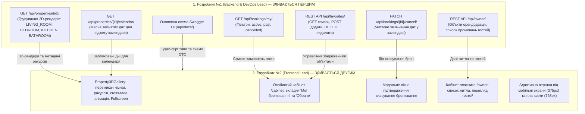

# Загальний план координації: Фаза 3 (Інтеграція 3D-галереї, Особисті кабінети та Адаптивність)
## Навчальний клон сервісу бронювання житла Booking.com 3D

Цей каталог містить вичерпні покрокові інструкції для **двох розробників** для виконання завдань **Фази 3** (Тиждень 3–4) відповідно до [Дорожньої карти проєкту](../roadmap/phases-and-milestones.md), [Архітектури системи](../architecture/system-overview.md), [Схеми бази даних](../architecture/database-schema.md) та [Життєвого циклу бронювання](../architecture/booking-lifecycle.md).

---

## 👥 Спеціалізація та індивідуальні інструкції

| Розробник | Роль у проєкті | Посилання на інструкцію | Ключові модулі | Головний артефакт Фази 3 |
| :---: | :--- | :--- | :--- | :--- |
| **Розробник №1** | **Backend & DevOps Lead** | [dev-1-backend-devops.md](dev-1-backend-devops.md) | `GET /api/properties/{id}/` з групуванням 3D-рендерів за кімнатами, API кабінету гостя (`/api/bookings/my/`, скасування `cancel/`), календар зайнятих дат, модуль "Обране" (`/api/favorites/`), API кабінету власника (`/api/owner/`) | Ендпоінти деталей помешкання з повною колекцією 3D-рендерів, кабінет гостя зі скасуванням броні, модуль збереженого житла, API власника для моніторингу заявок |
| **Розробник №2** | **Frontend Lead** | [dev-2-frontend.md](dev-2-frontend.md) | **Інтерактивна 3D-галерея інтер'єру** (`Property3DGallery`), повноекранний Lightbox, анімація зміни ракурсів, особистий кабінет гостя (`/cabinet`), кабінет власника (`/owner`), мобільна адаптивність (375px/768px) | Працююча 3D-галерея з перемикачем кімнат і ракурсів 3ds Max, кабінет користувача з керуванням бронюваннями та списком обраного, адаптивний інтерфейс для смартфонів |

---

## 🔄 Схема командної взаємодії у Фазі 3



---

## 🌿 Регламент роботи з Git у Фазі 3

### 1. Назви робочих гілок:
- **Розробник №1**: `feature/phase3-backend-cabinets-and-3d`
- **Розробник №2**: `feature/phase3-frontend-3d-gallery-and-cabinets`

### 2. Суворий двоетапний порядок злиття (Strict Merge Order):
1. **PR №1 (Розробник №1 — Backend & DevOps Lead)**:
   - Включає ендпоінти деталей житла зі структурованими 3D-рендерами, API кабінету гостя, скасування бронювання з перевіркою власника запису, календар зайнятих дат, модуль обраного та ендпоінти кабінету власника.
   - Розробник №2 тестує роботу через Swagger UI та тестовий файл [`docs/phase-3/api-tests.http`](api-tests.http) і дає **Approve**.
   - Розробник №1 зливає PR у `main`.

2. **PR №2 (Розробник №2 — Frontend Lead)**:
   - Після оновлення `main` Розробник №2 підтягує актуальну гілку (`git pull origin main`), підключає 3D-галерею до сторінки деталей помешкання `/properties/:id`, реалізує кабінет гостя `/cabinet`, кабінет власника `/owner` та тестує адаптивність верстки на мобільних пристроях.
   - Проводиться спільний наскрізний **Sprint 3 Smoke Test**.
   - Розробник №1 апрувить код, і PR зливається у `main`.

---

## 🧪 Спільний інтеграційний тест (Sprint 3 Smoke Test)

Перед закриттям Фази 3 вся команда проводить наскрізне тестування взаємодії клієнта, кабінетів та 3D-модуля:

1. **Крок 1: Запуск оновленої інфраструктури**:
   ```bash
   git checkout main
   git pull origin main
   docker compose up -d
   docker compose exec backend python manage.py migrate
   docker compose exec backend python manage.py test apps.bookings apps.reviews
   ```

2. **Крок 2: Автоматизовані тести через REST Client (`api-tests.http`)**:
   - Відкрити файл [`docs/phase-3/api-tests.http`](api-tests.http).
   - Отримати детальну інформацію про помешкання `GET /api/properties/{id}/` ➔ переконатися, що повертається масив `images_3d` з полями `room_type`, `camera_angle`, `render_engine`.
   - Запитати список заброньованих дат `GET /api/properties/{id}/calendar/`.
   - Додати житло в обране `POST /api/favorites/{id}/` ➔ перевірити наявність у списку `GET /api/favorites/` ➔ видалити `DELETE /api/favorites/{id}/`.
   - Перевірити список бронювань гостя `GET /api/bookings/my/`.
   - Виконати скасування бронювання `PATCH /api/bookings/{id}/cancel/` ➔ переконатися, що статус змінився на `CANCELLED`, а дати негайно зникли з календаря зайнятості.
   - Авторизуватися як власник та перевірити ендпоінти `GET /api/owner/properties/` та `GET /api/owner/bookings/`.

3. **Крок 3: Перевірка інтерфейсу React у браузері**:
   - Відкрити `http://localhost:5173/properties/:id` (об'єкт із 3D-бейджем).
   - **Тестування 3D-галереї**:
     - Перемкнути кімнату (наприклад, "Вітальня" ➔ "Спальня").
     - Перемкнути ракурс камери (наприклад, "Панорама" ➔ "Вид від входу") ➔ перевірити плавний cross-fade перехід зображень.
     - Натиснути кнопку повноекранного перегляду (Lightbox) ➔ перевірити зум та масштабування рендеру високої роздільної здатності.
   - Натиснути кнопку з сердечком "Додати в обране" ➔ перевірити збереження стану.
   - Перейти в особистий кабінет `/cabinet`:
     - Перевірити вкладку "Мої бронювання" (картка щойно оформленого або тестового замовлення).
     - Натиснути "Скасувати бронювання" ➔ підтвердити в модалці ➔ картка повинна змінити статус на "Скасовано".
     - Перевірити вкладку "Обране" (відображення збереженого помешкання).
   - Відкрити інструменти розробника Chrome DevTools, увімкнути режим емуляції мобільного пристрою (iPhone 14 / 375px):
     - Перевірити, що меню згорнулося у "гамбургер".
     - Перевірити зручність кнопок перемикання кімнат 3D-галереї на мобільному екрані.

---

## ✅ Загальний критерій готовності (Definition of Done) Фази 3

Фаза 3 вважається успішно завершеною, коли:
- [x] Реалізовано повний DTO деталей помешкання з колекцією 3D-рендерів інтер'єру з 3ds Max.
- [x] Створено API особистого кабінету гостя (`GET /api/bookings/my/`, `PATCH /api/bookings/{id}/cancel/`).
- [x] Реалізовано миттєве звільнення заброньованих дат при скасуванні та ендпоінт календаря зайнятості `/calendar/`.
- [x] Реалізовано модуль збереження об'єктів у "Обране" (`/api/favorites/`).
- [x] Реалізовано ендпоінти кабінету власника житла (`/api/owner/properties/`, `/api/owner/bookings/`).
- [x] На фронтенді розроблено інтерактивну 3D-галерею з перемикачем кімнат, ракурсів, плавною анімацією та Lightbox.
- [x] Зверстано сторінку особистого кабінету гостя `/cabinet` із керуванням бронюваннями та обраним.
- [x] Забезпечено повну адаптивність під мобільні екрани (375px) та планшети (768px).
- [x] Усі сценарії успішно пройшли інтеграційний Smoke Test.
- [x] Усі Pull Requests переглянуті, схвалені та об'єднані в `main`.
