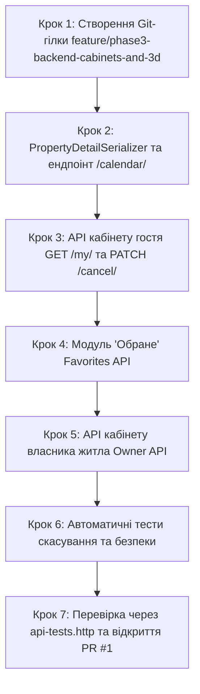

# Інструкція для Розробника №1: Backend & DevOps Lead
## Фаза 3: Деталі житла з 3D-модулем, Кабінет гостя (скасування броні), Календар зайнятості, Обране та API власника

---

> **Паспорт ролі:**
> - **Спеціалізація:** Backend Developer & DevOps Lead
> - **Стек:** Python 3.11+, Django 5+, Django REST Framework (DRF), PostgreSQL 16, SimpleJWT, Permissions (RBAC), drf-spectacular (OpenAPI 3)
> - **Термін виконання:** Тиждень 3–4 (Фаза 3)
> - **Головний результат:** Повний REST API деталей помешкання `GET /api/properties/{id}/` з колекцією 3D-рендерів інтер'єру з 3ds Max; ендпоінти особистого кабінету гостя (`GET /api/bookings/my/`, `PATCH /api/bookings/{id}/cancel/`); календар зайнятих дат об'єкта `/calendar/`; повноцінний модуль "Обране" (`/api/favorites/`); API кабінету орендодавця (`/api/owner/properties/`, `/api/owner/bookings/`); оновлення документації Swagger UI та створення PR №1 у `main`.

---

## 1. Мета та очікувані артефакти Фази 3

У Фазі 3 ви забезпечуєте бекенд-інфраструктуру для демонстрації головної фічі сервісу — інтерактивного огляду 3D-візуалізацій інтер'єру, а також розробляєте персоналізовані кабінети для гостей та орендодавців із безпечним скасуванням замовлень та відстеженням зайнятості житла.

### 📦 Результати (Deliverables) Розробника №1:
1. **Детальний DTO помешкання (`GET /api/properties/{id}/`)**:
   - Повна інформація: опис, адреса, господар, зручності, звичайні фото та структурований масив `images_3d` із метаданими кімнати (`room_type`), ракурсу камери (`camera_angle`) та рушія візуалізації (`render_engine`).
2. **Ендпоінт календаря доступності (`GET /api/properties/{id}/calendar/`)**:
   - Повертає список заброньованих інтервалів дат (`check_in`, `check_out`) для візуального блокування днів у календарі фронтенду.
3. **API особистого кабінету гостя (`apps/bookings/views.py`)**:
   - `GET /api/bookings/my/` — список бронювань авторизованого користувача з можливістю фільтрації за статусом (`active`, `past`, `cancelled`).
   - `PATCH /api/bookings/{id}/cancel/` — скасування бронювання з перевіркою прав доступу (тільки власник броні) та перевіркою правила: скасування можливе лише до настання дати заїзду (`check_in >= date.today()`). Дати миттєво звільняються для інших гостей.
4. **Модуль "Обране" (Favorites) (`apps/reviews/views.py` або `apps/properties/views.py`)**:
   - `GET /api/favorites/` — список об'єктів, збережених користувачем.
   - `POST /api/favorites/{property_id}/` — додавання житла до обраного (`get_or_create`).
   - `DELETE /api/favorites/{property_id}/` — видалення житла з обраного.
5. **API кабінету власника житла (`apps/properties/owner_views.py`)**:
   - Клас дозволів `IsOwnerRole` (перевірка `role in ['OWNER', 'ADMIN']`).
   - `GET /api/owner/properties/` — список об'єктів поточного орендодавця з лічильником активних бронювань.
   - `POST /api/owner/properties/` — швидке створення нового об'єкта житла.
   - `GET /api/owner/bookings/` — список заявок та бронювань гостей по об'єктах власника.
6. **Оновлена документація Swagger UI (`/api/docs/`)**: теги `Bookings Cabinet`, `Favorites`, `Owner Cabinet`.

---

## 2. Покроковий план реалізації



---

### Крок 1. Підготовка робочої гілки в Git

```bash
cd /home/skmelyuk/Documents/projects/Booking/booking-clone
git checkout main
git pull origin main
git checkout -b feature/phase3-backend-cabinets-and-3d
```

---

### Крок 2. Детальний серіалізатор житла та ендпоінт календаря

Оновіть `backend/apps/properties/serializers.py`, додавши детальний DTO:

```python
from rest_framework import serializers
from .models import Property, PropertyImage, Property3DImage, Amenity, Location
from apps.users.serializers import UserProfileSerializer

class PropertyImageSerializer(serializers.ModelSerializer):
    class Meta:
        model = PropertyImage
        fields = ['id', 'image', 'is_cover', 'display_order']

class Property3DImageDetailSerializer(serializers.ModelSerializer):
    room_type_display = serializers.CharField(source='get_room_type_display', read_only=True)

    class Meta:
        model = Property3DImage
        fields = [
            'id', 'image', 'room_type', 'room_type_display',
            'camera_angle', 'render_engine', 'display_order', 'created_at'
        ]

class PropertyDetailSerializer(serializers.ModelSerializer):
    owner = UserProfileSerializer(read_only=True)
    location = LocationSerializer(read_only=True)
    amenities = AmenitySerializer(many=True, read_only=True)
    images = PropertyImageSerializer(many=True, read_only=True)
    images_3d = Property3DImageDetailSerializer(many=True, read_only=True)
    has_3d = serializers.SerializerMethodField()

    class Meta:
        model = Property
        fields = [
            'id', 'owner', 'location', 'title', 'description', 'property_type',
            'address', 'price_per_night', 'cleaning_fee', 'max_guests',
            'bedrooms_count', 'bathrooms_count', 'rating_avg', 'reviews_count',
            'is_active', 'amenities', 'images', 'images_3d', 'has_3d', 'created_at'
        ]

    def get_has_3d(self, obj):
        return obj.images_3d.exists()
```

Додайте дію `calendar` у `backend/apps/properties/views.py`:

```python
from datetime import date
from rest_framework.decorators import action
from rest_framework.response import Response
from drf_spectacular.utils import extend_schema
from apps.bookings.models import Booking

# Всередині PropertyViewSet:
    @extend_schema(
        summary="Календар заброньованих дат помешкання",
        responses={200: list},
        tags=["Properties"]
    )
    @action(detail=True, methods=['get'], url_path='calendar', permission_classes=[permissions.AllowAny])
    def calendar(self, request, pk=None):
        prop = self.get_object()
        active_bookings = Booking.objects.filter(
            property=prop,
            status__in=[Booking.Status.PENDING, Booking.Status.CONFIRMED],
            check_out__gte=date.today()
        ).values('check_in', 'check_out')

        return Response(list(active_bookings))

    def get_serializer_class(self):
        if self.action == 'retrieve':
            return PropertyDetailSerializer
        return PropertyListSerializer
```

---

### Крок 3. API кабінету гостя (`/api/bookings/my/` та `cancel/`)

Створіть у `backend/apps/bookings/serializers.py` серіалізатор для списку бронювань користувача:

```python
from apps.properties.serializers import PropertyListSerializer

class MyBookingSerializer(serializers.ModelSerializer):
    property = PropertyListSerializer(read_only=True)
    status_display = serializers.CharField(source='get_status_display', read_only=True)
    can_cancel = serializers.SerializerMethodField()

    class Meta:
        model = Booking
        fields = [
            'id', 'property', 'check_in', 'check_out', 'guests_count',
            'nights_count', 'total_price', 'status', 'status_display',
            'payment_status', 'can_cancel', 'created_at'
        ]

    def get_can_cancel(self, obj):
        # Скасування дозволено лише якщо статус підтверджено і дата заїзду ще не настала
        return obj.status == Booking.Status.CONFIRMED and obj.check_in >= date.today()
```

Додайте ViewSet кабінету у `backend/apps/bookings/views.py`:

```python
from rest_framework import viewsets, permissions, status
from rest_framework.decorators import action
from rest_framework.response import Response
from drf_spectacular.utils import extend_schema
from .serializers import MyBookingSerializer

class GuestBookingViewSet(viewsets.ReadOnlyModelViewSet):
    serializer_class = MyBookingSerializer
    permission_classes = [permissions.IsAuthenticated]

    def get_queryset(self):
        qs = Booking.objects.filter(user=self.request.user).select_related('property', 'property__location').prefetch_related('property__images', 'property__images_3d')
        status_filter = self.request.query_params.get('filter')

        today = date.today()
        if status_filter == 'active':
            return qs.filter(status=Booking.Status.CONFIRMED, check_out__gte=today).order_by('check_in')
        elif status_filter == 'past':
            return qs.filter(check_out__lt=today).order_by('-check_out')
        elif status_filter == 'cancelled':
            return qs.filter(status=Booking.Status.CANCELLED).order_by('-created_at')

        return qs.order_by('-created_at')

    @extend_schema(summary="Скасування бронювання гостем", tags=["Bookings Cabinet"])
    @action(detail=True, methods=['patch'], url_path='cancel')
    def cancel_booking(self, request, pk=None):
        booking = self.get_object()

        if booking.status == Booking.Status.CANCELLED:
            return Response({"detail": "Це бронювання вже було скасовано раніше."}, status=status.HTTP_400_BAD_REQUEST)

        if booking.check_in < date.today():
            return Response({"detail": "Неможливо скасувати бронювання після настання дати заїзду."}, status=status.HTTP_400_BAD_REQUEST)

        booking.status = Booking.Status.CANCELLED
        booking.save()

        return Response(MyBookingSerializer(booking).data, status=status.HTTP_200_OK)
```

---

### Крок 4. Модуль "Обране" (Favorites API)

Створіть `backend/apps/properties/favorites_views.py`:

```python
from rest_framework import views, permissions, status
from rest_framework.response import Response
from drf_spectacular.utils import extend_schema
from .models import Property
from apps.reviews.models import Favorite
from .serializers import PropertyListSerializer

class FavoritesListView(views.APIView):
    permission_classes = [permissions.IsAuthenticated]

    @extend_schema(summary="Список збережених об'єктів у Обраному", tags=["Favorites"])
    def get(self, request):
        favorites = Favorite.objects.filter(user=request.user).select_related('property', 'property__location')
        properties = [f.property for f in favorites if f.property.is_active]
        serializer = PropertyListSerializer(properties, many=True, context={'request': request})
        return Response(serializer.data)

class FavoriteToggleView(views.APIView):
    permission_classes = [permissions.IsAuthenticated]

    @extend_schema(summary="Додати житло в Обране", tags=["Favorites"])
    def post(self, request, property_id):
        try:
            prop = Property.objects.get(id=property_id, is_active=True)
        except Property.DoesNotExist:
            return Response({"detail": "Помешкання не знайдено."}, status=status.HTTP_404_NOT_FOUND)

        favorite, created = Favorite.objects.get_or_create(user=request.user, property=prop)
        return Response({"status": "added", "property_id": str(prop.id)}, status=status.HTTP_201_CREATED)

    @extend_schema(summary="Видалити житло з Обраного", tags=["Favorites"])
    def delete(self, request, property_id):
        Favorite.objects.filter(user=request.user, property_id=property_id).delete()
        return Response({"status": "removed", "property_id": str(property_id)}, status=status.HTTP_204_NO_CONTENT)
```

---

### Крок 5. API кабінету власника житла (Owner API)

Створіть `backend/apps/properties/owner_views.py`:

```python
from rest_framework import viewsets, permissions, status
from rest_framework.response import Response
from drf_spectacular.utils import extend_schema
from .models import Property
from .serializers import PropertyDetailSerializer, PropertyListSerializer
from apps.bookings.models import Booking
from apps.bookings.serializers import MyBookingSerializer

class IsOwnerOrAdminPermission(permissions.BasePermission):
    def has_permission(self, request, view):
        return request.user.is_authenticated and (request.user.role in ['OWNER', 'ADMIN'] or request.user.is_staff)

class OwnerPropertyViewSet(viewsets.ModelViewSet):
    serializer_class = PropertyDetailSerializer
    permission_classes = [IsOwnerOrAdminPermission]

    def get_queryset(self):
        return Property.objects.filter(owner=self.request.user).select_related('location').prefetch_related('images', 'images_3d', 'amenities')

    def perform_create(self, serializer):
        serializer.save(owner=self.request.user)

class OwnerBookingsViewSet(viewsets.ReadOnlyModelViewSet):
    serializer_class = MyBookingSerializer
    permission_classes = [IsOwnerOrAdminPermission]

    def get_queryset(self):
        return Booking.objects.filter(property__owner=self.request.user).select_related('user', 'property', 'property__location').order_by('-created_at')
```

Підключіть нові маршрути у `backend/core/urls.py`:

```python
# backend/core/urls.py
from apps.bookings.views import GuestBookingViewSet
from apps.properties.favorites_views import FavoritesListView, FavoriteToggleView
from apps.properties.owner_views import OwnerPropertyViewSet, OwnerBookingsViewSet

router.register(r'bookings/my', GuestBookingViewSet, basename='my-bookings')
router.register(r'owner/properties', OwnerPropertyViewSet, basename='owner-properties')
router.register(r'owner/bookings', OwnerBookingsViewSet, basename='owner-bookings')

urlpatterns += [
    path('api/favorites/', FavoritesListView.as_view(), name='favorites-list'),
    path('api/favorites/<uuid:property_id>/', FavoriteToggleView.as_view(), name='favorites-toggle'),
]
```

---

### Крок 6. Автоматичні тести скасування бронювання (`apps/bookings/tests.py`)

Додайте тест скасування:

```python
    def test_guest_can_cancel_future_booking(self):
        in_date = date.today() + timedelta(days=7)
        out_date = date.today() + timedelta(days=10)

        booking = Booking.objects.create(
            user=self.user1, property=self.prop, check_in=in_date,
            check_out=out_date, guests_count=2, nights_count=3,
            total_price=4800.00, status=Booking.Status.CONFIRMED
        )

        booking.status = Booking.Status.CANCELLED
        booking.save()

        self.assertEqual(booking.status, Booking.Status.CANCELLED)

        # Перевірка: дати більше не вважаються зайнятими
        has_conflict = Booking.objects.filter(
            property=self.prop,
            status__in=[Booking.Status.CONFIRMED],
            check_in__lt=out_date,
            check_out__gt=in_date
        ).exists()

        self.assertFalse(has_conflict)
```

---

### Крок 7. Перевірка через REST Client та відкриття PR №1

1. Відкрийте файл [`docs/phase-3/api-tests.http`](api-tests.http) та виконайте всі запити кабінету гостя, скасування та обраного.
2. Зробіть коміт та відправте гілку:
   ```bash
   git add .
   git commit -m "feat(phase-3): add property 3d detail, guest cabinet, cancellation, favorites and owner API"
   git push origin feature/phase3-backend-cabinets-and-3d
   ```
3. Відкрийте PR №1 на GitHub, передайте контракти Розробнику №2 та злийте після схвалення.
