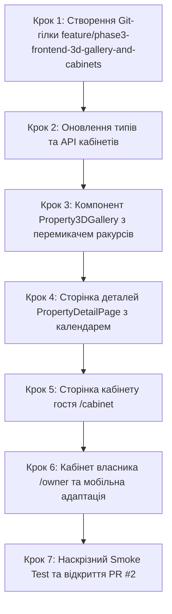

# Інструкція для Розробника №2: Frontend Lead
## Фаза 3: Інтерактивна 3D-галерея (3ds Max), Особистий кабінет гостя (/cabinet), Кабінет власника та Адаптивність

---

> **Паспорт ролі:**
> - **Спеціалізація:** Frontend Lead / Client Application Developer
> - **Стек:** React 18, TypeScript, Tailwind CSS, Lucide React, Axios, React Router v6, Context API
> - **Термін виконання:** Тиждень 3–4 (Фаза 3)
> - **Головний результат:** Реалізація фірмової **інтерактивної 3D-галереї інтер'єрів** (`Property3DGallery`) на сторінці помешкання `/properties/:id` з перемикачем кімнат, ракурсів камери, плавною анімацією cross-fade та повноекранним Lightbox; повноцінний особистий кабінет гостя `/cabinet` із вкладками "Мої бронювання" (із безпечним скасуванням) та "Обране"; базовий кабінет власника житла `/owner`; оптимізація верстки під мобільні екрани (375px) та планшети (768px); відкриття PR №2.

---

## 1. Мета та очікувані артефакти Фази 3

У Фазі 3 ви створюєте головну конкурентну перевагу платформи — інтерфейс демонстрації високоякісних рендерів інтер'єрів, створених у **Autodesk 3ds Max** (Corona/V-Ray). Користувач може віртуально переміщатися між кімнатами та досліджувати різні точки огляду. Крім того, реалізується кабінет користувача, де зберігаються всі замовлення та обрані об'єкти.

### 📦 Результати (Deliverables) Розробника №2:
1. **Інтерактивна 3D-галерея інтер'єру (`Property3DGallery.tsx`)**:
   - Вкладки вибору кімнати: "Вітальня", "Спальня", "Кухня", "Ванна кімната".
   - Перемикач ракурсів камери (Camera Angles): "Панорама", "Вид від дверей", "Кутова перспектива".
   - Плавний перехід між ракурсами (CSS cross-fade анімація без мерехтіння).
   - Інформаційна плашка: "3D-візуалізація інтер'єру (Autodesk 3ds Max)".
   - Кнопка повноекранного режиму (Fullscreen Lightbox).
2. **Сторінка деталей житла `/properties/:id` (`PropertyDetailPage.tsx`)**:
   - Повний опис, список зручностей з іконками, інформація про господаря.
   - Кнопка збереження в "Обране" (Heart toggle).
   - Блок бронювання з календарем зайнятих дат, отриманих з `/api/properties/{id}/calendar/`.
3. **Особистий кабінет гостя `/cabinet` (`GuestCabinetPage.tsx`)**:
   - Вкладка **"Мої бронювання"**: списки "Активні", "Минулі", "Скасовані".
   - Модальне вікно підтвердження скасування бронювання (`CancelModal`).
   - Вкладка **"Обране"**: сітка збережених карток житла зі швидким видаленням.
4. **Кабінет власника житла `/owner` (`OwnerCabinetPage.tsx`)**:
   - Список об'єктів орендодавця та таблиця заявок гостей на проживання.
5. **Мобільна адаптивність (375px / 768px)**:
   - Мобільне меню-гамбургер у `Header`.
   - Плаваюча нижня плашка ціни та бронювання (Sticky Mobile Bar) на сторінці деталей.
   - Зручне горизонтальне гортання кімнат 3D-галереї на сенсорних екранах.

---

## 2. Покроковий план реалізації



---

### Крок 1. Підготовка робочої гілки в Git

```bash
cd /home/skmelyuk/Documents/projects/Booking/booking-clone
git checkout main
git pull origin main
git checkout -b feature/phase3-frontend-3d-gallery-and-cabinets
```

---

### Крок 2. Оновлення типів та API кабінетів (`src/services/cabinetApi.ts`)

Створіть `src/services/cabinetApi.ts`:

```typescript
import api from './api';
import { PropertyItemDTO } from './propertiesApi';

export interface Property3DImageDTO {
  id: string;
  image: string;
  room_type: 'LIVING_ROOM' | 'BEDROOM' | 'KITCHEN' | 'BATHROOM';
  room_type_display: string;
  camera_angle: string;
  render_engine: string;
  display_order: number;
}

export interface PropertyDetailDTO extends PropertyItemDTO {
  description: string;
  is_active: boolean;
  images_3d: Property3DImageDTO[];
  images: Array<{ id: string; image: string; is_cover: boolean }>;
  owner: {
    id: string;
    first_name: string;
    last_name: string;
    avatar?: string;
  };
}

export interface BookingRecordDTO {
  id: string;
  property: PropertyItemDTO;
  check_in: string;
  check_out: string;
  guests_count: number;
  nights_count: number;
  total_price: string;
  status: 'PENDING' | 'CONFIRMED' | 'CANCELLED' | 'COMPLETED';
  status_display: string;
  can_cancel: boolean;
  created_at: string;
}

export const cabinetApi = {
  // Кабінет гостя
  getMyBookings: async (filter?: 'active' | 'past' | 'cancelled'): Promise<BookingRecordDTO[]> => {
    const response = await api.get('/bookings/my/', { params: { filter } });
    return response.data;
  },
  cancelBooking: async (bookingId: string) => {
    const response = await api.patch(`/bookings/my/${bookingId}/cancel/`);
    return response.data;
  },

  // Обране
  getFavorites: async (): Promise<PropertyItemDTO[]> => {
    const response = await api.get('/favorites/');
    return response.data;
  },
  toggleFavorite: async (propertyId: string, isFav: boolean) => {
    if (isFav) {
      await api.delete(`/favorites/${propertyId}/`);
    } else {
      await api.post(`/favorites/${propertyId}/`);
    }
  },

  // Календар доступності
  getPropertyCalendar: async (propertyId: string): Promise<Array<{ check_in: string; check_out: string }>> => {
    const response = await api.get(`/properties/${propertyId}/calendar/`);
    return response.data;
  },

  // Кабінет орендодавця
  getOwnerProperties: async () => {
    const response = await api.get('/owner/properties/');
    return response.data;
  },
  getOwnerBookings: async (): Promise<BookingRecordDTO[]> => {
    const response = await api.get('/owner/bookings/');
    return response.data;
  }
};
```

---

### Крок 3. Інтерактивна 3D-галерея інтер'єру (`src/components/property/Property3DGallery.tsx`)

Створіть `src/components/property/Property3DGallery.tsx`:

```tsx
import React, { useState, useMemo } from 'react';
import { Property3DImageDTO } from '../../services/cabinetApi';
import { Badge3D } from '../ui/Badge3D';
import { Maximize2, Minimize2, Eye, Layers } from 'lucide-react';

interface Property3DGalleryProps {
  renders: Property3DImageDTO[];
  propertyTitle: string;
}

export const Property3DGallery: React.FC<Property3DGalleryProps> = ({ renders, propertyTitle }) => {
  if (!renders || renders.length === 0) {
    return null;
  }

  // Групування рендерів за кімнатами
  const rooms = useMemo(() => {
    const map = new Map<string, Property3DImageDTO[]>();
    renders.forEach((item) => {
      const list = map.get(item.room_type) || [];
      list.push(item);
      map.set(item.room_type, list);
    });
    return Array.from(map.entries());
  }, [renders]);

  const [activeRoomType, setActiveRoomType] = useState<string>(rooms[0]?.[0] || '');
  const activeRoomRenders = useMemo(() => {
    return renders.filter((r) => r.room_type === activeRoomType);
  }, [renders, activeRoomType]);

  const [activeRenderIndex, setActiveRenderIndex] = useState<number>(0);
  const [isFullscreen, setIsFullscreen] = useState<boolean>(false);

  const currentRender = activeRoomRenders[activeRenderIndex] || activeRoomRenders[0];

  const handleRoomChange = (roomType: string) => {
    setActiveRoomType(roomType);
    setActiveRenderIndex(0);
  };

  const roomNamesMap: Record<string, string> = {
    LIVING_ROOM: 'Вітальня',
    BEDROOM: 'Спальня',
    KITCHEN: 'Кухня',
    BATHROOM: 'Ванна кімната'
  };

  return (
    <div className={`relative bg-gray-900 rounded-2xl overflow-hidden shadow-xl transition-all ${
      isFullscreen ? 'fixed inset-0 z-50 rounded-none flex flex-col justify-center' : 'w-full'
    }`}>
      {/* Верхня панель управління */}
      <div className="absolute top-4 left-4 right-4 z-10 flex items-center justify-between pointer-events-none">
        <div className="flex items-center gap-2 pointer-events-auto">
          <Badge3D />
          <span className="hidden sm:inline-block text-xs font-medium text-white/90 bg-black/40 backdrop-blur-md px-3 py-1 rounded-full">
            {currentRender?.render_engine} Renderer
          </span>
        </div>

        <button
          onClick={() => setIsFullscreen(!isFullscreen)}
          className="pointer-events-auto p-2 rounded-full bg-black/50 hover:bg-black/70 text-white backdrop-blur-md transition shadow"
          title={isFullscreen ? 'Вийти з повноекранного режиму' : 'Повноекранний режим'}
        >
          {isFullscreen ? <Minimize2 className="w-5 h-5" /> : <Maximize2 className="w-5 h-5" />}
        </button>
      </div>

      {/* Головна зона рендеру з ефектом плавного переходу */}
      <div className="relative w-full h-[380px] sm:h-[480px] md:h-[560px] bg-black flex items-center justify-center overflow-hidden">
        {currentRender && (
          
        )}

        {/* Підпис ракурсу */}
        <div className="absolute bottom-20 left-4 z-10 pointer-events-none">
          <span className="text-xs sm:text-sm font-semibold text-white bg-black/60 backdrop-blur-md px-3 py-1.5 rounded-lg flex items-center gap-1.5">
            <Eye className="w-4 h-4 text-yellow-400" />
            Ракурс: {currentRender?.camera_angle || 'Панорама'}
          </span>
        </div>
      </div>

      {/* Нижня панель перемикання кімнат та ракурсів */}
      <div className="p-4 bg-gradient-to-t from-black via-gray-950/90 to-transparent flex flex-col sm:flex-row items-center justify-between gap-3">
        {/* Кнопки вибору кімнати */}
        <div className="flex items-center gap-1.5 overflow-x-auto w-full sm:w-auto pb-1 sm:pb-0 scrollbar-none">
          <Layers className="w-4 h-4 text-gray-400 mr-1 flex-shrink-0" />
          {rooms.map(([roomKey, roomItems]) => (
            <button
              key={roomKey}
              onClick={() => handleRoomChange(roomKey)}
              className={`px-3 py-1.5 rounded-lg text-xs font-semibold whitespace-nowrap transition ${
                activeRoomType === roomKey
                  ? 'bg-blue-600 text-white shadow'
                  : 'bg-white/10 hover:bg-white/20 text-gray-300'
              }`}
            >
              {roomNamesMap[roomKey] || roomKey} ({roomItems.length})
            </button>
          ))}
        </div>

        {/* Мініатюри ракурсів поточної кімнати */}
        <div className="flex items-center gap-2 overflow-x-auto w-full sm:w-auto justify-start sm:justify-end">
          {activeRoomRenders.map((item, idx) => (
            <button
              key={item.id}
              onClick={() => setActiveRenderIndex(idx)}
              className={`relative w-16 h-10 rounded-md overflow-hidden border-2 transition flex-shrink-0 ${
                activeRenderIndex === idx ? 'border-yellow-400 scale-105 shadow-md' : 'border-transparent opacity-60 hover:opacity-100'
              }`}
            >
              
            </button>
          ))}
        </div>
      </div>
    </div>
  );
};
```

---

### Крок 4. Сторінка особистого кабінету гостя `/cabinet`

Створіть `src/pages/GuestCabinetPage.tsx`:

```tsx
import React, { useEffect, useState } from 'react';
import { cabinetApi, BookingRecordDTO } from '../services/cabinetApi';
import { PropertyItemDTO } from '../services/propertiesApi';
import { useNavigate } from 'react-router-dom';
import { Calendar, Heart, AlertCircle, XCircle } from 'lucide-react';

export const GuestCabinetPage: React.FC = () => {
  const [activeTab, setActiveTab] = useState<'bookings' | 'favorites'>('bookings');
  const [bookingFilter, setBookingFilter] = useState<'active' | 'past' | 'cancelled'>('active');

  const [bookings, setBookings] = useState<BookingRecordDTO[]>([]);
  const [favorites, setFavorites] = useState<PropertyItemDTO[]>([]);
  const [isLoading, setIsLoading] = useState<boolean>(true);
  const [cancelTargetId, setCancelTargetId] = useState<string | null>(null);

  const navigate = useNavigate();

  const loadData = async () => {
    setIsLoading(true);
    try {
      if (activeTab === 'bookings') {
        const data = await cabinetApi.getMyBookings(bookingFilter);
        setBookings(data);
      } else {
        const data = await cabinetApi.getFavorites();
        setFavorites(data);
      }
    } catch (err) {
      console.error(err);
    } finally {
      setIsLoading(false);
    }
  };

  useEffect(() => {
    loadData();
  }, [activeTab, bookingFilter]);

  const handleConfirmCancel = async () => {
    if (!cancelTargetId) return;
    try {
      await cabinetApi.cancelBooking(cancelTargetId);
      setCancelTargetId(null);
      loadData();
    } catch (err: any) {
      alert(err.response?.data?.detail || "Помилка скасування");
    }
  };

  return (
    <div className="max-w-6xl mx-auto px-4 py-8">
      <h1 className="text-3xl font-extrabold text-gray-900 mb-6">Особистий кабінет</h1>

      {/* Перемикач вкладок кабінету */}
      <div className="flex border-b border-gray-200 mb-6 gap-8">
        <button
          onClick={() => setActiveTab('bookings')}
          className={`flex items-center gap-2 pb-3 font-semibold text-sm border-b-2 transition ${
            activeTab === 'bookings'
              ? 'border-[#003580] text-[#003580]'
              : 'border-transparent text-gray-500 hover:text-gray-800'
          }`}
        >
          <Calendar className="w-4 h-4" />
          Мої бронювання
        </button>

        <button
          onClick={() => setActiveTab('favorites')}
          className={`flex items-center gap-2 pb-3 font-semibold text-sm border-b-2 transition ${
            activeTab === 'favorites'
              ? 'border-[#003580] text-[#003580]'
              : 'border-transparent text-gray-500 hover:text-gray-800'
          }`}
        >
          <Heart className="w-4 h-4" />
          Збережені (Обране)
        </button>
      </div>

      {activeTab === 'bookings' && (
        <div>
          {/* Фільтр статусів */}
          <div className="flex gap-2 mb-6">
            {(['active', 'past', 'cancelled'] as const).map((key) => (
              <button
                key={key}
                onClick={() => setBookingFilter(key)}
                className={`px-4 py-1.5 rounded-full text-xs font-semibold capitalize transition ${
                  bookingFilter === key
                    ? 'bg-[#003580] text-white shadow-sm'
                    : 'bg-gray-100 hover:bg-gray-200 text-gray-600'
                }`}
              >
                {key === 'active' ? 'Активні' : key === 'past' ? 'Минулі' : 'Скасовані'}
              </button>
            ))}
          </div>

          {isLoading ? (
            <div className="h-40 bg-gray-100 animate-pulse rounded-xl" />
          ) : bookings.length === 0 ? (
            <div className="text-center py-12 bg-white rounded-xl border border-gray-200 text-gray-500">
              Бронювань у цій категорії немає.
            </div>
          ) : (
            <div className="space-y-4">
              {bookings.map((b) => (
                <div key={b.id} className="bg-white p-5 rounded-xl border border-gray-200 flex flex-col md:flex-row items-start md:items-center justify-between gap-4 shadow-sm">
                  <div>
                    <h3 className="font-bold text-gray-900 text-lg hover:text-[#003580] cursor-pointer" onClick={() => navigate(`/properties/${b.property.id}`)}>
                      {b.property.title}
                    </h3>
                    <p className="text-xs text-gray-500 mt-1">
                      {b.check_in} — {b.check_out} ({b.nights_count} ночей) • {b.guests_count} гостей
                    </p>
                    <p className="text-sm font-extrabold text-[#003580] mt-2">
                      До сплати: {Number(b.total_price).toLocaleString()} грн ({b.status_display})
                    </p>
                  </div>

                  <div className="flex items-center gap-3 w-full md:w-auto justify-end">
                    {b.can_cancel && (
                      <button
                        onClick={() => setCancelTargetId(b.id)}
                        className="text-xs font-semibold text-red-600 hover:text-red-800 border border-red-200 hover:border-red-400 px-3 py-1.5 rounded-lg transition"
                      >
                        Скасувати бронь
                      </button>
                    )}
                    <button
                      onClick={() => navigate(`/properties/${b.property.id}`)}
                      className="text-xs font-semibold text-[#003580] hover:underline"
                    >
                      Деталі житла
                    </button>
                  </div>
                </div>
              ))}
            </div>
          )}
        </div>
      )}

      {/* Модалка підтвердження скасування */}
      {cancelTargetId && (
        <div className="fixed inset-0 bg-black/50 z-50 flex items-center justify-center p-4">
          <div className="bg-white rounded-xl p-6 max-w-sm w-full space-y-4 shadow-xl">
            <div className="flex items-center gap-2 text-red-600">
              <AlertCircle className="w-6 h-6" />
              <h3 className="font-bold text-gray-900">Скасувати бронювання?</h3>
            </div>
            <p className="text-xs text-gray-600">
              Заброньовані дати буде негайно звільнено в календарі. Цю дію неможливо відмінити.
            </p>
            <div className="flex justify-end gap-3 pt-2">
              <button
                onClick={() => setCancelTargetId(null)}
                className="px-4 py-2 rounded-lg text-xs font-medium text-gray-600 hover:bg-gray-100"
              >
                Назад
              </button>
              <button
                onClick={handleConfirmCancel}
                className="px-4 py-2 rounded-lg text-xs font-bold text-white bg-red-600 hover:bg-red-700"
              >
                Підтвердити скасування
              </button>
            </div>
          </div>
        </div>
      )}
    </div>
  );
};
```

---

### Крок 5. Наскрізне тестування та відкриття PR №2

1. Протестуйте клієнтський функціонал:
   - Перевірте перемикання кімнат та ракурсів у `Property3DGallery`.
   - Перевірте роботу вкладок у кабінеті `/cabinet` та дію скасування бронювання.
   - Перевірте вигляд сайту у мобільній версії (інспектор 375px).
2. Відкрийте PR №2 у GitHub:
   ```bash
   git add .
   git commit -m "feat(phase-3): add interactive 3d gallery, guest cabinet with cancellation and responsive mobile layout"
   git push origin feature/phase3-frontend-3d-gallery-and-cabinets
   ```
3. Після перевірки обома розробниками виконайте злиття у `main`.
