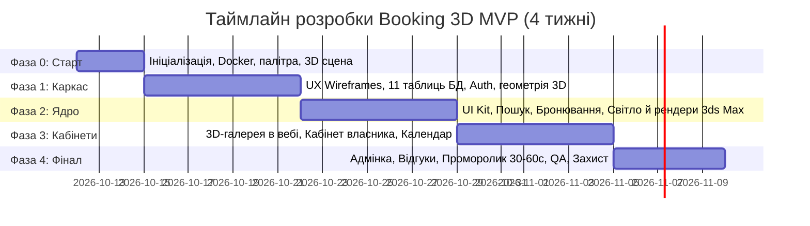

# Дорожня карта розробки (Roadmap): Клон Booking.com 3D

Цей документ визначає фази реалізації, щотижневі спринти, контрольні точки (Milestones) та критерії готовності (Definition of Done) для команди з 2 розробників та 3 дизайнерів згідно з оновленим розподілом ролей.

---

## 1. Загальний таймлайн фаз

---

## 2. Деталізація фаз та критерії готовності

### 🚀 Фаза 0: Одночасний старт та сетап інфраструктури (Дні 1–3)
* **Дизайнери**:
  - Дизайнер №1 (3D): Вибір 2–3 типових об'єктів для візуалізації (наприклад, сучасна студія, апартаменти з терасою, готельний номер). Збір референсів.
  - Дизайнер №2 (UX): Аналіз Booking.com та аналогів, драфт інформаційної архітектури (IA).
  - Дизайнер №3 (Brand): Концепт назви сервісу, базові кольори бренду, вибір шрифтової пари.
* **Розробники (Детальні покрокові інструкції)**:
  - **Розробник №1 (Backend & DevOps Lead)**: [dev-1-backend-devops.md](../phase-0/dev-1-backend-devops.md) — ініціалізація Git-репозиторію `main`, налаштування Docker Compose (PostgreSQL 16 + Django 5), сховище для 3D WebP-рендерів, сетап Django 5, DRF, SimpleJWT, Swagger UI (`/api/docs/`), CORS, створення Superuser для `/admin/` та ендпоінт перевірки працездатності `GET /api/health/`.
  - **Розробник №2 (Frontend Lead)**: [dev-2-frontend.md](../phase-0/dev-2-frontend.md) — ініціалізація React 18 + TypeScript + Vite + Tailwind CSS, фірмова палітра Booking, 6 маршрутів, Axios клієнт із віджетом статусу API.
  - **Загальний координаційний план Фази 0**: [docs/phase-0/README.md](../phase-0/README.md).
* **Критерій готовності (DoD)**:
  - Спільний чат команди створено; `docker compose up -d` піднімає робочий бекенд та PostgreSQL; `npm run dev` запускає фронтенд на `http://localhost:5173`; Swagger UI відкривається за `/api/docs/`; у шапці фронтенду світиться зелений індикатор зв'язку з бекендом.

---

### 🧱 Фаза 1: UX Wireframes, Схема БД та 3D-моделювання (Тиждень 1–2)
* **Дизайнери**:
  - Дизайнер №1: Моделювання стін, вікон, підлоги та корпусних меблів приміщень у **Autodesk 3ds Max**.
  - Дизайнер №2: Чорно-білі **Wireframes** ключових екранів (Головна, Результати пошуку, Картка житла, Форма бронювання).
  - Дизайнер №3: Логотип у векторі (горизонтальний та іконка), початок проєктування кабінету власника.
* **Розробники (Детальні покрокові інструкції)**:
  - **Розробник №1 (Backend & DevOps Lead)**: [dev-1-backend-devops.md](../phase-1/dev-1-backend-devops.md) — 11 моделей Django ORM, міграції PostgreSQL, сідер `seed_data` (6 міст, 10 зручностей, акаунти), панель Django Admin; модуль автентифікації (`/api/auth/register/`, `/api/auth/token/`, `/api/auth/google/`), SimpleJWT, профіль користувача, дозволи DRF та Swagger UI.
  - **Розробник №2 (Frontend Lead)**: [dev-2-frontend.md](../phase-1/dev-2-frontend.md) — `AuthContext`, модалки входу/реєстрації, Google Sign-In, перехоплювачі Axios та Wireframe-компоненти (SearchBar, PropertyCard з бейджем 3D, HomePage).
  - **Загальний координаційний план Фази 1**: [docs/phase-1/README.md](../phase-1/README.md).
* **Критерій готовності (DoD)**:
  - Працююча реєстрація та вхід через Swagger та через React-модалку; застосовані 11 моделей у PostgreSQL; базова адмінка заповнена демо-даними через `seed_data`; готова чорнова верстка компонентів на фронтенді; готова геометрія 3D-інтер'єру в 3ds Max.

---

### 🎨 Фаза 2: UI Kit, Каталог, Бронювання та 3D-рендеринг (Тиждень 2–3)
* **Дизайнери**:
  - Дизайнер №1: Текстурування, матеріали (дерево, скло, текстиль), налаштування освітлення (Corona/V-Ray), рендер 3–6 ракурсів на об'єкт, експорт у WebP.
  - Дизайнер №2: Фінальний **Figma UI Kit** (кнопки, інпути, картки житла, календар, модалки, рейтинги зірок).
  - Дизайнер №3: Макети кабінету власника житла та базової адмін-панелі.
* **Розробники**:
  - **Розробник №1 (Backend & DevOps)**: Логіка пошуку та фільтрації (місто, ціна, гості, зручності) + API перевірки доступності дат, ендпоінти бронювання, транзакція захисту від overbooking, таблиця `Property3DImages`.
  - **Розробник №2 (Frontend)**: "Натягування" фінального UI Kit на фронтенд, підключення пошуку, каталогу та форми бронювання.
* **Критерій готовності (DoD)**:
  - Користувач може знайти житло, вибрати вільні дати та створити тестове бронювання. Готові файли перших 3D-рендерів.

---

### 📱 Фаза 3: Інтеграція 3D-галереї та Кабінети (Тиждень 3–4)
* **Дизайнери**:
  - Дизайнер №1: Підготовка рендерів для 2-го та 3-го об'єктів (спальня, кухня, ванна кімната).
  - Дизайнер №2: Макети особистого кабінету гостя (список "Мої бронювання", "Обране", форма відгуку).
  - Дизайнер №3: Адаптивні версії екранів під планшети та смартфони (Mobile 375px, Tablet 768px).
* **Розробники**:
  - **Розробник №1 (Backend & DevOps)**: API кабінету гостя (`/api/bookings/my`, скасування бронювання, список обраного) + API кабінету власника (створення житла, завантаження фото, перегляд списку гостей).
  - **Розробник №2 (Frontend)**: **Інтерактивна 3D-галерея на картці житла** (перемикач ракурсів, повноекранний перегляд, бейдж "3D Тур інтер'єру"), адаптивна верстка під мобільні екрани, інтерфейси кабінетів.
* **Критерій готовності (DoD)**:
  - 3D-галерея повноцінно працює на сторінці житла; користувач бачить свої замовлення в особистому кабінеті.

---

### 🏆 Фаза 4: Відгуки, Адмінка, Промо-відео та Захист (Тиждень 4)
* **Дизайнери**:
  - Дизайнер №3: **Проморолик 30–60 секунд** (сценарій: пошук житла ➔ 3D-огляд інтер'єру ➔ вибір дат ➔ успішне бронювання ➔ фінальний логотип зі слоганом).
  - Дизайнери №1 та №2: Фінальний Design Review верстки (Pixel-Perfect, контраст, відступи).
* **Розробники**:
  - **Розробник №1 (Backend & DevOps)**: Модуль відгуків та перерахунку рейтингу, адмінка для модерації.
  - **Розробник №2 (Frontend)**: Інтеграція форми відгуків, Empty States, фінальна оптимізація швидкодії.
* **Критерій готовності (DoD)**:
  - Наскрізний сценарій проходить без жодної помилки; промо-відео змонтовано; презентація готова до захисту.
