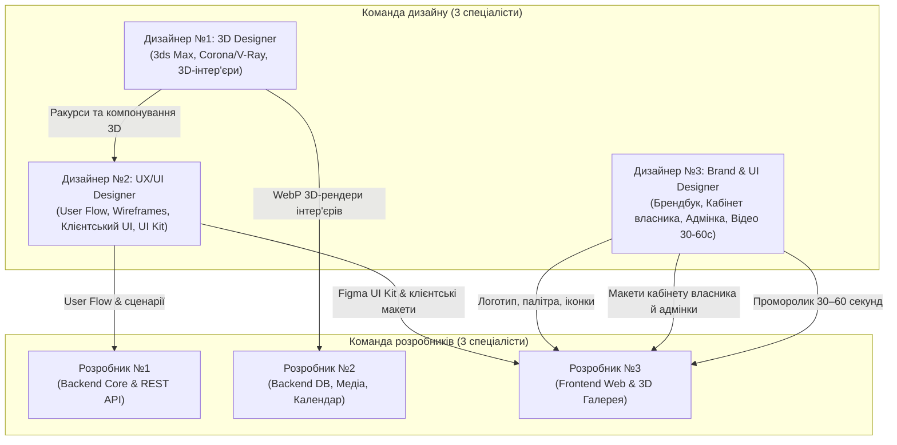

# Протокол взаємодії: Розробники та Команда дизайну (3 дизайнери)

Цей документ визначає регламент співпраці між 3 розробниками та 3 дизайнерами проєкту Booking.com 3D згідно з розділами 5, 6 та 13 ТЗ.

---

## ⚡ Протокол одночасного старту ("Cold Start")

Оскільки обидві команди стартують одночасно з нуля, **розробники НЕ чекають фінальних макетів Figma чи готових 3D-рендерів**, а дизайнери **НЕ поспішають видавати інтерфейс без дослідження**:

| Період | Команда дизайнерів (3 дизайнери) | Команда розробників (3 розробники) | Точка дотику (Handoff) |
| :--- | :--- | :--- | :--- |
| **Дні 1–3** | Швидкий вибір базової палітри (Primary, Accent) + шрифтової пари. 3D-дизайнер підбирає референси квартир. | Розгортання Docker, PostgreSQL 16, Django 5 REST API та каркасу React 18 з Tailwind CSS. | **Design Tokens**: назви кольорів та шрифтів фіксуються в `tailwind.config.js`. |
| **Тиждень 1–2 (Фаза 1)** | Чорно-білі **Wireframes** ключових екранів (UX). Моделювання стін та меблів у 3ds Max. Логотип бренду. | Auth (JWT), міграції 11 таблиць БД, Swagger API, верстка Wireframe-блоків на Tailwind. | **Wireframes**: фронтендер знає сітку, структуру сторінок та навігацію. |
| **Тиждень 3+ (Фаза 2–3)** | Фінальний **Figma UI Kit**. Текстури й освітлення в 3ds Max ➔ перші **готові 3D-рендери** (3–6 ракурсів). | Підключення реального API, розрахунок цін, захист від overbooking, вбудовування 3D-галереї. | **UI Kit & 3D WebP Assets**: стилізація інтерфейсу та завантаження візуалізацій. |

---

## 1. Склад дизайнерської команди та потоки артефактів

---

## 2. Зони відповідальності дизайнерів та точки передачі (Handoff)

### 2.1. Дизайнер №1 — 3D Designer / 3ds Max (Візуалізація інтер'єрів)
- **Що створює**:
  - Аналіз планувань та стилів житла (Modern Studio, Loft, Scandinavian Apartment).
  - 3D-моделювання геометрії кімнат, корпусних та м'яких меблів, предметів декору та освітлення в **Autodesk 3ds Max**.
  - Налаштування реалістичних матеріалів (паркет, плитка, текстиль, скло) та фотореалістичного освітлення (Corona Renderer або V-Ray).
  - Рендеринг **3–6 ракурсів** на об'єкт (вітальня, спальня, кухня, вид зверху).
  - Постобробка та експорт в оптимізований формат **WebP/JPG** (1920×1080px, розмір файлу < 300 КБ для швидкого завантаження у вебі).
- **Отримувачі в команді**:
  - **Розробник №2 (Backend DB)**: отримує файли з префіксами `prop_01_living_angle1.webp` для наповнення бази даних (`python manage.py seed_data`).
  - **Розробник №3 (Frontend)**: отримує структуру ракурсів для реалізації інтерактивного віджета перемикання кімнат.
  - **Дизайнер №2 (UX/UI)**: враховує пропорції рендерів у сітці галереї сторінки житла.

---

### 2.2. Дизайнер №2 — UX/UI Designer (Дослідження, Сценарії & Design System)
- **Що створює**:
  - Аналіз конкурентів (Booking.com, Airbnb) та Customer Journey Map (CJM).
  - User Flow головного сценарію: Пошук ➔ Вибір ➔ 3D-огляд ➔ Календар дат ➔ Бронювання ➔ Підтвердження.
  - Чорно-білі **Wireframes** основних сторінок.
  - **Design System & UI Kit** у Figma: палітра кольорів, типографіка, кнопки (Default, Hover, Active, Disabled), поля вводу з валідацією, картки помешкань з бейджем "3D Тур", інтерактивний календар, зірковий рейтинг, модальні вікна.
  - Фінальні макети клієнтської частини: Головна, Каталог із фільтрами, Сторінка житла з галереєю, Форма бронювання, Особистий кабінет гостя.
- **Отримувачі в команді**:
  - **Розробник №1**: використовує User Flow для проєктування статусів та ендпоінтів.
  - **Розробник №3**: отримує повний Figma UI Kit для безпомилкової верстки.

---

### 2.3. Дизайнер №3 — UX/UI + Graphic / Brand Designer (Бренд, Кабінети & Промо-відео)
- **Що створює**:
  - Унікальна назва сервісу бронювання (без копіювання бренду Booking.com).
  - Логотип у кількох накресленнях (горизонтальний, компактний знак/favicon, світла та темна версії).
  - Компактний Brandbook (правила кольорів, шрифтів та іконок зручностей).
  - Макети кабінету власника житла (форма додавання квартири, календар зайнятості) та адмінпанелі (модерація).
  - Адаптивні версії екранів під планшети (768px) та смартфони (375px).
  - **Проморолик 30–60 секунд**: динамічне відео для фінальної презентації проєкту (пошук міста ➔ вибір затишної квартири ➔ інтерактивний 3D-огляд спальні й вітальні ➔ клік "Забронювати" ➔ успіх ➔ логотип зі слоганом).
- **Отримувачі в команді**:
  - **Розробник №3**: інтегрує логотип, іконки зручностей, макети кабінету власника та відео на головний промо-блок.

---

## 3. Регламент комунікації та Design Review

1. **Щотижнева синхронізація (Weekly Sync)**: 20-хвилинна спільна онлайн-зустріч щопонеділка для розбору нових макетів перед передачею в спринт.
2. **Вимоги до Figma (Auto-layout & Tokens)**:
   - Усі кнопки та списки у Figma мають налаштований Auto-Layout.
   - Кольори прив'язані до стилів Figma (Tokens), щоб розробники не копіювали довільні hex-значення.
3. **Design QA (Контроль якості верстки)**:
   - Після завершення верстки екрана фронтендер демонструє його дизайнеру.
   - Дизайнер перевіряє відповідність: Pixel-Perfect, відступи (кратні 4/8px), контрастність та поведінку на мобільних пристроях.
